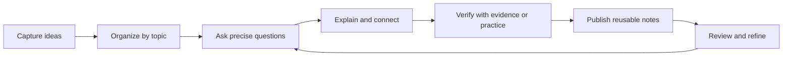

<div align="center">

# LIKUI · Knowledge Atlas

**A personal knowledge garden for learning, engineering, and continuous discovery.**

<p>
  <a href="https://github.com/ilikui/wiki"></a>
  <a href="https://www.mkdocs.org/"></a>
  <a href="https://github.com/ilikui/wiki/tree/master/docs"></a>
</p>

[浏览知识文档](https://www.likui.info/wiki/site) · [全部文档](https://github.com/ilikui/wiki/tree/master/docs) · [1000 问知识体系](https://github.com/ilikui/wiki/tree/master/docs/1000-questions)

</div>

---

## About

**LIKui Wiki** is a structured, evolving knowledge base built around one principle: capture ideas, connect concepts, verify understanding, and turn learning into reusable knowledge.

It brings together technical notes, learning roadmaps, problem-driven study collections, engineering references, and long-term explorations. The repository is organized as Markdown-first documentation so that knowledge remains portable, searchable, reviewable, and easy to maintain.

## Explore the knowledge base

| Knowledge collection | What you'll find | Entry |
|---|---|---|
| **1000 Questions** | Question-led learning maps, topic indexes, source links, and a repeatable workflow for deep study | [Open collection](docs/1000-questions/README.md) |
| **AUTOSAR** | Classic / Adaptive AUTOSAR, RTE/SWC, communication stack, diagnostics, NvM, OS, tooling, and integration troubleshooting | [Open topic](docs/1000-questions/autosar/README.md) |
| **Embedded Systems** | MCU architecture, peripherals, interrupts, RTOS, bootloaders, embedded Linux, debugging, and hardware/software integration | [Open topic](docs/1000-questions/embedded/README.md) |
| **C Language** | Language fundamentals, pointers, memory, compilation, undefined behavior, embedded C, and engineering practice | [Open topic](docs/1000-questions/c-language/README.md) |
| **AI & LLMs** | AI foundations, large language models, RAG, agents, deployment, and AI-assisted knowledge workflows | [Open topic](docs/1000-questions/ai/README.md) |
| **Mathematics** | Calculus, linear algebra, probability, statistics, derivations, and problem-solving maps | [Open topic](docs/1000-questions/math/README.md) |
| **Software Architecture** | Operating systems, networks, databases, architecture design, and certification-oriented study | [Open topic](docs/1000-questions/soft-exam/README.md) |
| **History & Education** | Topic maps for historical inquiry, child development, and education questions | [History](docs/1000-questions/history/README.md) · [Education](docs/1000-questions/child-education/README.md) |
| **Engineering & Simulation** | MATLAB / Simulink and electrical-engineering learning collections | [MATLAB](docs/1000-questions/matlab/README.md) · [Electrical](docs/1000-questions/electrical/README.md) |

> The topic pages are evolving indexes and migrated source collections. A question list is not automatically a completed answer; content should be marked as draft, verified, or in need of review.

## A knowledge workflow that compounds



### Principles

- **Question-driven:** start with a clear question, then build the explanation around it.
- **Connected:** link prerequisites, neighboring concepts, code examples, standards, and real cases.
- **Evidence-aware:** distinguish personal experience, hypotheses, source-backed facts, and verified results.
- **Incremental:** preserve original notes and improve them in small, reviewable steps.
- **Portable:** keep content in Markdown with relative links whenever practical.
- **Maintainable:** prefer focused topic pages and index pages over a single enormous document.

## Repository structure

```text
wiki/
├── README.md
├── mkdocs.yml
└── docs/
    ├── index.md
    └── 1000-questions/
        ├── README.md
        ├── autosar/
        ├── embedded/
        ├── c-language/
        ├── ai/
        ├── math/
        ├── probability/
        ├── soft-exam/
        ├── history/
        ├── child-education/
        ├── matlab/
        ├── electrical/
        └── electrical-overview/
```

## Work with the notes

1. Open the [1000 Questions index](docs/1000-questions/README.md) to choose a topic.
2. Keep one canonical page for each question; link duplicates as alternate wording or supplementary context.
3. Include a concise answer, reasoning, examples, assumptions, and validation steps where relevant.
4. Preserve source links and engineering context such as platform, toolchain, standard version, and test conditions.
5. Use relative links between Markdown pages so the collection can be browsed on GitHub and rendered by MkDocs.

### Suggested question-note template

```markdown
# The question

> **Short answer:** State the conclusion first.

## Why it works
Explain the mechanism and assumptions.

## Example
Add code, diagrams, data, or a practical case.

## Limits and common mistakes
Record edge cases, version differences, and likely misunderstandings.

## Validation
Describe a test, experiment, reference, or reproducible check.

## Related notes
- [Prerequisite concept](../path/to/note.md)

## Source and status
- Source: [original note](https://example.com)
- Status: Draft / Reviewed / Verified / Needs update
- Last reviewed: YYYY-MM-DD
```

## Sources and migration policy

- Original Flomo notes remain untouched as the source of capture and historical context.
- Structured copies and indexes live under `docs/1000-questions/`.
- Duplicate questions should be consolidated without discarding useful differences or examples.
- Technical claims should identify the applicable standard, software version, hardware platform, and evidence where possible.
- Migration is incremental. The index should state clearly which content has been migrated and which still needs review.

## Build locally

```bash
python -m pip install mkdocs
mkdocs serve
```

Open the local address printed by MkDocs to preview the documentation. Build a static site with:

```bash
mkdocs build
```

---

<div align="center">

**Capture · Connect · Verify · Share · Repeat**

<sub>Knowledge is not a pile of notes. It is a network of ideas that can be revisited, tested, and improved.</sub>

</div>
