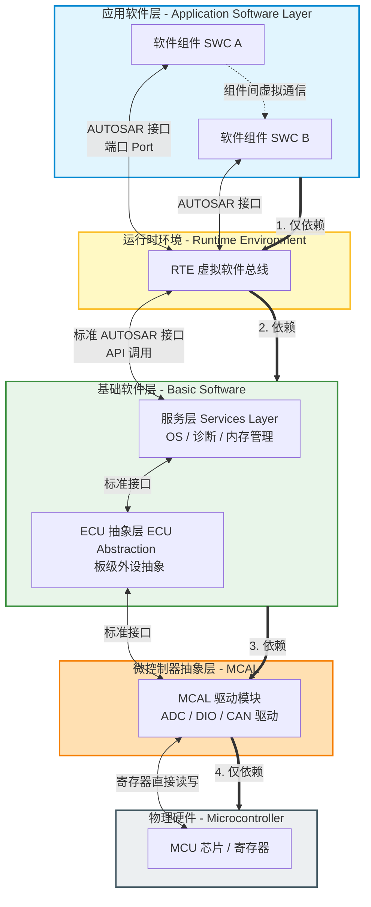
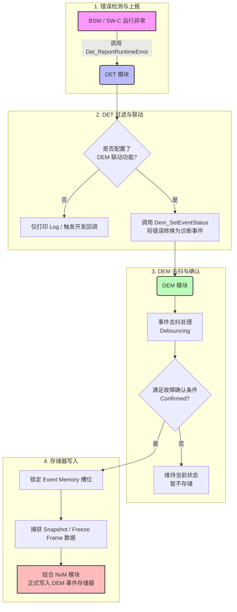
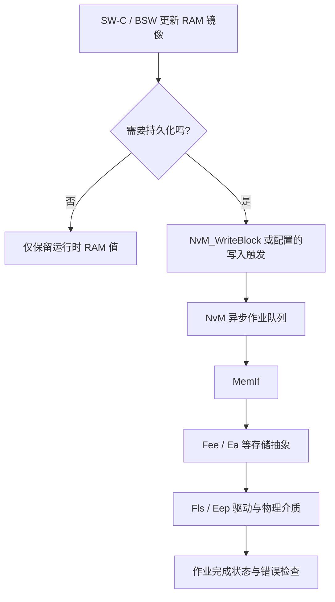

# AUTOSAR 1000问：问题总表

> 来源：Flomo 原始笔记（12857 字）
> 原始链接：[AUTOSAR 1000问总表](https://v.flomoapp.com/mine/?memo_id=MjMxMTQ2NDk4)
>
> 本页忠实迁移问题清单；这是问题目录，不代表每题都已有答案。答案笔记需后续逐题关联补全。

> **覆盖进度与缺口管理：** [逐题覆盖矩阵与补全队列](coverage-matrix.md)（按主题列出已有答案、待补缺口和后续优先级）。
> **RTE 专题补充：** [RTE Event、Runnable 调度与跨核 IOC 实战](rte-events-runnable-scheduling-ioc.md)（事件触发、周期抖动、数据接收、Client-Server 与跨核通信排查）。

记录AUTOSAR学习的1000个问题：

**基础概念**

1. 什么是AUTOSAR？请说出其全称并解释含义。

---

> AUTOSAR 的全称是 AUTomotive Open System ARchitecture，中文翻译为“汽车开放系统架构”。
> 它既指由全球主要整车厂（OEM）、一级供应商（Tier 1）及半导体厂商共同建立的全球合作联盟，
> 也指由该联盟所制定的开放式、标准化的汽车电子软件架构规范。

2. AUTOSAR联盟成立于哪一年？最初由哪些公司发起？

**基础 / 架构**

1. AUTOSAR的分层架构（应用层/RTE/BSW/MCAL）各层之间通过什么接口通信？谁依赖谁？

---

2. RTE在AUTOSAR架构中解决的核心问题是什么？如果没有RTE，会怎样？

3. 一个SW-C（软件组件）在运行时是怎么被调度的？它跟普通C函数有什么区别？

4. AUTOSAR方法论中的"配置"和"代码生成"两个步骤，为什么拆开？合在一起行不行？

**通信栈**

1. CAN通信从PDU发到CAN总线，经过COM→PduR→CanIf→Can驱动，每一层做了什么？ → 答案

2. 如果两个节点用同一个CAN报文，AUTOSAR怎么避免接收冲突？

3. Signal和PDU的关系是什么？什么时候一个PDU里要放多个Signal？

4. 为什么需要PduR（PDU Router）？直接让COM层发到CanIf不行吗？

**网络管理**

1. 节点唤醒≠网络唤醒——这句话在什么场景下成立？

2. EcuM管理唤醒源时，哪些唤醒源状态下节点需要启动BSW，哪些节点只记录状态不启动？

3. CanNm的重复消息状态（Repeat Message State）解决的是什么问题？

4. 如果网络管理中一个节点没有按时进入Bus-Sleep Mode，会发生什么？

**诊断**

1. UDS over CAN在AUTOSAR中经过Dcm→PduR→CanTp→CanIf→Can的路径，每层分别处理了什么？

2. 诊断请求和响应在同一个CAN报文里还是分开发送的？谁决定走CAN TP（传输协议）？

3. 为什么需要DoIP（Diagnostic over IP）？它与UDS over CAN在架构上有什么不同？

**存储栈（Memory Stack）**

1. NVM（非易失性存储器）在AUTOSAR中的架构路径是什么？NvM→MemIf→Fee→Fls各层做什么？

2. NvM管理的"块"（Block）和底层Fee的"扇区"是什么关系？一个Block可以跨多个扇区吗？

3. 为什么AUTOSAR要有一个Fee（Flash EEPROM Emulation）层？直接用Flash驱动读写不行吗？

4. 写NVM时掉电了怎么办？AUTOSAR怎么保证数据一致性？

5. NvM提供同步写和异步写两种接口，什么时候该用哪种？

**OS & 调度**

1. AUTOSAR OS和普通RTOS（如FreeRTOS）的核心区别是什么？

2. AUTOSAR任务的优先级反转问题怎么处理？有没有类似优先级继承的机制？

3. 什么叫Trusted Function和Non-Trusted Function？这个区分解决了什么问题？

4. Schedule Table是怎么工作的？如果多个Schedule Table的触发点在时间上重叠了，谁优先？

5. AUTOSAR的中断分类（Category 1 / Category 2）的区别在哪里？

**Debug & 工具**

1. 用Vector Davinci / EB tresos配置BSW时，配置项之间经常有交叉依赖——怎么系统性地排查一个配置项的依赖链？

2. 一个生成的RTE代码里，如果某个SW-C的端口映射错了，一般怎么定位？看生成代码还是看.arxml？

3. BSW的PostBuild和PreCompile模式下，调试策略有什么不同？

**功能安全（Functional Safety / ISO 26262）**

1. AUTOSAR怎么支持ISO 26262的功能安全要求？它提供了哪些安全机制？

2. E2E（End-to-End Communication Protection）保护的是什么？它怎么检测和应对通信中的silent data corruption？

3. WdgM（Watchdog Manager）在AUTOSAR里怎么实现程序流监控？如果某个SW-C的执行顺序错了或超时了，它怎么探测？

4. ASIL（Automotive Safety Integrity Level）从QM到ASIL D，AUTOSAR的BSW模块在不同ASIL等级下行为上有什么差异？

5. 在同一MCU上混合部署QM和ASIL应用时，AUTOSAR的自由度干扰（Freedom from Interference）怎么保证？

**信息安全 & OTA**

1. AUTOSAR的SecOC（Secure On-board Communication）解决什么问题？它是怎么防止CAN总线上的重放攻击和伪造报文的？

2. 密钥管理在AUTOSAR中是怎么做的？密钥存在哪、谁来管理、怎么更新？

3. 一个OTA更新的完整流程在AUTOSAR架构下是怎样的？从接收到下载到回滚，各层做什么？

4. UDS的诊断会话（Diagnostic Session）和安全访问（Security Access）之间是什么关系？刷写时走的是哪条路径？

5. 如果OTA更新了一半断电了，AUTOSAR怎么保证还能恢复而不是变砖？

**工程问题**

1. 一个配置项改完导致另一个模块代码生成失败，从.arxml的依赖关系怎么追溯？

2. SW-C的Runnable执行周期设置不合理会导致什么运行时问题？怎么确定一个Runnable的周期该设多少？

3. 多核MCU下AUTOSAR怎么分配SW-C到不同核？核间通信走的是哪条路径？

4. BSW配置中PreCompile和PostBuild两种模式，什么场景下会选PostBuild？

5. 生成代码后发现某个PDU的收发出错了，第一步应该检查配置中的哪些地方？

**C语言基础（AUTOSAR语境下的C）**

1. volatile在AUTOSAR里最典型用在哪些场景？去掉会出什么错？

2. AUTOSAR为什么规定Bool类型不能用标准C的bool？它自己定义的Boolean有什么不同？

3. BSW的配置结构中大量使用函数指针——好处是什么？调试时怎么跟踪？

4. 什么是MISRA C？AUTOSAR项目中违反MISRA C最常见的几条规则是哪些？

5. AUTOSAR的BSW代码里经常看到pragma，它通常用来控制什么？不同编译器之间移植时要注意什么？

**AUTOSAR思考 & 感悟**

1. AUTOSAR这么重，它到底解决了什么核心痛点？不用AUTOSAR的项目，最大差别在哪？

2. AUTOSAR用复杂的配置工具链来"生成代码"而不是"手写代码"——这种思路的利和弊分别是什么？

3. 为什么AUTOSAR会从Classic Platform发展到Adaptive Platform？两种平台分别适合什么场景？

4. 学习和使用AUTOSAR的过程中，哪些地方花了很多时间回头想其实可以跳过？

5. 如果重新设计AUTOSAR，你觉得最应该砍掉或简化的是哪一部分？

**RTE深入**

1. RTE生成的代码里，一个Sender-Receiver通信走的是什么机制？如果发送方和接收方在不同的核上，生成的代码有什么不同？

2. Runnable的触发事件有哪几种类型？TimingEvent、DataReceivedEvent、OperationInvokedEvent各自对应什么实际场景？

3. RTE是怎么把一个SW-C的Port数据路由到另一个SW-C的？如果两个SW-C都在同一个ECU上，数据是拷贝还是引用？

4. 如果某个Runnable执行超时了，RTE会怎么处理？这跟Watchdog的监控有什么关系？

**BSW模块深探**

1. EcuM的资源调用序列（Startup Sequence / Shutdown Sequence）是可配置的吗？在配置工具里，各个调用的顺序怎么确定？

2. BswM（BSW Mode Manager）是干什么的？它怎么根据Communication Mode和ECU Mode做仲裁？

3. DET（Default Error Tracer）和DEM（Diagnostic Event Manager）的区别是什么？一个运行时错误从DET上报到最终进入DEM的事件存储器，经过了哪几步？

| 特性     | DET (Default Error Tracer)                                                         | DEM (Diagnostic Event Manager)                                                               |
| -------- | ---------------------------------------------------------------------------------- | -------------------------------------------------------------------------------------------- |
| 主要定位 | 软件内部错误追踪器。主要用于软件开发阶段的调试和运行时的软件防错。                 | 诊断事件管理器。面向售后维保、法规合规（如 OBD），负责车辆故障码管理。                       |
| 错误类型 | 开发错误（Development Errors，如空指针、参数越界）及运行时错误（Runtime Errors）。 | 诊断事件（Diagnostic Events，如传感器短路、信号丢失、硬件失效）。                            |
| 存储机制 | 通常不进行非易失性存储。错误发生时直接触发回调、记录日志或进入死循环挂起。         | 持久化存储（NVRAM）。将故障码（DTC）、冻结帧（Freeze Frame）和扩展数据存储在非易失性内存中。 |
| 处理对象 | BSW（基础软件）模块和 SW-C（应用软件组件）。                                       | 主要是与整车诊断相关的 ECU 内部或外部故障。                                                  |
| 交互对象 | 主要是开发人员（通过调试器或 Log 日志）。                                          | 售后技师（通过诊断仪/UDS协议）、仪表盘（MIL灯）和整车网络。                                  |

1. DLT（Diagnostic Log and Trace）是用来做什么的？它在实际量产车上开着还是关着？什么时候你会用它代替普通的printf调试？

**诊断栈深入**

1. UDS的0x22（ReadDataByIdentifier）和0x2E（WriteDataByIdentifier）在实际项目中标识符（DID）是怎么分配的？DID的范围划分背后有什么约定？

2. 一个诊断请求从CAN报文到Dcm再到SW-C的DataElement——如果你要让某个诊断请求最终触发一个SW-C的Runnable，需要在配置工具里串起哪几层？

3. 0x19（ReadDTCInformation）的子功能那么多——在实际排查故障时，你最常用的子功能是哪几个？它们各查出什么信息？

**集成与编译**

1. AUTOSAR的Memory Mapping机制是怎么回事？为什么各个模块的代码段可以映射到不同的Flash分区或RAM分区？

2. 在多核AUTOSAR项目中，IOC（Inter-OS-Application Communication）是怎么工作的？它和普通的RTE通信有什么不同？

3. 如果你把某个BSW模块从PreCompile切换到PostBuild配置——除了配置工具里的操作，代码层面会发生什么变化？

**工具链与工程化**

1. 用Vector Davinci Configurator或EB tresos时，一个模块依赖另一个模块的配置——怎么在工具里追踪这种横跨多个模块的依赖链？

2. ARXML文件可以直接被工程化手段（如diff、脚本修改、CI检查）处理——有没有用脚本或工具在ARXML上做自动化检查或修改？

3. 在项目里做AUTOSAR基线升级（如从R20-11升到R21-11）时，最头疼的是哪类变化？配置迁移还是生成的代码行为变了？

**Adaptive AUTOSAR**

1. Adaptive AUTOSAR和Classic AUTOSAR最核心的架构差异是什么？为什么Adaptive要改用POSIX操作系统？

2. Adaptive的Execution Management（执行管理）和Classic的EcuM+OS在任务调度思想上有什么不同？"进程"和"任务"在这里的差异意味着什么？

3. ara::com（Adaptive中的通信中间件接口）和Classic的RTE/SWC概念有什么对应关系？一个曾经在Classic上写SW-C的人，转到Adaptive后最需要改掉的是什么习惯？

**SOME/IP 与通信中间件**

1. SOME/IP的Service Discovery（服务发现）是怎么让一个节点动态发现另一个节点提供的服务的？为什么说这是从"静态配置"到"动态协作"的转变？

2. SOME/IP的Request/Response模式和Fire&Forget模式分别适合什么场景？在AUTOSAR里怎么配置一个SW-C用SOME/IP和远程ECU通信？

3. DDS（Data Distribution Service）和SOME/IP在设计哲学上的核心区别是什么？什么时候该选DDS而不是SOME/IP？

**复杂驱动（CDD）**

1. 什么是复杂驱动（Complex Device Driver）？AUTOSAR已经有了完整的BSW栈，什么场景下还必须写CDD？

2. CDD在AUTOSAR架构里是怎么"接入"的？它跟BSW模块和RTE之间是什么关系？

3. 写CDD时怎么保证它不破坏AUTOSAR的时序和调度？如果一个CDD访问了某个BSW模块共享的资源，谁来保证互斥？

**生成代码解读**

1. RTE生成的头文件里，Rte_Read和Rte_Write是如何实现的？打开一个RTE生成的.c文件，通常先看哪几个函数来判断配置是否正确？

2. BSW生成的配置文件（如Can_Cfg.h, Can_PBcfg.c）里，那些巨大的配置结构体是怎么组织的？为什么不像手写代码那样用简单的if-else？

3. 生成代码里的SchM（Schedule Manager）是怎么调用各个Runnable的？它在生成的代码里对应哪个函数？

**测试与验证**

1. AUTOSAR项目中，对SW-C做单元测试时，RTE生成的接口函数（Rte_Read/Rte_Write）怎么模拟？桩函数（stub）怎么设计？

2. SIL（Software-in-the-Loop）和HIL（Hardware-in-the-Loop）在AUTOSAR项目里各自适合测试哪类问题？一个通信栈问题你会在哪个环境里先测？

3. 诊断协议栈的测试——怎么验证Dcm对一个UDS请求的响应是正确的？手动发CAN报文还是用测试工具（如CANoe）？

4. 多ECU集成时，A节点的SW-C发信号给B节点的SW-C——如果B收到数据不对，是A发错了、路由错了、还是B解析错了？怎么拆？

**XCP / 标定**

1. XCP协议是干什么的？它跟UDS在用途上的根本区别是什么？

2. XCP on CAN和XCP on Ethernet（XCP on TCP/IP或UDP）在传输效率和实时性上有什么不同？

3. A2L文件是什么？标定工具（如INCA、CANape）是怎么通过A2L知道一个变量的内存地址和数据类型的？

4. 标定（calibration）和测量（measurement）在XCP里是两个不同的概念——ECU一侧分别需要什么支持才能实现？

**时间同步**

1. AUTOSAR的Global Time Synchronization（全局时间同步）是怎么让多个ECU共享同一个时间基准的？

2. 为什么时间同步对分布式系统和XCP测量那么重要？如果两个ECU的时间差了几毫秒，会出什么问题？

**项目实践**

1. 项目上AUTOSAR基线迁移——从一个供应商版本迁移到另一个（如从Vector换到EB），最麻烦的是配置工具的差异还是生成的代码行为？

2. 当你拿到一个别人配好的AUTOSAR工程，你按什么顺序检查它是否配对了？第一眼看哪个模块？

3. 不同Tier1或OEM对AUTOSAR的使用深度差很多——有的只在应用层用它，有的整个BSW都跑——你经历过哪种模式？你觉得哪种更值得？

4. AUTOSAR的复杂配置带来了大量"配置错误"而不是"代码错误"——有没有什么经验帮你减少这类问题？

**VFB（Virtual Functional Bus）深入**

1. VFB（Virtual Functional Bus）在AUTOSAR方法论里到底代表什么概念？它和最终的RTE实现之间是什么关系？

2. 在VFB视图下，两个SW-C之间的通信看起来是"直接连接"的——实际部署到ECU上后，这个"直接连接"变成了什么？

**SWC 类型与设计**

1. Application SWC、Service SWC、Sensor-Actuator SWC、Composition SWC——这四类的角色分别是什么？什么样的功能应该放在哪一类里？

2. Composition SWC是"SWC里套SWC"——它解决了什么问题？它和普通的文件夹组织有什么本质不同？

3. Sender-Receiver接口和Client-Server接口各自适用什么通信模式？如果把一个"请求-响应"的场景错误地用S/R来实现，会出什么问题？

**BSW 更多模块 & CAN XL**

1. LinIf和FrIf（FlexRay Interface）在架构上跟CanIf有什么相似和不同？为什么CAN是主导但LIN和FlexRay仍然在某些ECU上存在？

2. CAN XL在帧格式和速率上和CAN FD有什么关键区别？它会取代CAN FD吗？

**Crypto Stack 深入**

1. AUTOSAR的Crypto Stack是怎么分层的？Crypto Driver→Crypto Interface→Crypto Service Manager（Csm）→SW-C，各层在做什么？

2. HSM（Hardware Security Module）和SHE（Secure Hardware Extension）的区别是什么？在AUTOSAR里它们对应哪个模块？

3. 如果MCU没有硬件密码学加速模块，Crypto Stack还能工作吗？软件实现的性能和安全性跟硬件实现差多少？

**Partial Networking（部分网络）**

1. "部分网络"（Partial Networking）解决了什么问题？为什么一个ECU在不该做某事的时候还要被唤醒是一种浪费？

2. Partial Network Cluster是怎么配置的？一个支持PN的ECU怎么知道哪些报文跟自己有关、哪些可以忽略继续睡？

**多核通信与OS深入**

1. 多核ECU上，两个核之间共享一个变量——不用IOC，只用volatile加全局变量可以吗？缓存一致性问题怎么处理？

2. Spinlock和Mutex在多核环境下各自用在什么场景？为什么ISR里不能等Spinlock？

3. AUTOSAR OS的Memory Protection（MPU配置）是怎么做的？Trusted Function和Non-Trusted Function在内存访问上具体有什么不同？

**ECU 提取与系统级设计**

1. VFB层面的System Description是怎么"提取"出单个ECU的配置的？ECU Extract of System Description是在做裁剪还是做映射？

2. 同一组SW-C部署到不同的ECU上，RTE生成的代码会有多不同？哪些部分要重配、哪些可以复用？

**AUTOSAR 版本差异与演进**

1. AUTOSAR R4.0、R4.2、R4.4、R20-11、R21-11——这几个主要版本的模块接口或配置方式有什么关键变化？

2. 在项目上从哪个基线开始用的？换基线时，最让人头疼的是规范改了还是工具改了？

**工具配置实战（Davinci / EB tresos）**

1. 新建一个BSW模块配置时，配置工具中哪些参数是"必填"的？你怎么知道一个参数填错了——编译报错还是生成代码报错？

2. 在Davinci Configurator里，你怎么判断一个模块的配置是否完整？有没有"验证配置"的功能？

3. Module之间经常有"引用"关系（例如CanIf引用Can驱动的配置）——配置工具里这个引用是怎么建立的？填模块名还是选下拉列表？

4. PostBuild配置生成的是.c还是.arxml？如果你的项目在运行时需要修改某个PDU的路由，PreCompile和PostBuild哪个支持？

**生成代码分析与集成**

1. 生成代码后，编译报了"undefined reference"——通常是因为模块没配全还是链接脚本没加源文件？第一步会查什么？

2. BSW生成的代码里大量使用宏来控制条件编译——怎么确定某个配置参数对应的宏是ENABLED还是DISABLED？

3. RTE生成的头文件里Rte_Type.h定义了哪些类型？如果应用层的类型和RTE生成的类型不一致，谁说了算？

**运行时问题定位**

1. 程序跑起来后，发现某路CAN报文没发出来——从应用层接口（Rte_Write）开始顺藤摸瓜，依次检查哪几个函数返回值来确定是哪一层卡住了？

2. 某路PDU在COM层配置了周期发送（如100ms发一次），但示波器上看实际发送间隔是乱的——可能的原因有哪些？从哪开始查？

3. 一个SW-C在运行时调用了Rte_Read但读到的数据是上次的值——数据有没有刷新？RTE的DataReceivedEvent触发了吗？怎么确认？

**SW-C设计与应用层实践**

1. 你在设计一个SW-C时，一个Runnable里应该放多少逻辑？什么情况下应该把一个大Runnable拆成多个？

2. 同一个SW-C内部，两个Runnable之间共享数据——应该用RTE的Sender-Receiver还是直接用全局变量？AUTOSAR推荐的做法是什么？

3. Client-Server接口中，一个Client调用了Server的Operation——如果在Server还没返回时Client被抢占了，会不会出问题？

**AUTOSAR 性能优化**

1. RTE生成的代码里，大量的函数调用会不会影响运行性能？在运行时，一个PDU从应用到总线，四层接口调用的总开销大概是多少？

2. 一个ECU上部署了大量SW-C（比如50个以上）——RTE生成的Schedule Table会变成什么样？Runnable的执行顺序怎么保证实时性？

**BswM 模式管理深入**

1. BswM（BSW Mode Manager）本质上是一个"模式仲裁器"——它接收来自不同模块的模式请求（如 CanNm 请求通信模式、EcuM 请求运行模式），根据预设的规则做仲裁，然后触发动作。这个"规则"在配置工具里是怎么描述的——if-then-else 还是状态机？

2. BswM 的 Action List 能触发哪些操作？仅仅修改一个模式值，还是真的能调用其他 BSW 模块的接口（如切换 PduR 路由表）？

**变体管理（Variant Handling）**

1. 同一套 AUTOSAR 代码要适配高配车和低配车——高配有 CAN FD 但低配只有 CAN 2.0，高配有 8 个传感器但低配只有 4 个。AUTOSAR 的"变体管理"（Variant Handling）怎么在不维护两套配置的前提下做到？

2. PreCompile、Link、PostBuild 三种变体处理方式——在什么阶段决定用哪个变体？如果一个变体的决策只能在实车上通过诊断指令来切换，选哪种？

**E2E / 端到端通信保护深入**

1. E2E Profile 1 到 Profile 7 的区别是什么？Profile 1（CRC+Counter）和 Profile 5（CRC+Counter+Timeout）在实际项目里分别用在什么安全等级的场景？

2. E2E 保护的报文如果到达了但 CRC 校验失败——接收方 SW-C 应该怎么处理这个数据？直接丢弃还是用上次的有效值？AUTOSAR 有没有推荐的做法？

**SW-C 生命周期与状态管理**

1. 一个 Application SW-C 从 ECU 上电到正常运行，它的生命周期是什么？SW-C 在什么时候开始执行 Runnable、什么时候被停止——这些生命周期节点是 SW-C 自身控制的，还是由 EcuM/BswM 等外部模块管理的？

2. SW-C 可以感知到自身所在的 ECU 正在"唤醒"、"运行"、"休眠"、"关机"吗？如果能，它是通过什么接口收到的？

**ARXML 解析与自动化脚本**

1. ARXML 本质上是一个 XML 文件——有没有尝试写脚本（Python + lxml）来自动生成或检查 AUTOSAR 配置？常见的自动化场景有哪些——批量修改 PDU 名称、检查所有 SW-C 端口是否映射完整？

2. 两个版本的 ARXML 之间做 diff——除了文本层面的差异（XML 行号变了），哪些才是真正影响行为的"语义差异"？怎么在 CI 里自动检测这些差异？

**AUTOSAR 与 J1939 集成**

1. 商用车和工程机械常用 J1939（基于 CAN 的上层协议），而乘用车用 AUTOSAR 的 CAN 通信栈——如果把 J1939 的应用层搬到 AUTOSAR 架构上，J1939 的 PGN 和 AUTOSAR 的哪个概念对应？是在 COM 层兼容还是在应用层另写？

2. J1939 的多帧传输（BAM/CMDT）和 AUTOSAR 的 CanTp 在处理大包传输上的机制有什么不同？如果在一个同时跑 J1939 和 UDS 的 CAN 网络上，两者的传输协议会冲突吗？

**AUTOSAR 与 ROS 2 对比**

1. AUTOSAR Adaptive 和 ROS 2 都在用 DDS 做通信中间件——那一个自动驾驶量产的 ECU 能用 ROS 2 代替 AUTOSAR Adaptive 吗？ROS 2 缺了什么（安全、调度确定性、功能安全）？

2. ROS 2 的"节点"（Node）和 AUTOSAR Adaptive 的"进程"（Process / Execution Cluster）在架构思维上的最大区别是什么？一个 ROS 2 开发者转 AUTOSAR Adaptive，最需要适应的是什么？

**工具链自动化构建**

1. 在大项目里，AUTOSAR 配置工具（Davinci / EB）和代码构建（make/cmake）是怎么衔接的？如果每次改配置都要手动点"生成代码"，怎么跟 CI 集成？有没有"命令行无头模式"（headless mode）来做到自动配置生成+编译？

**Dcm 协议多路复用（同一诊断栈支持 CAN + DoIP）**

1. 一个 ECU 同时支持 UDS over CAN（通过 CanTp）和 DoIP（通过 DoIP 模块）——Dcm 同时挂两个 Protocol 的配置在工具里怎么做的？诊断请求从 CAN 来和从以太网来，Dcm 怎么区分是同一个服务但不同的传输路径？

2. 如果用 DoIP 刷写和用 CAN TP 刷写同一个 ECU——两个刷写路径在 Dcm 层的处理逻辑是一样的吗？刷写速率谁快？如果 CAN 路径刷一半断电了，恢复后能接着刷，那 DoIP 路径也支持同样的恢复机制吗？

**NvM 块管理策略深入**

1. NvM 的 Block 有 Native 和 Redundant 两种类型——Redundant 存了两份数据，一份坏了还能从另一份恢复。那问题来了：怎么判断"哪一份是好的"？NvM 用什么机制来判断一份数据的完整性？

2. NvM 的 Write Block 有"立即写"（Immediate）和"周期写"（Periodic）两种策略。如果一个关键参数（如转向角偏移校准值）被 SW-C 改写了，应该用 Immediate 还是 Periodic 来触发 NvM 写？如果用 Periodic，掉电了会不会丢数据？

**EcuM 状态机深入（Run / PostRun / Shutdown）**

1. EcuM 的启动序列（Startup Sequence）结束进入 RUN 状态后——哪些 BSW 模块在这个阶段完成了初始化？如果某个 BSW 模块初始化失败，EcuM 会怎么处理——继续启动还是复位？

2. PostRun 状态是干什么用的？如果所有 SW-C 都停止运行了但 EcuM 还在 PostRun——这期间通常哪些模块还在工作？正在 NvM 写数据的时候收到 Shutdown 请求，EcuM 会强制掉电还是等写完？

**CAN 错误处理与 Bus-off 恢复**

1. CAN 控制器进入 Bus-off 状态后，不能再收发任何报文。AUTOSAR 的 Can 驱动和 CanIf 是怎么处理 Bus-off 的？驱动检测到 Bus-off 后，会上报到哪一层来决定什么时候恢复？

2. Bus-off 恢复策略通常有三种：立即恢复、延迟恢复、手动恢复。在实际项目中（比如动力域 ECU），选哪种策略？如果选了"延迟恢复"，这个延迟是谁来计时——Can 驱动自身的定时器还是 BswM？

**AUTOSAR 的数据一致性与 RTE Buffer 管理**

1. 一个 Sender SW-C 以 10ms 的周期写一个 32 位信号，接收方 SW-C 以 20ms 的周期读——如果发送方写到一半数据还没写完就被打断了，接收方读到的是"高字节是新值、低字节是旧值"的拼凑数据吗？RTE 怎么保证这种跨 Runnable 的读/写不被打断？

2. RTE 的 Buffer 有 queued 和 non-queued 两种模式。queued 模式（队列）能存多条历史数据，non-queued（最后一个）只保留最新值。那如果一个周期 5ms 发送的信号，接收方周期是 100ms——用 queued 还是 non-queued？如果选错了，接收方每次读到的会是什么？

**AUTOSAR 启动依赖与 BSW 模块初始化顺序**

1. EcuM 的 Startup Sequence 里注册了多个 BSW 模块的 InitFunction——这些 InitFunction 的执行顺序谁决定的？如果一个模块（比如 Can）依赖另一个模块（比如 IoHwAb 的端口配置），依赖关系在哪声明？

2. 假设 PduR 的初始化在 CanIf 之前，但 PduR 在初始化时需要知道已经有哪些通信接口（CAN、LIN、FlexRay）可用——那 PduR 先初始化了、CanIf 还没初始化，PduR 怎么知道后面还会有个 CAN 接口加进来？

**AUTOSAR 与 Linux 共存（同 SoC 混合部署）**

1. 现在的域控制器和高性能 SoC（如 TDA4、S32G、R-Car）上经常 Linux 跑非实时应用（导航、HMI）、AUTOSAR 跑实时控制（制动、转向）。那 Linux 和 AUTOSAR 之间怎么通信？共享内存？RPMSG？还是走 Ethernet 的 SOME/IP？

2. 两个 OS 共存的场景下，时间同步问题怎么解决——Linux 那边的 PTP 时间域和 AUTOSAR 的 Global Time 域是同一个吗？如果 Linux 那边 NTP 调整了系统时间，会不会把 AUTOSAR 的调度时间也带偏？

#Area/技术/AUTOSAR

- [通信栈深度问答：CanIf 硬件对象与 PduR 路由排障](answers-communication-stack-deep-dive.md) — HRH/HTH、PDU 映射、Tx/Rx 路由与分层排障。
- [诊断栈实战：Dcm、Dem、DET、DTC 与 UDS](answers-diagnostics-dcm-dem-det.md) — DTC 全链路、Dem 防抖/状态位、Dcm 三层架构与 DET/DEM 边界。
- [FIM 功能抑制与 UDS 刷写](answers-diagnostics-fim-uds-flashing.md) — 功能抑制条件、0x34/0x36/0x37 下载流程与刷写故障排查。
- [RTE / Runnable 快速检查清单](rte-runnable-checklist.md) — 从 ARXML 事件、Runnable 调度与 OS Task 映射，排查 Rte_Read/Rte_Write 和数据访问问题。
- [EcuM 启动与 Init 失败排查](ecum-startup-init-failure.md) — Startup/RUN 阶段、初始化依赖、错误记录与项目级降级/复位策略。
- [EcuM 唤醒验证与醒后重睡排查](ecum-wakeup-validation.md) — 检查唤醒源、验证窗口、模式仲裁和电源/通信恢复时序。
- [NvM 关机保存时序与掉电预算](nvm-shutdown-save-timing.md) — BswM Action、NvM 异步作业完成判据、EcuM 关机超时及断电注入排查。
- [NvM RAM、ROM 与 NV Block 数据模型](nvm-ram-rom-nv-block-model.md) — 区分运行时 RAM 镜像、默认值与非易失保存数据，并提供启动恢复和掉电排障步骤。
- [NvM Immediate 与 Periodic 写入策略](nvm-immediate-periodic-strategy.md) — 按数据丢失风险、更新频率、擦写寿命和关机预算选择策略，并定义掉电验证场景。
- [AUTOSAR V 模型开发与验证流程](v-model-development-and-verification.md) — 将需求、架构、ARXML/BSW 配置、代码生成与分层测试建立双向追踪。
- [Dcm Session、Security、DID 与 Routine 配置排查](dcm-configuration-session-security-did-routine.md) — 检查诊断连接、会话/安全条件、数据接口、Routine 回调和 NRC。
- [Dcm 多诊断传输路径：CAN 与 DoIP](dcm-can-doip-multiprotocol-routing.md) — 检查多入口的传输层、PduR、Dcm 连接映射与响应回路。
- [诊断配置集成自检清单](diagnostics-integration-preflight-checklist.md) — 覆盖 Dcm/PduR 路由、S3Server、DTC/NvM、刷写时序和启动就绪检查。

## NvM 数据模型：RAM、ROM Default 与 NV Block

这部分补充两个常见问题：**修改 RAM 数据是否等于写入 Flash？**以及**RAM、ROM 默认值和 NV Block 分别承担什么职责？**

### 三类数据不要混为一谈

| 对象                 | 作用                                              | 典型生命周期   | 常见误区                                 |
| -------------------- | ------------------------------------------------- | -------------- | ---------------------------------------- |
| RAM Block / RAM 镜像 | 应用或 BSW 当前运行时读写的数据                   | 本次上电期间   | 改了 RAM 就以为已持久化                  |
| ROM Default          | 配置提供的默认值，供缺省恢复或初始化策略使用      | 随软件镜像发布 | 认为它一定会在每次启动时覆盖有效 NV 数据 |
| NV Block             | NvM 管理的非易失数据逻辑块，经 MemIf 访问底层存储 | 跨掉电保存     | 把逻辑 Block 与 Flash 物理扇区当成一回事 |

具体行为由 NvM Block 配置、初始化策略、默认值配置、校验/冗余设置和供应商实现共同决定，不能仅凭“有 ROM 默认值”推断启动时一定使用默认值。

### 读写数据流

图中的 Fee/Ea 是常见路径示例，不表示每个项目都同时使用两者；底层模块取决于 MCU、存储介质和项目配置。

### 启动时如何判断数据来自哪里

1. 确认 NvM Block 的配置：是否有 RAM Block、ROM Default、初始化回调、校验或冗余配置。
2. 检查启动初始化流程是否按项目要求调用 NvM 初始化与 ReadAll，及其完成判据。
3. 对目标 Block 检查读取结果和恢复/初始化结果；不要只看 RAM 中最终数值就推断数据来源。
4. 在调试器中分别观察 RAM 镜像、NvM 作业状态和底层存储读写，不要把“函数已调用”当成“数据已落盘”。

## NvM Immediate 与 Periodic：按数据风险选策略

Immediate（立即请求写入）和 Periodic（周期性写入）是策略选择，不是“关键数据永远 Immediate”的简单规则。应结合数据丢失后果、更新频率、Flash 擦写寿命、关机时序预算、底层异步作业行为与掉电恢复能力评估。

| 评估维度     | Immediate 倾向                                 | Periodic 倾向                              |
| ------------ | ---------------------------------------------- | ------------------------------------------ |
| 数据丢失后果 | 丢失最新值可能带来严重后果，且架构允许立即请求 | 可接受有限时间窗口内的数据回退             |
| 更新频率     | 更新较少、每次变更值得持久化                   | 高频更新，合并写入有助于控制擦写次数       |
| 掉电窗口     | 仍需验证作业能否在掉电前完成                   | 必须明确周期窗口内掉电可能丢失最新更新     |
| 系统约束     | 需要预留调度和关机预算                         | 需要定义周期、最大可丢失窗口及关机补写策略 |

**关键边界：**调用写入 API 不等于物理介质已经可靠保存。要检查返回值、作业完成状态、底层存储状态，以及项目规定的最终完成判据；具体判据应按所用 AUTOSAR 版本、供应商实现和集成设计确认。

### 推荐的验证用例

- 修改 RAM 后不触发写入就复位，确认重启后值是否按设计回退。
- 触发写入后，在作业排队、写入中、完成后分别断电，检查恢复行为。
- 高频修改关键参数，统计写入次数或擦写压力，并确认是否存在写入风暴。
- 在关机流程中注入延迟或写入失败，确认系统不会把“请求已发出”误判为“保存完成”。
- 对冗余块、CRC/校验或默认值恢复路径分别注入损坏/无效数据，验证项目定义的恢复策略。

### 参考资料

- [AUTOSAR Classic Platform 官方页面](https://www.autosar.org/standards/classic-platform/)
- [AUTOSAR CP NvRAM Manager Specification（R24-11）](https://www.autosar.org/fileadmin/standards/R24-11/CP/AUTOSAR_CP_SWS_NVRAMManager.pdf)

> 本页用于建立排查框架。NvM API、Block 配置字段、作业状态及底层 Fee/Ea 行为，请以项目实际采用的 AUTOSAR 版本和供应商文档为准。

## CAN Bus-Off：检测、上报与恢复排查

- [CAN Bus-Off：检测、上报与恢复排查](can-busoff-recovery.md)

- **RTE Buffer 与数据一致性：Queued / Non-queued 选择、数据快照、新鲜度与队列溢出**：[工程指南](rte-buffer-data-consistency-queued-nonqueued.md)。

- **COM / PduR / CanIf 发送与接收回调链**：[分层排查指南](com-pdur-canif-tx-rx-callback-chain.md)，覆盖 TxConfirmation、RxIndication、PDU ID 映射与总线无报文/接收旧值定位。

- **ComM / CanNm / BswM / EcuM：通信模式、唤醒与 Bus-Sleep 联动**：[工程排查指南](comm-cannm-bswm-ecum-network-mode-wakeup-shutdown.md)。

- [PduR 网关路由：Routing Path、PDU ID 映射与转发排查](pdur-gateway-routing-path-mapping.md) — 路由路径、跨 CAN 网关、TP 缓冲与验证清单。

- [COM 周期发送与时序抖动：Direct / Periodic / Mixed / MDT](com-tx-mode-periodic-direct-mixed-jitter.md) — 发送模式、最小延迟时间、MainFunction 与 CAN 总线时序排查。
