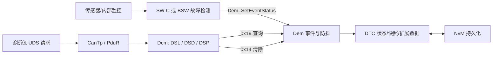

# AUTOSAR 诊断栈：Dcm、Dem、DET、DTC 与 UDS 实战

> 本文是 Flomo 原始笔记的结构化整理版，保留原始来源链接；配置细节应以项目所用 AUTOSAR Release、供应商实现和诊断规范为准。

## 1. 先建立全链路模型

- **检测方**负责判断故障并上报事件；**Dem**负责事件状态、DTC、快照/扩展数据及持久化协调；**Dcm**负责 UDS 服务处理；**NvM**为需要保存的数据提供非易失存储。
- **DET 不等于 Dem**：DET 通常用于开发期报告 BSW API 参数、调用顺序或前置条件等软件错误；它不会自动把错误变成 DTC。若某个问题需要面向售后诊断，必须另行设计诊断事件映射和上报路径。
- **DTC 不是简单的“故障发生即写入”**：事件防抖、确认条件、DTC 状态位、存储条件和老化策略共同决定诊断仪最终能读到什么。

## 2. Dem：事件、防抖和存储

### 2.1 Event 与 DTC 的关系

应用或 BSW 监控逻辑通过配置好的事件接口报告状态。Dem 根据事件配置关联 DTC，并维护测试结果、确认状态、故障记录以及可能配置的 Freeze Frame 和 Extended Data。具体一个 DTC 是否由单个事件映射、记录哪些数据，应检查项目 ARXML 和 Dem 配置。

### 2.2 防抖策略

常见思路包括基于计数器的防抖、基于时间的防抖，以及按项目配置立即确认的策略。不要照搬固定的 N 次或毫秒数：阈值必须结合监控周期、故障机理、功能安全要求和误报/漏报风险确定。

排查顺序：

1. 确认监控逻辑是否真的执行，以及失败/通过条件是否正确。
2. 确认事件 ID、事件状态上报接口和运行条件。
3. 检查防抖算法、阈值、使能条件及 Operation Cycle。
4. 检查事件与 DTC 的映射、确认条件和存储条件。
5. 检查快照/扩展数据触发条件、NvM 写入状态及恢复行为。

### 2.3 状态位与老化

UDS 0x19 读取的 DTC 状态由诊断规范定义，常见概念包括当前测试失败、当前操作循环失败过、待定、已确认、清除后失败过以及测试未完成等。**不要按记忆直接给 bit 编号贴标签**：不同资料可能采用不同展示顺序，调试时以 ISO 14229、项目 Dem 配置和诊断仪解码定义核对。

- **Confirmed 不等于永久保留**：确认、事件当前状态、DTC 是否存储以及何时老化是相关但不同的概念。
- **老化不等于 0x14 清除**：老化按配置的操作循环/条件推进；0x14 是诊断仪发起的 ClearDiagnosticInformation 请求，服务权限和清除范围由配置决定。
- **NvM 不是“每次故障立即写 Flash”**：需检查 Dem/NvM 的块配置、写入触发、写入结果和掉电恢复策略。

## 3. Dcm：DSL、DSD、DSP

- **DSL（Diagnostic Session Layer）**：会话、安全状态、定时器及诊断通信相关管理。
- **DSD（Diagnostic Service Dispatcher）**：服务请求的分发与相关检查。
- **DSP（Diagnostic Service Processing）**：具体 UDS 服务的处理逻辑，例如 ReadDataByIdentifier、ReadDTCInformation、RoutineControl 等。

典型请求链路：诊断仪 → CAN/CanTp 或 DoIP 传输路径 → PduR → Dcm → 会话/安全与服务检查 → 对应服务处理 → 访问 SW-C、Dem 或其他数据源 → 响应返回。

常见服务（是否启用、子功能、会话和安全等级均以项目配置为准）：

- **0x10** DiagnosticSessionControl：切换诊断会话。
- **0x27** SecurityAccess：按配置执行安全访问。
- **0x22 / 0x2E** Read/WriteDataByIdentifier：读取/写入 DID。
- **0x19** ReadDTCInformation：读取 DTC 信息。
- **0x14** ClearDiagnosticInformation：请求清除诊断信息。
- **0x31** RoutineControl：执行配置的例程。

## 4. DET 与 Dem 的边界

| 对比项     | DET                                       | Dem                               |
| ---------- | ----------------------------------------- | --------------------------------- |
| 主要目的   | 开发/集成期的软件错误追踪                 | 面向诊断的事件和 DTC 管理         |
| 典型入口   | Det_ReportError(ModuleId, ApiId, ErrorId) | Dem 事件状态上报接口              |
| 常见内容   | API 参数、调用上下文、前置条件等错误      | 车辆功能或 ECU 监控识别的故障事件 |
| 面向诊断仪 | 通常不会直接作为 DTC 提供                 | 可由 Dcm 的 UDS 诊断服务访问      |
| 持久化     | 取决于 DET 实现，通常不是 DTC 持久化链路  | 按 Dem/NvM 配置保存诊断记录       |

若 BSW 内部错误需要售后可诊断，应定义明确的故障检测/映射策略，再通过 Dem 事件机制报告；不能假定 Det_ReportError 会自动转成 DTC。

## 5. 典型故障排查清单

### 现象：0x19 读不到预期 DTC

- 检查 Tester 的 sub-function、StatusMask、DTC format/record 参数是否匹配。
- 检查监控代码是否执行、事件是否上报、事件是否被使能。
- 检查防抖是否达到确认条件、Operation Cycle 是否正确。
- 检查 DTC 映射、状态掩码筛选、存储条件和老化状态。
- 检查 Dcm 服务配置、会话/安全限制、响应码与 Dem 返回结果。

### 现象：故障发生过，但重启后记录消失

- 核实 Dem 是否配置保存相应状态/快照/扩展数据。
- 核实 NvM 块、写入触发、异步写入完成状态和掉电时序。
- 区分“事件恢复”“DTC 老化”“诊断仪主动清除”和“持久化失败”。

### 现象：DET 有错误，但诊断仪没有 DTC

这可能完全符合设计：DET 记录的是软件开发错误，不自动等于诊断事件。确认是否需要将该故障纳入量产诊断，并建立检测、事件映射、DTC 配置和 Dcm 查询路径。

## 6. 原始 Flomo 笔记

- [DTC 从监控到 Dcm/Dem 的完整路径](https://v.flomoapp.com/mine/?memo_id=MjUyNDg5MDQy)
- [Dem 事件防抖与 DTC 存储逻辑](https://v.flomoapp.com/mine/?memo_id=MjQ4NTYwNTU1)
- [Dem 事件存储与 DTC 状态位](https://v.flomoapp.com/mine/?memo_id=MjUyNTg3MDkx)
- [DET 与 DEM 的区别](https://v.flomoapp.com/mine/?memo_id=MjU0MDI2MzIw)
- [Dcm/ Dem 诊断栈完整实作：三层架构与 UDS 服务](https://v.flomoapp.com/mine/?memo_id=MjQ3NTEwNzk1)
- [FIM 功能抑制管理器（待后续单独整理）](https://v.flomoapp.com/mine/?memo_id=MjQ4ODcyODM5)
- [UDS 刷写专题（待后续单独整理）](https://v.flomoapp.com/mine/?memo_id=MjQ4ODc0Njg1)

## 7. 官方参考

- [AUTOSAR Classic Platform](https://www.autosar.org/standards/classic-platform/)
- [AUTOSAR Diagnostic Event Manager (Dem) R22-11](https://autosar.org/fileadmin/standards/R22-11/CP/AUTOSAR_SWS_DiagnosticEventManager.pdf)
- [AUTOSAR Diagnostic Communication Manager (Dcm) specification](https://www.autosar.org/fileadmin/standards/R3.2.3/CP/AUTOSAR_SWS_DCM.pdf)

> 说明：本文用于学习和排障导航，不替代所用版本的规范、OEM 诊断规范、供应商实现文档或项目 ARXML。
