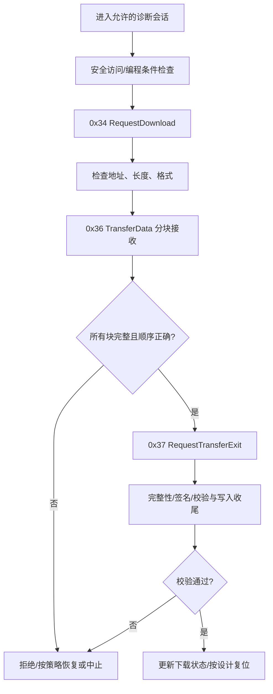

# AUTOSAR 诊断专题：FIM 功能抑制与 UDS 刷写

> 本文整理 Flomo 两篇原始笔记，补充工程排查视角。实际行为取决于 AUTOSAR 版本、OEM 诊断规范、Bootloader 设计及供应商配置。

## 1. FIM（Function Inhibition Manager）解决什么问题？

FIM 用于根据诊断事件状态和项目配置的抑制条件，决定某个功能是否允许执行。典型动机是避免一个上游故障导致大量下游功能误报，或在关键前置条件不成立时禁止特定功能。

例如，温度传感器失效后，替代值可能使下游控制逻辑产生不可信结果。若项目配置了对应的事件依赖和功能抑制关系，FIM 可按配置抑制相关功能。它不是通用的“自动屏蔽所有相关 DTC”开关：功能、事件和抑制关系必须在配置中明确建立。

### FIM 配置与排障检查

1. **抑制映射是否准确**：哪个 Dem Event 状态会影响哪个功能？是否把不相关功能也纳入抑制？
2. **状态条件是否正确**：检查配置的事件状态、使能条件及依赖关系。
3. **解除路径是否完整**：故障恢复、事件状态更新或条件变化后，功能是否能按预期重新允许。
4. **与 Dem 防抖的关系**：若抑制条件依赖事件确认/失败状态，确认阈值和状态更新时序会影响抑制窗口。
5. **可观测性**：记录事件状态、FIM 查询结果、被抑制的功能及其原因，避免只看到“功能没执行”却找不到链路。

### 常见风险

- 抑制范围过大，真实故障被掩盖；
- 依赖关系配置错误，导致功能长期被抑制；
- 事件状态更新和功能调用时序不匹配；
- 将 FIM 当作诊断故障检测本身，忽略上游监控与 Dem 事件配置。

**原则：** FIM 控制功能是否被允许；故障检测、事件状态和 DTC 生命周期仍需要由对应监控逻辑与 Dem 配置负责。

## 2. UDS 刷写：0x34 / 0x36 / 0x37

典型下载流程中，三个服务的职责不同：

| 服务 | 名称 | 核心职责 | 重点检查 |
|---|---|---|---|
| 0x34 | RequestDownload | 请求开始下载，协商地址/长度及传输参数 | 地址范围、长度、格式与允许的内存区域 |
| 0x36 | TransferData | 按块传输数据，带 blockSequenceCounter | 块序号、长度、顺序、超时与重传规则 |
| 0x37 | RequestTransferExit | 结束传输阶段，执行或触发后续处理 | 实际接收长度、完整性校验、状态转换 |

常见前置流程还包括 0x10 会话切换、0x27 安全访问，以及项目配置的编程前置检查。并非所有 ECU 都采用完全相同的顺序或权限策略。

### 建议的刷写状态机

此图是概念流程，不意味着所有项目都在 0x37 的同步处理期间完成全部校验；具体实现可能将擦写、校验、有效标记和复位拆成不同步骤。

### 三类高频故障

**1. 0x34 地址或长度越界**
- 核对请求中的地址和长度编码、地址对齐要求及 Bootloader 允许的内存区域；
- 确认请求范围没有覆盖 Bootloader、标定区或受保护分区；
- 检查 NRC 与 Bootloader 的边界校验日志。

**2. 0x36 传输异常**
- 核对 blockSequenceCounter、块长度、总接收长度和传输超时；
- 区分 Tester 重传、丢帧、传输层分段问题与 Bootloader 状态机拒绝；
- 检查 CanTp/PduR/Dcm 的缓冲与超时配置是否与刷写数据块相容。

**3. 0x37 后校验或通信状态异常**
- 区分“传输结束请求被接受”与“镜像最终有效”：正响应不应被简单等同于镜像已成功验证并可启动；
- 检查镜像完整性、签名/安全校验、写入完成状态、有效标记和复位条件；
- 若通信管理状态发生变化，按时间线核对 CanSM、ComM、BswM、EcuM 与 Bootloader 的状态转换，不要直接假定单一模块是根因。

### 工程排查顺序

1. 用 CANoe 等工具保存完整请求/响应和时间戳。
2. 按 0x10、0x27、0x34、0x36、0x37 的顺序确认状态机进展与 NRC。
3. 对照 Dcm、CanTp、PduR、CanIf、通信管理和 Bootloader 的日志。
4. 核对下载地址、声明总长度、实际接收字节数、块序号与校验结果。
5. 在台架上验证断点、重传、掉电恢复和失败回滚策略；不要在未确认恢复机制前对量产 ECU 做破坏性测试。

## 3. Flomo 原始笔记

- [FIM 功能抑制管理器](https://v.flomoapp.com/mine/?memo_id=MjQ4ODcyODM5)
- [UDS 刷写三件套：0x34/0x36/0x37](https://v.flomoapp.com/mine/?memo_id=MjQ4ODc0Njg1)
- [诊断栈基础：Dcm、Dem、DET、DTC 与 UDS](https://github.com/ilikui/wiki/blob/master/docs/1000-questions/autosar/answers-diagnostics-dcm-dem-det.md)

## 4. 参考资料

- [AUTOSAR Classic Platform](https://www.autosar.org/standards/classic-platform/)
- [AUTOSAR Diagnostic Event Manager (Dem) R22-11](https://autosar.org/fileadmin/standards/R22-11/CP/AUTOSAR_SWS_DiagnosticEventManager.pdf)
- [AUTOSAR Dcm specification](https://www.autosar.org/fileadmin/standards/R3.2.3/CP/AUTOSAR_SWS_DCM.pdf)

> 说明：本文是学习与排障参考，不替代项目诊断规范、Bootloader 设计说明、OEM 安全要求和对应版本的 AUTOSAR 规范。