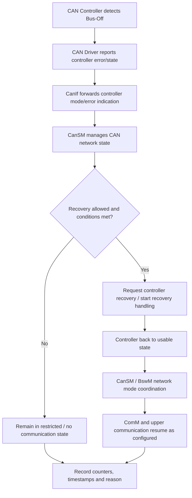

# AUTOSAR CAN Bus-Off：检测、上报与恢复排查

> 适用范围：Classic Platform CAN 通信栈的一般排查框架。具体 API、恢复计时、自动恢复策略与状态转换必须以项目采用的 AUTOSAR 版本、MCAL/供应商实现和 ECUC 配置为准。

## 1. Bus-Off 是什么

CAN 控制器的发送错误计数达到协议规定的 Bus-Off 条件后，控制器进入不能正常参与总线通信的状态。Bus-Off 通常不是“应用层没发报文”的直接证据；应先确认控制器状态、错误计数和物理总线条件。

## 2. 常见软件链路

该图是概念级链路示意；回调名称、状态通知顺序和模块间具体调用因 AUTOSAR 版本与供应商实现而异。

## 3. 分层定位清单

| 层级 | 检查内容 | 需要的证据 |
| --- | --- | --- |
| 物理层 | 终端电阻、线束、接地、收发器供电、短路/干扰 | 示波器、总线波形、收发器状态脚 |
| CAN Controller / MCAL | 控制器状态、错误计数、Bus-Off 中断是否触发 | 寄存器快照、驱动回调计数、调试跟踪 |
| CanIf | 控制器 ID 映射、通知配置、模式转换 | ECUC 配置、回调参数与控制器映射 |
| CanSM | 网络状态机、恢复策略、恢复计时与重试行为 | 状态转换日志、配置参数、时间戳 |
| BswM / ComM | NoCom/FullCom 仲裁与模式请求 | Mode Request、Rule/Action 执行记录 |
| COM / 应用 | 网络恢复后信号是否恢复更新 | I-PDU Group 状态、信号超时计数、接收端监控 |

## 4. 推荐排查顺序

1. **确认是真 Bus-Off**：记录发生时刻、控制器编号、错误状态和复位前后的寄存器；区分 Bus-Off、Error Passive、Bus Error 和收发器故障。
2. **判断是否有物理根因**：查看波形、波特率/采样点、终端与线束；不要通过无限重启控制器掩盖物理故障。
3. **确认上报链路**：验证驱动检测到 Bus-Off 后，CanIf/CanSM 收到的是正确控制器与网络对应关系。
4. **跟踪 CanSM 状态机**：确认进入 Bus-Off 相关状态、恢复计时启动、重试次数和退出条件；不要仅看应用层是否重新发报文。
5. **检查模式协调**：确认 BswM、ComM 和通信相关模块按项目设计进入 NoCom/FullCom 或相应网络模式。
6. **验证恢复后的数据面**：检查控制器重新可用后，PDU 路由、I-PDU Group、COM 信号和接收端超时监控是否恢复。
7. **做可重复测试**：在台架上以受控方式注入总线错误，记录从 Bus-Off 到恢复的时长、重试行为和上层恢复结果。

## 5. 常见误区

- Bus-Off 恢复成功不代表物理故障已消失；故障持续时可能再次进入 Bus-Off。
- CanSM 不是 CAN 错误的物理根因检测器；物理层、控制器与网络管理层的证据要分开。
- “立即恢复、延迟恢复、手动恢复”不能脱离具体项目配置和安全策略直接选型。
- 不应在没有确认网络状态与系统安全要求的情况下，通过应用层无限重试或强制重启来规避故障。

## 6. 验收标准

- [ ] 能捕获 Bus-Off 的控制器、时刻和原始状态证据。
- [ ] 驱动到 CanIf/CanSM 的通知链路经过验证。
- [ ] 恢复策略、计时和重试行为与项目配置一致。
- [ ] 恢复后应用通信与信号超时监控均恢复。
- [ ] 重复注入测试能给出稳定、可追溯的结果。

## 参考

- [AUTOSAR Classic Platform 官方规范入口](https://www.autosar.org/standards/classic-platform/)
- [AUTOSAR Standards](https://www.autosar.org/standards)
