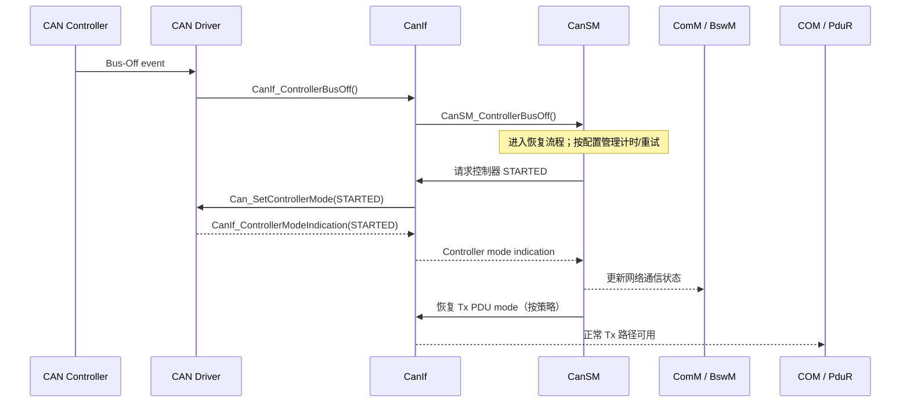

# CanSM / CanIf / CAN Driver：Bus-Off 恢复状态机与端到端验证

> 本文是对 [CAN Bus-Off 恢复基础](./can-busoff-recovery.md) 的工程补充，重点是模块职责、状态确认、通信路径恢复与可复现测试。恢复时间、次数、DEM 事件及网络策略必须以项目需求和实际 CanSM 配置为准，不能把某个 OEM 的参数当作 AUTOSAR 通用值。

## 1. 先划清模块职责

| 模块 | 责任边界 | 关键证据 |
|---|---|---|
| CAN Driver (Can) | 控制器硬件状态、检测/报告 Bus-Off、执行控制器模式请求 | 中断/错误状态、CanIf 回调、控制器寄存器 |
| CanIf | 适配驱动与上层；接收 Bus-Off 通知并向配置的上层分发；管理 PDU 模式与 Tx buffer | `CanIf_ControllerBusOff`、`CanIf_SetControllerMode`、PDU mode |
| CanSM | 每个网络的 Bus-Off 恢复控制、恢复计时/重试、协调控制器和 Tx 路径 | 状态机状态、恢复计数、mode request/indication |
| ComM / BswM | 接收通信状态并执行上层策略 | `ComM_BusSM_ModeIndication`、`BswM_CanSM_CurrentState` |
| DEM | 按项目配置记录/清除 Bus-Off 相关事件 | Event status、debounce、恢复后的清除策略 |

不要混淆三种状态：**CAN 控制器模式**（STARTED/STOPPED）、**CanIf PDU 通信模式**（TX ONLINE/OFFLINE 等）、**CanSM 网络通信状态**。它们是不同层级，某一层“恢复”不代表端到端通信已恢复。

## 2. 典型事件链

AUTOSAR CAN Interface R24-11 描述的典型流程为：控制器检测 Bus-Off，驱动必要时停止控制器并调用 `CanIf_ControllerBusOff()`；CanIf 清理其 Tx buffer 并通知上层；CanSM 按恢复算法等待后请求控制器 STARTED；驱动通过 `CanIf_ControllerModeIndication()` 确认模式变化，再由 CanIf 通知上层。实际项目还需核对具体 CanSM 配置和供应商实现。

## 3. 恢复状态机的检查点

1. **检测**：确认 Bus-Off 只由真实控制器状态触发；记录控制器 ID、时间戳、错误计数/状态。
2. **隔离发送**：确认恢复期间的 Tx PDU mode 与上层通信状态符合项目要求；检查是否仍有应用层请求持续堆积。
3. **等待恢复时间**：确认计时基于正确的 CanSM 主函数/调度周期，避免把配置时间误读为精确总线恢复时刻。
4. **控制器重启**：检查 CanIf 请求是否返回成功，以及后续是否收到 STARTED indication。请求成功不等于模式已切换。
5. **恢复通信**：检查 PDU mode、ComM 状态、CanNm 状态、COM 周期报文与 Tx confirmation 是否共同恢复。
6. **重试/升级策略**：核对快速/慢速恢复参数、最大次数、DEM 触发条件和网络降级策略。参数应来自项目规范，不在本文中硬编码。
7. **持续故障**：断开总线或保持错误条件，观察状态机是否按预期重复恢复、限制重试或报告诊断。

## 4. 常见误判与定位

| 现象 | 可能原因 | 优先检查 |
|---|---|---|
| Bus-Off 已上报但没有重启 | CanSM 未收到回调、网络映射错误、状态机未调度 | CanIf 上层回调配置、CanSM network/controller mapping、MainFunction |
| STARTED 请求返回成功但控制器仍 STOPPED | 异步模式切换未确认、驱动异常或 indication 丢失 | Can driver 状态、CanIf mode indication、请求重试/超时 |
| 控制器 STARTED 但报文不发 | PDU mode 仍 TX_OFFLINE、ComM 未恢复、Tx PDU 未触发 | CanIf PDU mode、ComM/BswM、COM Tx mode |
| 重启后仍立即 Bus-Off | 物理层故障仍存在、波特率/采样点错误、终端/接地问题 | CANH/CANL、终端电阻、波形、错误计数 |
| 恢复了但 DTC 不清除/过早清除 | DEM debounce、恢复判据与项目需求不一致 | DEM event 配置、成熟/清除条件 |
| 反复进入恢复循环 | 重试策略、总线持续故障或其他节点异常 | 恢复计数、总线抓包、错误帧与节点隔离 |

## 5. 端到端回归用例

| ID | 注入/条件 | 预期检查 |
|---|---|---|
| BO-01 | 正常网络运行后注入一次 Bus-Off | 回调链完整；恢复时间符合项目配置 |
| BO-02 | 恢复期间持续请求 Tx | 不违反隔离策略；恢复后无错误的旧缓存突发 |
| BO-03 | 控制器 STARTED indication 延迟/丢失 | 超时与重试按配置处理，不假定请求已完成 |
| BO-04 | 总线持续断开 | 恢复尝试、计数、DEM/上层状态符合需求 |
| BO-05 | 短暂故障后总线恢复 | 控制器与 PDU 路径均恢复，应用报文可观测 |
| BO-06 | 多个 CAN 网络分别触发 Bus-Off | 网络/控制器映射正确，状态不串扰 |
| BO-07 | Bus-Off 与 ComM 请求/网络睡眠交叠 | 状态转换无死锁，按项目策略决定恢复或休眠 |
| BO-08 | 多次 Bus-Off 达到策略阈值 | 快慢恢复或降级行为、DEM 状态与需求一致 |

## 6. 测量点建议

在同一时间基准下记录：CAN 错误帧/Bus-Off 时刻、`CanIf_ControllerBusOff`、`CanSM_ControllerBusOff`、控制器 STOPPED/STARTED indication、CanIf PDU mode、ComM/BswM 状态、第一帧成功 Tx 与 Tx confirmation。由此区分“恢复计时”“控制器启动延迟”和“总线仲裁/报文调度延迟”。

## 7. 参考

- [AUTOSAR CP R24-11 — Specification of CAN Interface](https://www.autosar.org/fileadmin/standards/R24-11/CP/AUTOSAR_CP_SWS_CANInterface.pdf)（Bus-Off 通知与控制器恢复流程）
- [AUTOSAR Classic Platform standards](https://www.autosar.org/standards/classic-platform)

> 版本提醒：本文按 R24-11 CAN Interface 的流程组织。不同 AUTOSAR release、供应商栈和项目配置在参数、回调细节及扩展策略上可能不同；实施前请对照项目采用的 CanSM / CanIf / Can Driver 规范与生成配置。
