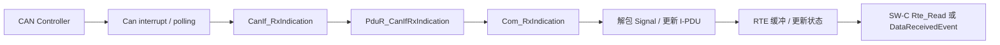

# COM → PduR → CanIf → Can：发送/接收回调链排查

> 适用范围：AUTOSAR Classic Platform 的 CAN 通信栈。本文聚焦常见 COM 信号通信路径；诊断、CanTp、CanNm、SecOC、网关和供应商扩展可能使用不同的上层模块与回调链。具体函数、PDU ID 和路由由项目配置及生成代码决定。

## 1. 先区分两条路径

### 发送路径（典型 COM I-PDU）

```mermaid
flowchart LR
    A["SW-C"] --> B["Rte_Write / RTE"]
    B --> C["COM Signal / I-PDU"]
    C --> D["PduR routing"]
    D --> E["CanIf_Transmit"]
    E --> F["Can_Write"]
    F --> G["CAN Controller / Bus"]
    G -. "发送完成通知" .-> H["CanIf_TxConfirmation"]
    H --> I["PduR_TxConfirmation"]
    I --> J["Com_TxConfirmation"]
```

典型职责：
- **SW-C / RTE**：写入 Sender-Receiver 数据元素；是否立即触发发送取决于 RTE、COM 配置与发送模式。
- **COM**：维护 Signal / I-PDU，执行打包、更新位、发送模式与相关计时处理。
- **PduR**：根据配置的 routing path 将 I-PDU 请求转发到下层。
- **CanIf**：屏蔽 CAN 驱动差异，映射 PDU ID、控制器/通道和发送对象。
- **Can Driver**：向硬件发送对象提交 L-PDU，并在规范定义的事件中通知 CanIf。

### 接收路径（典型 COM I-PDU）

注意：图是常见路径示意。接收过滤、COM I-PDU 处理、RTE 通知、DataReceivedEvent 触发与 Runnable 实际运行并非同一个动作；需要分别验证。

## 2. 回调名与观察点

| 阶段 | 常见函数/观察点 | 主要确认什么 |
|---|---|---|
| 应用写入 | Rte_Write_* 或生成器提供的对应 API | 返回值、端口/数据元素是否正确 |
| COM 更新 | Com_SendSignal / I-PDU 发送请求相关函数（具体实现可能内联或生成） | Signal 是否写入正确 I-PDU、发送模式是否满足触发条件 |
| 路由 | PduR_ComTransmit 或供应商生成的等价路由函数 | Source PDU ID、Destination PDU ID、路由路径是否匹配 |
| CAN 接口发送 | CanIf_Transmit | CanIfTxPduCfg、PDU channel mode、HTH/控制器映射 |
| CAN 驱动发送 | Can_Write | 控制器是否 STARTED、硬件发送对象是否可用、返回值 |
| 发送确认 | CanIf_TxConfirmation → 上层确认回调 | 确认是否到达、PDU ID 是否映射到正确上层模块 |
| 接收硬件通知 | CanIf_RxIndication | Rx PDU 是否匹配、DLC/数据是否正确 |
| 接收路由 | PduR_CanIfRxIndication | Source PDU ID 和 destination routing path |
| COM 接收 | Com_RxIndication / COM 内部处理 | I-PDU 是否更新、信号解包、超时/更新状态 |
| 应用读取 | Rte_Read_*、Rte_IsUpdated_*（若适用） | 值、返回状态、更新状态和数据年龄 |

函数名是常见 AUTOSAR API 线索，并不保证每个供应商工程都会以独立 C 函数形式出现；请结合生成的头文件、链接映射、宏展开和调用栈核实。

## 3. 发送失败：按层向下切分

1. **先在 Rte_Write 后确认数据**：确认 API 返回状态、SW-C Runnable 是否执行、值是否被其他 Runnable 覆盖。
2. **检查 COM 发送条件**：I-PDU 是否启用；发送模式是周期、直接、混合还是触发式；最小延时、重复发送、更新位、TxMode 条件是否影响时机。
3. **核对 PduR 路由**：COM 使用的 Tx I-PDU ID 是否对应到正确的 PduR Source PDU 与 CanIf Destination PDU；检查路由是否被变体或配置条件关闭。
4. **检查 CanIf**：PDU channel mode 是否允许发送；TxPdu 配置是否引用正确 HTH、Controller 和 CAN Driver；确认是否发生 PDU ID 混用。
5. **检查 Can Driver / 硬件**：Can_Write 返回值、发送邮箱/硬件对象是否繁忙、控制器是否处于 STARTED、是否 Bus-Off、是否有中断或发送轮询。
6. **检查确认链**：若总线上确实出现报文但上层状态未完成，沿 CanIf_TxConfirmation → PduR → COM 检查 callback 配置、PDU ID 映射和通知使能。

## 4. 接收数据错误：从总线到 Runnable

1. 用 CANoe、总线记录或硬件分析工具确认总线上实际 ID、DLC、周期和数据字节。
2. 确认 CAN Controller/Can Driver 已接收该帧，并检查硬件过滤、接收对象和错误计数。
3. 在 CanIf_RxIndication 处确认 CanIf Rx PDU 映射、数据长度和 payload。
4. 在 PduR_CanIfRxIndication 处核对 Source PDU ID、路由目标和路由配置。
5. 在 COM 接收处理处确认 I-PDU 更新、Signal 起始位/长度/字节序/缩放/无效值，以及接收超时监控。
6. 在 RTE/SW-C 处检查接收端口连接、DataReceivedEvent 是否配置、Runnable 是否被激活、Rte_Read 返回状态与数据是否为最新。
7. 若只有特定时段失败，进一步检查 PDU channel mode、ComM/CanSM 状态、Bus-Off 恢复、模式仲裁与电源/唤醒状态。

## 5. 常见现象与根因分支

| 现象 | 优先怀疑 | 下一步证据 |
|---|---|---|
| Rte_Write 成功但总线无帧 | COM TxMode、PduR 路由、CanIf channel mode、驱动返回值 | 逐层记录返回值与 PDU ID |
| 总线有帧但 TxConfirmation 没到 | CAN 驱动确认配置、CanIf 上层确认映射、PduR 路由 ID | 在 CanIf_TxConfirmation 设断点并追踪上层回调 |
| 总线有帧但 SW-C 读旧值 | Rx PDU 过滤/映射、COM Signal 配置、RTE 连接/更新 | 从 CanIf_RxIndication 到 Rte_Read 逐点比对 payload |
| 周期报文间隔不稳定 | Runnable/COM 周期、TxMode、最小延时、调度抖动、总线负载 | 对比期望触发时间、COM 请求时间与实际总线时间 |
| 只有 Bus-Off 后不恢复 | CanSM 策略、CanIf 控制器状态、驱动通知、BswM/ComM 协作 | 检查 Bus-Off indication、恢复计时和 controller mode |
| PDU ID 正确但数据错位 | Signal bit position、endianness、长度、E2E/SecOC、打包更新时序 | 用已知测试向量逐字节比对 |

## 6. 最小化观测方案

推荐在同一条测试记录里保留这些字段：

- 时间戳 / OS tick；
- SW-C Runnable 名称与输入/输出值；
- Rte_Write 返回值；
- COM I-PDU ID、触发请求时间和实际发送时间；
- PduR source/destination PDU ID；
- CanIf PDU ID、通道模式、控制器状态；
- Can_Write 返回值与 TxConfirmation；
- Rx Indication 的 ID、DLC、payload；
- COM 解包后的 Signal 值、更新状态、超时状态；
- Rte_Read 返回值与 SW-C 实际消费值。

**原则：每一层都要同时确认“调用是否发生、ID 是否正确、返回状态是什么、数据是否一致”。** 单看 CANoe 总线上有无报文，无法判断 RTE/COM/PduR 的内部状态是否符合需求。

## 7. 回归验收清单

- [ ] 验证正常周期发送、直接发送和配置中实际使用的其他发送模式。
- [ ] 验证接收过滤、DLC 错误、无效信号值与接收超时。
- [ ] 验证 TxConfirmation / RxIndication 回调映射和 PDU ID 一致性。
- [ ] 验证 PDU channel mode 离线、Tx Offline、恢复在线等项目实际使用状态。
- [ ] 验证 Bus-Off、控制器停止/启动、通信模式切换期间的发送与接收行为。
- [ ] 验证高总线负载和任务抖动下的周期及数据新鲜度。
- [ ] 记录 AUTOSAR Release、MCAL/BSW/RTE 供应商版本、ARXML 基线和可复现测试证据。

## 8. 官方参考

- [AUTOSAR Specification of CAN Interface — R24-11](https://www.autosar.org/fileadmin/standards/R24-11/CP/AUTOSAR_CP_SWS_CANInterface.pdf)
- [AUTOSAR Classic Platform 标准入口](https://www.autosar.org/standards/classic-platform/)

> 本指南用于建立分层定位方法，不替代项目的模块规范、生成代码、集成手册和测试规范。不同版本及供应商实现可能在缓冲、确认、回调封装和函数内联方面存在差异。
