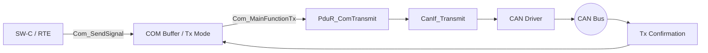
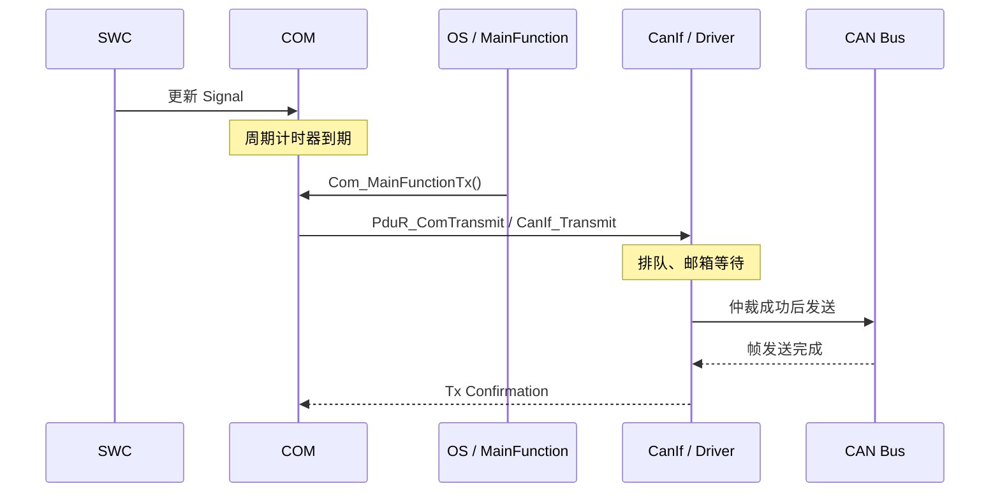

# AUTOSAR COM 周期发送与时序抖动：Direct / Periodic / Mixed / MDT

> 适用：AUTOSAR Classic Platform COM，以 R24-11 Specification of Communication 为参考。具体行为取决于 Release、供应商实现、Com_MainFunctionTx 调度和总线负载。

## 1. 先区分三个时刻

COM 不直接控制 CAN 总线的物理发送时刻。典型链路：

- **信号更新**：SW-C 更新 COM I-PDU 缓冲区。
- **COM 请求**：COM 调用 PduR_ComTransmit。
- **总线发送**：CAN 控制器获得发送机会，仲裁成功后实际发送帧。

所以，配置 10 ms 周期不等于总线上每 10.000 ms 必定出现一帧。

## 2. 三种 Tx Mode

| 模式 | 主要触发方式 | 典型用途 | 常见误区 |
|---|---|---|---|
| PERIODIC | 周期定时器 | 周期状态量、传感器值 | 每次写信号都会额外发帧 |
| DIRECT | 信号/信号组事件触发 | 状态变化、事件通知 | API 调用时刻就是总线发送时刻 |
| MIXED | 事件触发 + 周期发送 | 变化快速上报且周期刷新 | 事件发送会取消周期发送 |

### PERIODIC

由 ComTxModeTimePeriod 配置周期。信号更新通常只更新 I-PDU 缓冲区，不会因每次更新额外触发发送；到周期发送时使用缓冲区当前数据。

### DIRECT

由参与 I-PDU 的信号/信号组传输属性及过滤条件触发发送请求。ComTxModeNumberOfRepetitions 和 ComTxModeRepetitionPeriod 可配置事件发送后的重复请求。实际请求仍受 MainFunction 调度、MDT 和底层发送能力影响。

### MIXED

同时具备事件触发和周期发送部分。事件发生时可触发发送，周期部分仍按配置节奏运行。N 次重复、周期部分、MDT 和 Tx Confirmation 的交互应结合规范时序图及项目配置分析。

## 3. Transfer Property 与 Tx Mode 的区别

- Transfer Property 属于 Signal / SignalGroup 层面，例如 TRIGGERED、TRIGGERED_ON_CHANGE、PENDING。
- Tx Mode 属于 I-PDU 层面，例如 DIRECT、PERIODIC、MIXED、NONE。
- 每个 I-PDU 的 Transmission Mode Selector（TMS）可依据过滤条件选择 ComTxModeTrue 或 ComTxModeFalse。
- 因此必须一起检查信号属性、过滤器、TMS 结果和当前生效的 Tx Mode。

不能只看某个 Signal 的 Transfer Property，就断言整帧必然即时发送。

## 4. Minimum Delay Time（MDT）

ComMinimumDelayTime 用于限制同一 I-PDU 向 PDU Router 发起发送请求的最小间隔。它不是 CAN 总线上的严格帧间隔保证。

- MDT 未到期时，COM 可能推迟本次 PduR_ComTransmit 请求。
- MDT 与 Tx Confirmation、周期模式配置和所用 Release 的计时行为有关。
- R24-11 规范定义了成功 Tx Confirmation 对 MDT 计时器的重装行为，也存在特定例外，例如 Com_TriggerTransmit 不按普通请求路径处理 MDT。
- ComMinimumDelayTime 为 0 或未配置时，不进行 MDT 监控。
- Stop/Start、TMS 切换、N-times 发送和 Deadline Monitoring 会影响时间线，应按规范章节逐项核对。

MDT 不等于周期时间。例如周期 20 ms、MDT 5 ms，不意味着报文变成每 5 ms 发送；周期模式仍由周期定时器决定请求节奏。

## 5. 周期发送为什么会抖动

假设周期配置为 10 ms，而 Com_MainFunctionTx 每 5 ms 执行一次：

1. 周期定时器到期后，发送请求通常要等到 COM Tx MainFunction 运行时处理。
2. MainFunction 有调度相位、任务释放抖动和执行时间。
3. 请求交给 PduR / CanIf 后，可能受到发送队列、控制器状态和硬件邮箱资源影响。
4. CAN 总线还要经历仲裁；高优先级报文、错误帧、重发和总线负载会改变真实发送时刻。
5. Tx Confirmation 可能晚于发送请求，影响依赖确认的计时行为和后续请求节奏。

## 6. 抖动预算与测量点

可用以下工程预算模型定位问题：

`t_bus(n) = t_ideal(n) + J_OS(n) + D_SW(n) + D_BUS(n)`

其中 J_OS 是 MainFunction 调度抖动，D_SW 是 COM 到 CanIf 接受请求的处理延迟，D_BUS 是请求接受后到总线发送的等待时间。它是分析模型，不是规范规定的固定公式。

建议采集：
- Com_MainFunctionTx 入口时间戳；
- PduR_ComTransmit 调用时间戳和返回值；
- CanIf_Transmit 接收时间戳和返回值；
- Tx Confirmation 时间戳；
- CANoe / 总线分析仪的帧时间戳、错误帧和总线负载。

## 7. 配置检查清单

| 配置项 | 检查重点 |
|---|---|
| ComTxModeMode | 实际生效模式：DIRECT / PERIODIC / MIXED |
| ComTxModeTimePeriod | 周期值、单位及需求一致性 |
| ComTxModeTimeOffset | 是否需要启动错峰，避免上电突发 |
| ComTxModeNumberOfRepetitions | 事件触发后的重复次数 |
| ComTxModeRepetitionPeriod | 重复请求间隔 |
| ComMinimumDelayTime | 是否过大导致请求延后，是否与重复/监控策略冲突 |
| Transfer Property | Signal / SignalGroup 触发属性 |
| TMS / ComFilter | 当前信号值是否改变有效 Tx Mode |
| Com_MainFunctionTx | 调用周期、任务优先级、漏调和超时 |
| PduR / CanIf | 请求返回值、队列和硬件资源 |
| CAN Controller / Bus | Bus-Off、重发、总线负载、仲裁优先级 |

## 8. 按现象定位

| 现象 | 优先检查 | 证据 |
|---|---|---|
| COM 入口时间不均匀 | OS 调度、MainFunction 周期 | OS Trace |
| COM 调用规律，PduR 请求不规律 | Tx Mode、MDT、TMS、重复发送 | COM 计时器与 PduR 打点 |
| PduR 请求规律，CanIf 接收不规律 | PduR/CanIf 资源、返回值 | API 返回值、队列/邮箱状态 |
| CanIf 接收规律，总线帧不规律 | CAN 仲裁、负载、重发 | CANoe Trace、错误帧 |
| 周期帧偶尔缺失 | Tx Deadline Monitoring、发送失败策略 | Tx Confirmation、DET/DEM |
| 切换模式后首帧异常 | TMS 切换、周期计时器重启、MDT | 切换前后时间线 |

## 9. 最小回归测试

1. 单一周期 I-PDU、低总线负载，分别测 COM 请求间隔和总线帧间隔。
2. 改变 Com_MainFunctionTx 周期与相位，观察请求延迟。
3. 分别验证 TRIGGERED、TRIGGERED_ON_CHANGE、PENDING。
4. 验证 MIXED 模式在无事件时仍周期发送，事件发生时额外请求是否符合预期。
5. 在 MDT 到期前后连续触发，验证推迟与确认行为。
6. 切换 TMS true/false，检查当前模式和周期计时器。
7. 增加高优先级总线负载，比较 COM 请求和真实帧时间。
8. 制造发送失败，检查返回值、重试策略和 Deadline Monitoring。
9. 比较配置/不配置 TimeOffset 时启动瞬间的报文突发。

## 10. 参考资料

- [AUTOSAR CP R24-11 — Specification of Communication (COM)](https://www.autosar.org/fileadmin/standards/R24-11/CP/AUTOSAR_CP_SWS_COM.pdf)
- [AUTOSAR Classic Platform 标准入口](https://www.autosar.org/standards/classic-platform)
- [COM I-PDU Transmission Modes 解释](https://www.autosartoday.com/posts/com_-_demystifying_i-pdu_transmission_modes)

> 规范要求、工具生成行为、供应商实现和项目实测结果需要分开记录。最终以当前生成配置、供应商手册和 Trace 为准。
