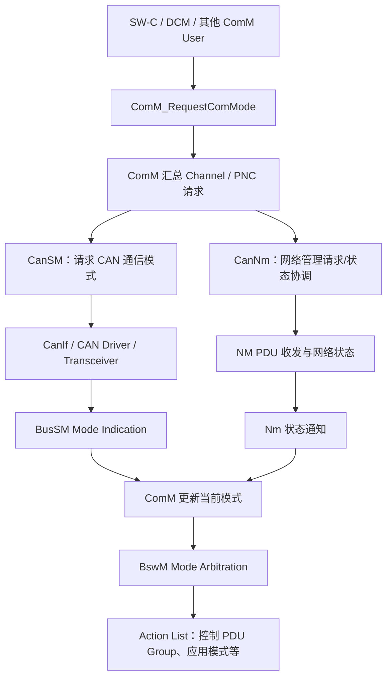
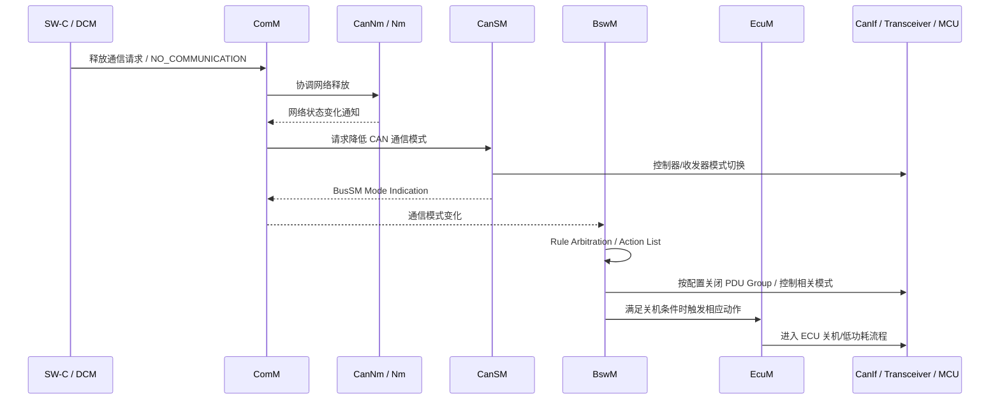
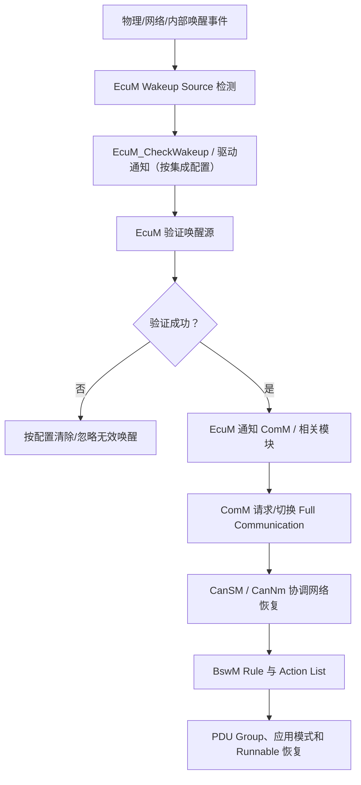

# ComM / CanNm / BswM / EcuM：通信模式、唤醒与 Bus-Sleep 联动

> 适用范围：AUTOSAR Classic Platform CAN 网络管理场景。本文描述常见模块职责与集成排查思路。具体行为应以项目采用的 AUTOSAR Release、ARXML、供应商实现和整车需求为准。

## 1. 四个模块的职责

| 模块 | 核心职责 | 不应误认为 |
|---|---|---|
| ComM | 汇总 SW-C、诊断等用户的通信请求，管理每个 Channel/PNC 的通信模式 | 直接控制 CAN 控制器寄存器或决定每个 CAN 帧内容 |
| CanNm | 执行 CAN 网络管理协议，处理 NM PDU、Repeat Message、Normal Operation、Ready Sleep 等网络状态 | 通用 CAN 信号通信模块或 CAN 驱动 |
| BswM | 根据模式/状态请求进行 Mode Arbitration，并通过 Rule/Action List 编排模块动作 | 只负责开关 COM 的简单开关 |
| EcuM | 管理 ECU 启动、唤醒源验证、休眠/关机流程和电源状态协作 | 代替 ComM/CanNm 管理网络协议状态 |

还要关注 CanSM：它负责 CAN 通信状态管理及控制器/收发器模式协调，是 ComM 与 CAN 底层状态之间的重要桥梁。CanNm 的网络管理状态与 CanSM 的控制器/通信模式不是同一套状态机。

## 2. 典型通信请求链

要点：
- 用户请求 COMM_FULL_COMMUNICATION 是请求，不代表控制器已经启动、PDU Group 已打开或总线上已经有报文。
- ComM_RequestComMode 的返回值表示请求 API 的受理情况，不等于整个网络已经完成模式切换。
- ComM 的请求模式、当前模式、最大允许模式以及 CanSM/CanNm 的内部状态必须分开观测。
- BswM 是否参与某项控制，取决于项目是否配置对应 Mode Request Port、Rule 和 Action List。

## 3. ComM 三种常见通信模式

| ComM 模式 | 含义（概念层面） | 工程关注点 |
|---|---|---|
| COMM_NO_COMMUNICATION | 用户不请求该通道进行常规通信 | 进入无通信的条件、网络释放、PDU Group 关闭时机 |
| COMM_SILENT_COMMUNICATION | ECU 可接收通信，但不主动发送常规应用通信 | 只接收/静默场景是否符合整车需求，NM 报文与诊断例外按规范和配置确认 |
| COMM_FULL_COMMUNICATION | 允许完整通信 | 仍需等待底层状态切换、控制器启动、PDU Group 与应用 Runnable 就绪 |

不要把 COMM_FULL_COMMUNICATION 直接等同于 CanNm 的 Normal Operation，也不要把 COMM_NO_COMMUNICATION 直接等同于 MCU 已经进入 Sleep。ComM 是通信模式管理；ECU 电源状态还涉及 EcuM、BswM、OS、MCU、收发器和整车电源策略。

## 4. CanNm 状态与 Repeat Message

| CanNm 状态 | 典型作用 | 排查重点 |
|---|---|---|
| Repeat Message State | 网络唤醒/重复消息阶段，用于让网络节点识别通信恢复或节点加入 | Repeat Message 时间、NM PDU 发送、重复消息位/配置、网络请求来源 |
| Normal Operation State | 正常网络运行阶段 | 网络请求是否持续、NM PDU 周期、节点是否保持网络唤醒 |
| Ready Sleep State | 本节点不再主动请求网络保持，但仍观察网络活动并等待进入睡眠条件 | 本地请求是否真正释放、其他节点 NM PDU 是否仍存在、Ready Sleep 定时器 |
| Prepare Bus-Sleep Mode | 准备进入 Bus-Sleep 的过渡阶段 | Prepare Bus-Sleep 时间、是否有新网络请求/唤醒事件打断 |
| Bus-Sleep Mode | 网络管理层认为总线进入睡眠状态 | 收发器唤醒能力、唤醒源、网络静默条件和后续唤醒验证 |

上述状态名称和具体转换条件应按所用 CanNm 规范版本及配置确认。NM PDU 停止发送、CanNm 进入 Bus-Sleep、CanSM 进入无通信、收发器进入低功耗、MCU Sleep 是不同层次的事件，不应当作同一时间点。

## 5. 休眠流程：从释放请求到 ECU Sleep

建议按“谁还在请求通信”开始排查：
1. 检查所有 ComM User：SW-C、DCM、诊断活动、网络管理相关请求是否已释放。
2. 检查是否存在其他 Channel User 或 PNC 仍请求 Full Communication。
3. 检查 ComM 是否受到 Communication Allowed、NoCom 或 PreventWakeUp 等项目配置约束。
4. 检查 CanNm 是否仍处于 Repeat Message/Normal Operation，或仍收到其他节点 NM PDU。
5. 检查 CanSM 的模式请求、控制器/收发器模式指示和 Bus-Off 状态。
6. 检查 BswM 对应 Rule 是否满足、Action List 是否执行、是否有后续规则重新打开通信。
7. 最后判断 EcuM 是否满足进入 Sleep/Shutdown 的条件。

## 6. 唤醒流程：唤醒事件不等于唤醒已验证

排查唤醒问题时至少区分：
- **检测到唤醒源**：硬件或驱动报告了事件。
- **唤醒源已验证**：EcuM 的验证流程确认该事件有效。
- **通信恢复**：ComM/CanSM/CanNm 的状态机完成必要切换。
- **应用恢复**：COM PDU Group、RTE 数据、SW-C Runnable 和诊断服务进入可工作状态。

## 7. Repeat Message 与 Full Communication 常见误判

| 现象 | 不要直接下的结论 | 应检查 |
|---|---|---|
| 请求 Full Communication 后很快看到 NM 报文 | 应用通信已全部恢复 | ComM 当前模式、CanSM 模式指示、COM I-PDU Group、应用数据 |
| NM 报文持续发送 | 一定有 SW-C 用户没释放 | ComM User、CanNm 网络请求、其他节点 NM PDU、诊断请求、Repeat Message 配置 |
| 本节点不发 NM 报文但总线仍有流量 | 本 ECU 已经睡眠 | 其他节点 NM PDU、应用 PDU、控制器/收发器状态 |
| CanNm 已到 Ready Sleep 但 ECU 不休眠 | CanNm 状态机卡死 | 其他 User 请求、ComM 状态、BswM Rule、EcuM shutdown 条件 |
| Wakeup Source 检测到但未恢复通信 | CanIf 一定有问题 | EcuM 验证、唤醒源映射、ComM 通知、CanSM/CanNm 恢复 |
| 关机后短时间又被唤醒 | 硬件误唤醒 | 网络上其他节点仍活跃、收发器唤醒配置、Wakeup Validation、整车电源策略 |

## 8. BswM Rule / Action List 检查清单

- [ ] 每个 Mode Request Source 是否正确连接到对应的 BswM Mode Request Port。
- [ ] Rule 条件是否覆盖 ComM、CanSM、CanNm、EcuM、DCM 及项目自定义模式。
- [ ] Action List 的触发条件、执行顺序和是否可重复执行是否明确。
- [ ] 是否有多个 Rule 写同一个目标模式或 PDU Group，导致动作相互覆盖。
- [ ] 是否存在一个 Action List 关闭 PDU Group，另一个 Action List 又重新打开。
- [ ] 是否区分初始化、正常运行、诊断会话、PostRun、Shutdown 和 Wakeup 阶段。
- [ ] 对每个 Action 的返回值、执行结果和异步完成条件是否有观测证据。
- [ ] 是否把模式通知当作异步状态变化处理，而不是假设请求后立即切换完成。

## 9. 最小化调试观测表

| 时间点 | 观测对象 | 建议记录 |
|---|---|---|
| T0 | ComM User | User ID、请求模式、请求来源、API 返回值 |
| T1 | ComM Channel/PNC | Requested Mode、Current Mode、最大允许模式 |
| T2 | CanNm/Nm | 网络状态、Repeat Message、NM PDU Tx/Rx、网络请求 |
| T3 | CanSM | BSM 状态、控制器/收发器模式请求和指示、Bus-Off |
| T4 | BswM | Mode Request、Rule 命中、Action List 执行顺序和结果 |
| T5 | EcuM | Wakeup Source、验证状态、Shutdown Target、Sleep 条件 |
| T6 | COM/CanIf/硬件 | PDU Group 状态、总线报文、Controller/Transceiver 状态 |
| T7 | 应用 | Runnable 激活、RTE 数据更新、降级/恢复状态 |

不要只记录最终模式值；需要记录请求来源、状态转换前后值和时间戳，否则难以区分“没有请求”“请求被限制”“状态切换未完成”和“切换完成后又被其他用户拉起”。

## 10. 回归测试建议

- [ ] 单个 SW-C User 请求 Full Communication，再释放请求，验证完整进入和退出路径。
- [ ] 两个 User 同时请求 Full Communication，先释放其中一个，确认另一个仍能保持通信。
- [ ] 注入 DCM 诊断活动，确认诊断请求可按设计保持通信，诊断结束后可正确释放。
- [ ] 验证 Repeat Message、Normal Operation、Ready Sleep、Prepare Bus-Sleep 和 Bus-Sleep 的时间条件。
- [ ] 验证其他节点持续发送 NM PDU 时，本节点不会错误进入睡眠。
- [ ] 分别测试有效唤醒、无效唤醒、重复唤醒和唤醒期间再次收到网络活动。
- [ ] 验证 PDU Group 关闭/打开与 ComM、CanSM、CanNm 状态之间的先后关系。
- [ ] 验证 Bus-Off、控制器停止/启动、收发器低功耗和通信模式切换的交互。
- [ ] 验证 PostRun/Shutdown 条件下 NvM 保存完成判据与通信关闭顺序。
- [ ] 记录 AUTOSAR Release、供应商版本、ARXML 配置、定时参数和测试证据。

## 11. 官方参考资料

- [AUTOSAR Specification of Communication Manager — R24-11](https://www.autosar.org/fileadmin/standards/R24-11/CP/AUTOSAR_CP_SWS_COMManager.pdf)
- [AUTOSAR Classic Platform 标准入口](https://www.autosar.org/standards/classic-platform/)

AUTOSAR ComM 规范说明 EcuM 负责唤醒事件验证并在验证后通知 ComM；BswM 可根据配置传播用户请求、控制 COM I-PDU Group，并参与通信允许/禁止协调。具体动作仍由项目配置决定。

> 本指南是集成排查框架，不是固定状态机参数模板。请对照项目实际的 ComM、CanNm、CanSM、BswM、EcuM 配置和供应商集成手册逐项核验。
