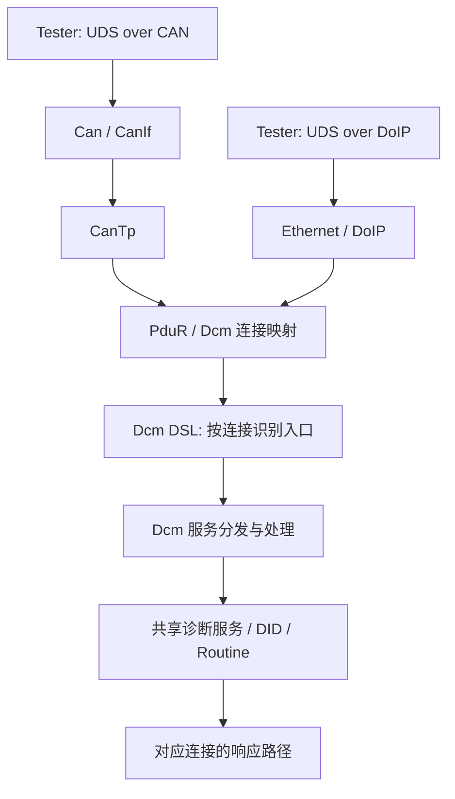

# Dcm 多诊断传输路径：CAN 与 DoIP 共用诊断服务

## 1. 核心思路

一个 ECU 可以在项目配置允许的前提下，通过不同传输路径提供相同的 UDS 服务。例如 UDS over CAN 经过 CanTp，UDS over DoIP 经过 DoIP 传输模块；Dcm 的连接/协议配置负责把不同入口映射到诊断服务处理。

不要把“CAN 和 DoIP 使用同一套 Dcm 服务”理解为“只需配置一条连接”。两个入口的传输层、PDU、路由和连接关系必须分别核对。

## 2. 逻辑路径

此图展示概念路径。实际模块、路由方向、接口和连接参数要依据所用 AUTOSAR release、供应商实现及项目 ARXML 确认。

## 3. 配置检查表

- [ ] 每个诊断入口都定义了正确的传输协议与连接关系。
- [ ] CAN 入口的 CanTp Rx/Tx PDU、PduR 路由和 Dcm 连接映射闭环。
- [ ] DoIP 入口的 DoIP 诊断消息路由、PduR 映射和 Dcm 连接映射闭环。
- [ ] 每条连接的寻址方式、Tester/ECU 地址、响应 PDU 与超时参数符合项目约定。
- [ ] Dcm 服务、Session、Security、DID、Routine 和 Mode 条件与预期一致。
- [ ] 两条路径分别执行正常请求、负响应、超时和断链测试。
- [ ] 验证同一服务在两条路径上的权限、会话、安全状态及异步处理是否符合项目要求；不要未经验证就假设所有状态完全独立或完全共享。

## 4. 如何定位问题

1. 确认测试请求确实到达对应物理网络。
2. 追踪传输层接收回调和 PduR 路由，确认请求被送到预期的 Dcm 连接。
3. 在 Dcm 侧记录连接/协议标识、服务 ID、子功能、会话、安全等级和 NRC。
4. 对响应反向追踪到正确的传输连接，特别排查“服务已执行但响应发不回去”的情况。
5. 分别验证 CAN 与 DoIP，不要因为一条路径通过就推断另一条路径也正确。

## 5. 参考

- [AUTOSAR Classic Platform](https://www.autosar.org/standards/classic-platform/)
- [AUTOSAR 官方文档检索](https://www.autosar.org/search/)
- [Dcm 配置排查指南](dcm-configuration-session-security-did-routine.md)
