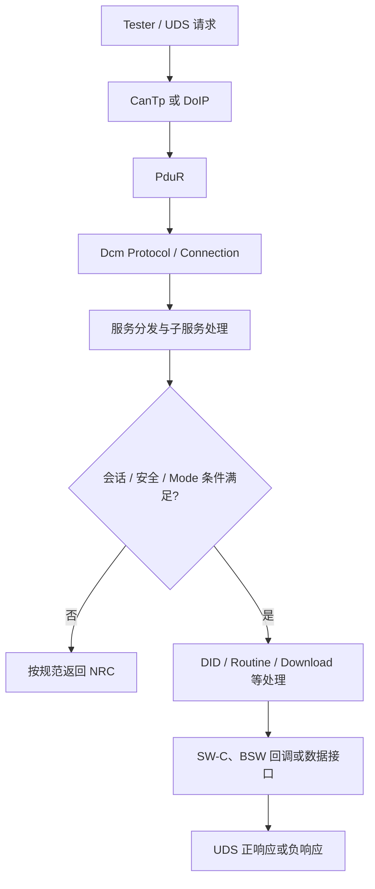

# Dcm 配置实战：Session、Security、DID 与 Routine

> 本文是配置检查框架，不替代项目采用的 AUTOSAR release、供应商工具手册或 OEM 诊断规范。DID、Routine ID、Session/Level 和访问条件必须以项目定义为准。

## 1. 诊断请求主链路

实际传输路径取决于 ECU 是否启用 CAN TP、DoIP 或其他诊断连接。Dcm 负责诊断服务处理，但传输层、PduR 路由、连接映射和应用回调仍需分别配置和验证。

## 2. 配置分层检查

| 配置域                   | 检查项                                             | 常见问题                                  |
| ------------------------ | -------------------------------------------------- | ----------------------------------------- |
| Protocol / Connection    | 协议、Rx/Tx PDU、连接与传输层映射                  | 请求到不了 Dcm，或响应发错连接            |
| Session                  | Default / Extended / Programming 等项目支持的会话  | 服务在错误会话中被允许或拒绝              |
| Security Access          | Security Level、Seed/Key 回调、尝试次数/延迟策略   | 解锁状态未更新、Key 算法或等级映射错误    |
| DID                      | DID 范围、读/写权限、长度、数据类型、数据接口/回调 | 长度不匹配、接口未绑定、会话条件遗漏      |
| Routine Control          | Routine ID、Start/Stop/Results 子功能、回调与状态  | ID 冲突、子功能不支持、执行结果未正确返回 |
| Mode / Access Conditions | 会话、安全等级、车辆模式、电压/车速等条件          | 访问条件依赖未配置或状态源不正确          |
| Error handling           | NRC、回调返回值、异步处理与超时                    | 所有失败都返回同一个 NRC，或异步任务超时  |
| Integration              | Dcm、PduR、CanTp/DoIP、应用接口联调                | 单模块配置正确但端到端路径不通            |

## 3. 推荐排障顺序

1. 用 CANoe 或等效测试工具确认请求是否真实到达总线，地址/寻址类型和报文格式是否正确。
2. 检查 CanTp/DoIP Rx 处理、PduR 路由和 Dcm Connection/Protocol 映射。
3. 先用项目明确支持的简单服务验证会话和连接，再逐步验证 DID、Security Access 和 Routine Control。
4. 对拒绝请求记录当前会话、安全等级、Mode 条件、服务/子功能和 NRC，不要只凭 NRC 猜测根因。
5. 检查 DID/Routine 回调是否被调用、输入长度是否正确、返回值是否映射为正确的 UDS 响应。
6. 对异步服务检查 pending 响应、完成回调、超时和取消路径。
7. 在配置生成后进行编译链接、静态检查、诊断用例和回归测试；保存 ARXML、工具版本和测试报告基线。

## 4. Security Access 的边界

- Seed/Key 算法和等级映射通常受 OEM 安全规范约束，不能用通用示例替代项目算法。
- 需要测试错误 Key、重复尝试、延迟/锁定、复位后状态、会话切换和授权失效。
- 不要把“当前会话是 Extended”当成“已经通过 Security Access”；两者是不同条件。
- 诊断安全访问也不自动等价于整个 ECU 的授权模型，相关服务仍需检查项目定义的条件。

## 5. 最小测试矩阵

| 测试                      | 期望验证                       |
| ------------------------- | ------------------------------ |
| 正确会话 + 允许服务       | 服务正常执行                   |
| 错误会话                  | 返回项目定义的 NRC             |
| 未解锁 / 错误 Key         | 访问被拒绝，安全状态与计数正确 |
| 未满足 Mode 条件          | 服务按定义拒绝或延迟           |
| DID 长度错误 / 不支持 DID | 长度与支持性错误处理正确       |
| Routine ID 或子功能不支持 | 返回正确的否定响应             |
| 回调返回失败 / 超时       | NRC、pending 与完成路径一致    |
| 多连接/多传输路径         | 请求与响应关联到正确连接       |

## 参考资料

- [AUTOSAR Classic Platform](https://www.autosar.org/standards/classic-platform/)
- [AUTOSAR 官方文档检索](https://www.autosar.org/search/)
- [AUTOSAR 1000问目录](README.md)
