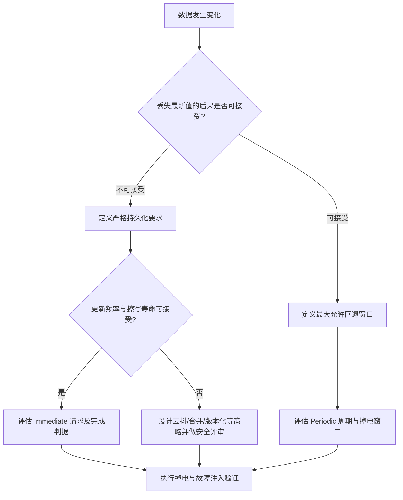

# NvM Immediate 与 Periodic 写入策略：设计与验证

## 1. 先区分请求、完成与持久化

调用 NvM 写入接口通常只是提交作业。具体 API 的同步/异步行为、队列处理和完成状态应按项目使用的 AUTOSAR 版本及供应商实现确认。不要把“API 已调用”或“请求已接受”直接当成“数据已物理持久化”。

## 2. 策略比较

| 维度 | Immediate 倾向 | Periodic 倾向 |
|---|---|---|
| 丢失后果 | 最新值丢失的后果严重，且允许立即请求写入 | 可接受有限窗口内的数据回退 |
| 更新频率 | 低频更新，单次变化值得保存 | 高频变化，合并写入有利于控制擦写压力 |
| 资源预算 | 需评估即时作业队列、调度干扰与关机预算 | 需评估周期、队列容量及掉电前剩余窗口 |
| 失败恢复 | 需定义请求失败、写入失败和重试策略 | 需定义周期写失败与下次周期处理策略 |

这不是“关键数据一律 Immediate”的通用规则。设计决策必须依据安全分析、数据一致性要求、更新频率、Flash endurance、写入耗时和系统调度预算。

## 3. 推荐决策流程

## 4. 实施时需要明确的内容

- **触发条件**：谁请求写入、何时请求、是否存在重复请求。
- **数据源**：写入使用当前 RAM Block，还是通过项目配置的回调获取镜像。
- **完成判据**：检查请求返回值、单块作业状态、底层存储错误和项目定义的最终完成条件。
- **关机配合**：EcuM/BswM 关机路径是否等待保存作业完成，最大等待预算是多少，超时如何处理。
- **耐久性**：按预期更新频率估算写入/擦除压力，避免高频参数变化导致写入风暴。
- **恢复策略**：校验失败、冗余副本损坏、默认值回退和版本迁移如何处理。

## 5. 必测故障场景

1. 修改 RAM 后未请求写入就复位。
2. 请求已提交但作业尚未开始时断电。
3. 底层写入进行中断电。
4. 写入完成后立即复位或断电。
5. 队列满、底层驱动失败、校验失败或重试耗尽。
6. 关机请求到来时仍有写入作业在途。
7. 高频连续更新同一 Block，观察排队、覆盖语义与存储耐久性。

每个测试应记录软件/配置版本、触发时刻、API 返回值、作业状态、底层错误、重启后数据和预期结果。

## 6. 参考资料

- [AUTOSAR CP NvRAM Manager Specification R25-11](https://www.autosar.org/fileadmin/standards/R25-11/CP/AUTOSAR_CP_SWS_NVRAMManager.pdf)
- [AUTOSAR CP NvRAM Manager Specification R24-11](https://www.autosar.org/fileadmin/standards/R24-11/CP/AUTOSAR_CP_SWS_NVRAMManager.pdf)
- [AUTOSAR Classic Platform](https://www.autosar.org/standards/classic-platform/)
