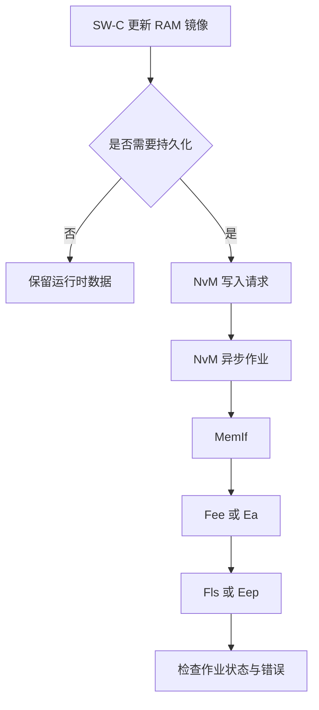

# NvM RAM、ROM Default 与 NV Block 数据模型

## 核心结论

NvM 管理的是逻辑非易失数据块。RAM Block 是运行时镜像，ROM Block 是可选默认数据来源，NV Block 是非易失保存的数据对象；它们不是三个等价的备份副本。实际块结构与启动恢复行为取决于配置。

## 数据流

该图是常见路径示意，不表示每个 ECU 都同时使用 Fee、Ea、Fls 和 Eep。

## RAM / ROM / NV 对照

| 对象      | 主要职责                           | 调试重点                                   |
| --------- | ---------------------------------- | ------------------------------------------ |
| RAM Block | 应用和 BSW 当前使用的数据          | 地址、写入时机、RAM 镜像是否与 NV 内容同步 |
| ROM Block | 配置提供的默认数据，可参与缺省恢复 | 默认值配置、有效 NV 数据缺失时的恢复策略   |
| NV Block  | 跨复位/掉电保存的数据              | 读写作业状态、底层存储、校验与冗余行为     |

## 排障步骤

1. 查看目标 NvM Block 的 RAM 地址、ROM 地址、NV Block 数量、管理类型、CRC/校验、默认值和初始化回调配置。
2. 核实启动流程中的 NvM 初始化与 ReadAll，以及项目要求的完成判据。
3. 同时观察 RAM 镜像、NvM 作业状态与 Fee/Ea/Fls/Eep 相关状态，不要只凭最终 RAM 数值判断数据来源。
4. 验证 RAM 修改后未写入即复位、写入排队时断电、写入中断电、写入完成后断电等边界。
5. 如果使用冗余、CRC 或默认值恢复，分别注入无效数据，确认恢复路径和诊断记录。

## Immediate 与 Periodic 策略提醒

不要仅凭“关键数据”标签机械地选 Immediate。要评估数据丢失后果、更新频率、Flash 擦写寿命、写入队列与调度能力、关机预算和可接受的数据回退窗口。调用写入 API 不代表数据已经物理持久化，必须按项目定义确认作业完成状态。

## 官方参考

- [AUTOSAR Classic Platform](https://www.autosar.org/standards/classic-platform/)
- [AUTOSAR CP NvRAM Manager Specification R25-11](https://www.autosar.org/fileadmin/standards/R25-11/CP/AUTOSAR_CP_SWS_NVRAMManager.pdf)
- [AUTOSAR CP NvRAM Manager Specification R24-11](https://www.autosar.org/fileadmin/standards/R24-11/CP/AUTOSAR_CP_SWS_NVRAMManager.pdf)
