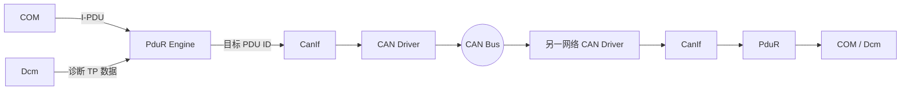
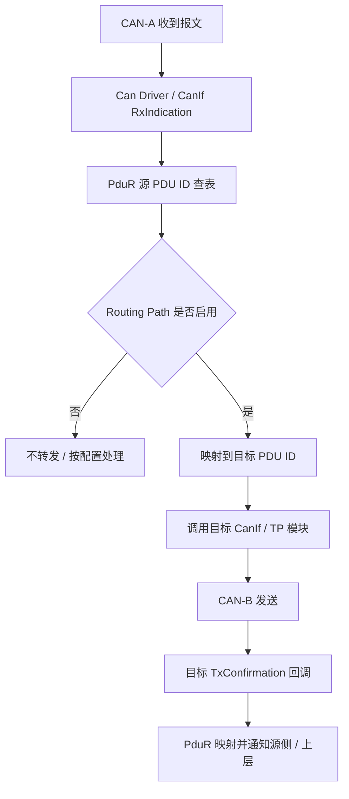

# AUTOSAR PduR 网关路由：Routing Path、PDU ID 映射与转发排查

> 适用范围：AUTOSAR Classic Platform；以 R24-11《Specification of PDU Router》为主要规范参考。项目实际行为还取决于所用 AUTOSAR Release、PduR 配置、生成器和供应商实现。
>
> 本文是工程解释与排查指南，不替代项目配置说明或规范条款。

## 1. 先理解 PduR 的职责

PduR（PDU Router）位于通信模块之间，按静态配置将 I-PDU 从源模块转发到一个或多个目标模块。它不是 CAN 驱动，也不负责解释 COM Signal 的业务含义。普通 I-PDU 路由通常不修改载荷；路由核心工作是查找路由配置、转换模块本地 PDU ID，并调用目标模块接口。

AUTOSAR R24-11 将 PduR 主要划分为：

- **Routing Paths / Routing Tables**：描述每条 I-PDU 路由的源、目标及路由属性。
- **PduR Engine**：执行实际路由、源/目标 PDU ID 转换，以及相应的确认/接收回调转发。

## 2. PduR 在通信栈中的位置

典型的信号报文路径是 COM → PduR → CanIf → Can Driver；接收方向反向经过 CanIf → PduR → COM。诊断 TP 路径会涉及 Dcm、CanTp、CanIf，不能把所有路径都简化成 COM 路径。

## 3. Routing Path 是什么

一条 Routing Path 可理解为“源 PDU 到目标 PDU 的静态映射规则”。配置中通常要能回答：

1. 谁是源模块（例如 COM、CanIf、CanTp、Dcm）？
2. 源模块使用哪个本地 PDU ID？
3. 目标模块是谁（例如 CanIf、COM、CanTp）？
4. 目标模块对应哪个本地 PDU ID？
5. 是单播还是一对多？是否属于 TP 路由？
6. 是否受 Routing Path Group / routing activation 控制？
7. 对 TP 网关而言，使用什么缓冲策略与资源限制？

**重要：PDU ID 是模块接口边界上的本地标识，不应假设源模块 ID、PduR 内部 ID、目标模块 ID 数值相同。** PduR 根据配置表完成转换。排查时要沿着模块边界逐个核对，而不是只搜索一个数字。

## 4. 普通 I-PDU 路由与 TP 网关的区别

| 维度 | 普通 I-PDU 路由 | TP 路由 / 网关 |
|---|---|---|
| 数据模型 | 通常一次转发一个 I-PDU | StartOfReception、CopyRxData、CopyTxData、TpRxIndication 等分段交互 |
| 数据完整性 | 典型路由不解析、不改写载荷 | 需要管理分段数据和接收/发送状态 |
| 缓冲 | 取决于路由类型及配置 | 网关可能需要专用缓冲，或按请求提供数据 |
| 时序 | 受触发发送、目标模块和总线调度影响 | 受流控、块大小、STmin、超时及缓冲资源影响 |
| 典型场景 | COM 报文跨总线转发 | CAN 诊断请求经网关转发到另一 CAN 网络 |

不要把 TP 网关的缓冲机制套用到普通 COM I-PDU，也不要假设所有 TP 路由都必须完整缓存整帧；AUTOSAR PduR 规范描述了 on-the-fly gatewaying 等处理方式，具体支持能力应检查版本和实现。

## 5. 一对多与跨 CAN 网络网关

假设 ECU 有 CAN-A 和 CAN-B 两个网络：接收 CAN-A 上的源 PDU 后，PduR 根据 Routing Path 将其转发到 CAN-B 上配置的目标 PDU。

需要特别检查：

- 源、目标 PDU 的长度、DLC、动态长度能力和目标总线约束是否兼容。
- 是否存在一对多路由；多个目标的发送失败是否会被分别处理。
- Routing Path Group 是否在当前模式下启用。
- 目标网络是否处于可通信状态，CanIf Tx PDU 是否可用。
- 是否存在网关环路（A→B 同时 B→A）或重复转发。
- 信号级网关（例如 COM Signal Gateway）与 PDU 级透明转发不是同一层面的功能，确认项目究竟使用哪一种。

## 6. 关键配置对象检查表

不同工具的参数名和树结构可能不同，建议按语义检查，而不是照搬某个供应商界面名称。

| 检查对象 | 要核对的内容 | 常见错误 |
|---|---|---|
| Source PDU | 源模块、源 PDU 引用、方向 | 引用了错误的 CanIf Rx PDU 或 COM I-PDU |
| Destination PDU | 目标模块、目标 PDU 引用、方向 | 目标 PDU ID 指向另一报文 |
| Routing Path | 源到目标的关联关系 | 路径缺失、方向配置反了 |
| Routing Path Group | 默认状态、启停控制、所属路径 | 路径存在但组未激活 |
| TP Gateway Buffer | 缓冲大小、数量、对齐及并发容量 | 高负载时资源不足 |
| Module API mapping | 生成的源/目标回调及 ID 表 | 目标模块回调未连接或宏未启用 |
| PDU Length | 固定/动态长度与最大长度 | 源长度超过目标能力或配置长度不匹配 |
| Variant / Post-Build | 当前选择的配置集 | 修改了未被 ECU 实际选择的变体 |

## 7. 从现象定位故障

| 现象 | 优先检查 | 观测证据 |
|---|---|---|
| 源总线能收到，目标总线无报文 | 源 Rx PDU ID、Routing Path、Group 状态、目标 Tx PDU | CanIf RxIndication、PduR 路由入口、CanIf_Transmit 返回值 |
| 目标发出了错误报文 | 目标 PDU 引用、ID 映射、载荷长度 | 目标 PDU 配置、发送缓冲区、CANoe Trace |
| 只在某模式下不转发 | Routing Path Group、BswM/模式控制 | Group 启停调用、模式切换时间线 |
| 小负载正常、大负载丢失 | TP Buffer、并发数、队列/资源配置 | Buffer 请求结果、TP 回调返回值、DET |
| 偶发重复报文 | 多目标配置、双路径、网关环路 | 源/目标总线 Trace 时间戳和 PDU ID |
| 回调未到上层 | TxConfirmation/RxIndication 的目标映射 | CanIf、PduR、COM/Dcm 回调逐层打点 |

## 8. 推荐调试顺序

1. 在 CANoe 或总线日志中确认源报文真实到达，记录时间戳、CAN ID、DLC 和载荷。
2. 在 CanIf 接收入口确认命中的 Rx PDU 配置和本地 PDU ID。
3. 在 PduR 入口确认实际传入的源 PDU ID。
4. 查生成的 PduR Routing Path 表，确认源 ID 命中哪条路径、目标 ID 是什么。
5. 确认路径组状态、当前变体和路由启用状态。
6. 在目标模块入口确认目标 ID 与长度；若调用 CanIf_Transmit，记录返回值。
7. 在目标总线上确认报文是否发出；随后检查确认回调是否按目标→源映射返回。
8. 若是 TP 网关，额外跟踪 StartOfReception、CopyRxData、CopyTxData、TxConfirmation / TpRxIndication 等回调及缓冲资源。

## 9. 最小回归测试集

- 单条有效路由：源报文只到达预期目标。
- 无效源 ID：不得误命中其他 Routing Path。
- 路径组关闭/开启：分别验证不转发与恢复转发。
- 一对多：每个目标均收到预期内容，独立检查发送结果。
- 长度边界：最小、标称、最大长度及不支持长度。
- 高负载/并发：检查 TP Buffer、资源耗尽与错误上报。
- 双向路径：验证不存在意外环路和重复转发。
- 变体切换：确认实际 ECU 选中的配置表与预期一致。
- 回调链：确认发送确认和接收指示映射到正确上层 PDU。

## 10. 规范与资料

- [AUTOSAR CP R24-11 — Specification of PDU Router](https://www.autosar.org/fileadmin/standards/R24-11/CP/AUTOSAR_CP_SWS_PDURouter.pdf)
- [AUTOSAR CP R24-11 — Requirements on Gateway](https://www.autosar.org/fileadmin/standards/R24-11/CP/AUTOSAR_CP_RS_Gateway.pdf)

> 工程提示：配置工具中显示的 PDU 名称、生成代码中的符号名和运行时 PDU ID 可能不是同一个概念。最终以当前工程生成的配置表、头文件宏、调用点和总线 Trace 相互印证。
