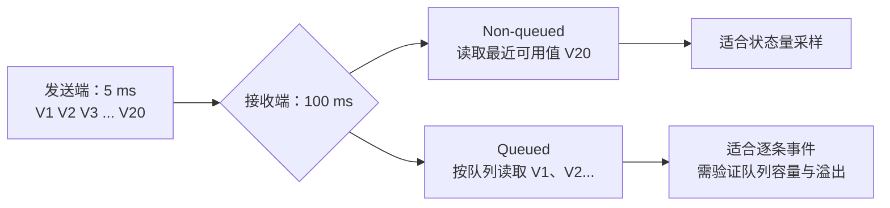

# RTE Buffer 与数据一致性：Queued / Non-queued 工程排查

> 适用范围：AUTOSAR Classic Platform 的 Sender-Receiver（S/R）通信。本文是工程实践指南；最终行为应以项目采用的 AUTOSAR 版本、ARXML、RTE 生成器和供应商实现为准。

## 先记住三个结论

1. **Non-queued 是最新值语义（last-is-best）**：新值可以覆盖尚未读取的旧值，适合周期采样量，例如车速、温度、开关状态。
2. **Queued 是事件/历史项语义**：新到的数据进入接收队列，未读取项不会被新值简单覆盖；适合需要逐条处理的事件或命令，但必须配置并验证队列长度与溢出处理。
3. **数据一致性、数据新鲜度和事件完整性是三件事**：一致性关注一次读取是否得到自洽的数据；新鲜度关注值是否过期；事件完整性关注每一条事件是否都被处理。不要用 queued/non-queued 选择替代其他两类设计。

## 1. 两种缓冲语义对比

| 维度 | Non-queued | Queued |
|---|---|---|
| 主要语义 | 最新值优先 | 按队列逐项消费 |
| 连续写入多次、接收端未读取 | 中间值可能被覆盖 | 未读项按队列保留，直到队列容量限制 |
| 典型用途 | 车速、温度、踏板位置、周期状态量 | 事件、命令、需要逐项处理的通知 |
| 接收 API（常见形式） | Rte_Read；也可能使用隐式读取 API | Rte_Receive（显式队列读取） |
| 发送 API（常见形式） | Rte_Write；也可能使用隐式写入 API | Rte_Send |
| 关键风险 | 接收端看到旧值；误把采样数据当事件 | 队列积压、队列满、延迟增加、容量配置不足 |
| 配置关注点 | 初始值、更新标志、数据一致性机制、超时/新鲜度策略 | queueLength、消费速率、队列满时行为、返回状态与恢复策略 |

> API 名称和可用性可能随接口、数据访问方式及 RTE 生成配置变化；以生成的 Rte_* 头文件为准。

## 2. 5 ms 发送、100 ms 接收：应该选哪一种？

假设发送端每 5 ms 更新一次，接收端每 100 ms 执行一次：

- **如果它是周期状态量**（例如当前车速），通常选 non-queued。接收端每次执行时读到最近可用值，约 20 次发送中大部分中间值不会被逐条消费。这是“采样最新状态”，不是丢失故障。
- **如果每一次发送都代表一个必须处理的事件**（例如计数脉冲、订单、边沿事件），不能只依赖 non-queued。应评估 queued 语义，并确保接收端长期处理能力足够、队列长度覆盖允许的突发量。
- 队列并不能解决持续的速率失配：发送平均速率高于接收平均处理速率时，积压会不断增长，最终达到容量限制。应调整周期、分批消费、背压/流控或定义明确的丢弃策略。

### 简单时间线

时间线仅用于说明语义；实际值取决于任务相位、数据可见时刻、RTE 生成方式和调度。

## 3. 数据一致性：不要把“读到新值”误当成“读到一致值”

当发送和接收 Runnable 可抢占、跨任务或跨核运行时，要确认 RTE 采用的具体一致性机制。目标是避免读取到同一数据对象的混合状态，或在一次 Runnable 执行期间因重复读取而得到意外变化的结果。

检查顺序：

1. **数据类型与访问粒度**：32 位数据是否在目标 MCU 上自然对齐；复合结构体是否需要整体一致性保护。不能仅凭“32 位 CPU”推断所有访问都原子。
2. **隐式/显式访问模式**：若 Runnable 内多次读取同一输入，且要求本次执行使用同一快照，检查是否应使用 implicit access（例如生成器提供的 Rte_IRead 类 API）。隐式访问的确切快照边界按 RTE 规范及实现确认。
3. **共享数据和跨核路径**：查看生成代码是否经共享缓冲、OS 资源、IOC 或供应商专用机制；不要用 `volatile` 替代同步、互斥或原子性保证。
4. **复合数据一致性**：若多个字段必须属于同一时刻（例如位置 + 时间戳 + 状态），设计明确的快照/版本号/一致性机制，不能只验证每个字段都能读。
5. **查看生成代码**：检查 Rte_Read/Rte_IRead 实际展开、缓冲区、临界区、复制逻辑、IOC 调用及返回状态。生成代码是实现证据，不能只看 ARXML。

## 4. 新鲜度、更新标志与超时

Non-queued 通信常常让接收端拿到“当前缓冲里的值”，但这不必然说明数据刚刚更新。建议按需求明确以下策略：

- 使用适用的更新状态接口（例如生成器支持时的 Rte_IsUpdated_*）判断自上次读取以来是否更新。
- 用时间戳或接收超时监控定义数据最大允许年龄；数据超时后的行为应由需求定义，例如保持上次有效值、切换降级值、置无效状态或触发故障反应。
- 区分“没有更新”“读 API 报错”“值本身无效”和“数据过期”，避免都映射成同一个默认值。
- 若使用 COM 信号超时监控，还要区分网络侧 COM 超时与 SW-C/RTE 本地数据新鲜度要求；两者检测位置和触发条件可能不同。

## 5. 常见故障矩阵

| 现象 | 优先检查 | 验证办法 |
|---|---|---|
| 接收端总读到旧值 | Sender Runnable 是否执行、写 API 返回值、端口连接、RTE 更新路径 | 在发送写入点、生成 RTE 缓冲和接收读取点记录序号/时间戳 |
| 接收端只看到最新值，中间值没了 | 数据元素是否为 non-queued；需求是否真的要求逐条消费 | 连续发送带递增序号的数据，检查接收端是否跳号 |
| 队列延迟越来越大 | 发送/消费速率、队列长度、Runnable 执行时间 | 记录队列积压趋势，比较长期平均生产率与消费率 |
| 偶发读到不一致的复合数据 | 跨任务/跨核访问、隐式/显式访问、临界区/IOC、数据结构对齐 | 用字段版本号和时间戳做压力测试，并检查生成代码 |
| 超时后仍使用旧数据 | 超时检测是否配置、错误状态是否传播、应用是否忽略状态 | 停止发送端，确认在需求规定时间内进入降级路径 |
| 队列满后事件丢失或发送失败 | queueLength、Rte_Send 返回值、队列满策略和上层恢复设计 | 用高于消费速率的突发输入压测并检查每次返回值 |

## 6. 配置与代码审查清单

- [ ] 在 Sender-Receiver Interface / DataElement 上确认 swImplPolicy 语义；不要仅从端口名字推断。
- [ ] 在 ARXML 中核对 P-Port、R-Port、Assembly Connector、DataElement 类型和连接关系。
- [ ] 对 queued 数据确认队列长度配置来源、生成值和队列满时行为；检查 Rte_Send 等 API 的返回状态。
- [ ] 对 non-queued 数据明确“最新值”是否满足需求；若需要逐条事件，重新审视接口语义。
- [ ] 明确 Runnable 周期、触发事件、优先级、核映射和最坏执行时间。
- [ ] 明确输入快照、一致性、更新标志、数据超时和无效值的处理规则。
- [ ] 检查生成的 RTE API、缓冲、临界区、IOC/跨核路径，而不只是模型配置。
- [ ] 进行速率失配、队列满、无数据、旧数据、跨核并发和异常返回值测试。
- [ ] 记录 AUTOSAR release、RTE 生成器/供应商版本、配置文件版本、测试条件和可复现证据。

## 7. 结论

选择规则可以简化为：**要最新状态，优先评估 non-queued；要逐条事件，评估 queued；要保证数据自洽、及时和有效，还必须分别设计一致性、新鲜度与错误处理。** 最终配置必须与系统需求、接收消费能力和生成代码共同验证。

## 参考资料

- [AUTOSAR Classic Platform — Specification of RTE Software, R24-11](https://www.autosar.org/fileadmin/standards/R24-11/CP/AUTOSAR_CP_SWS_RTE.pdf)
- [MathWorks — Configure AUTOSAR Queued Sender-Receiver Communication](https://www.mathworks.com/help/autosar/ug/configure-autosar-queued-sender-receiver-communication.html)
- [MathWorks — Configure AUTOSAR Sender-Receiver Communication（IsUpdated 等 QoS 属性）](https://www.mathworks.com/help/autosar/ug/configure-autosar-sender-receiver-communication.html)

> 参考资料用于核对概念；具体队列长度、返回码、缓冲实现与 API 细节必须按项目所用规范版本和供应商 RTE 生成代码确认。
