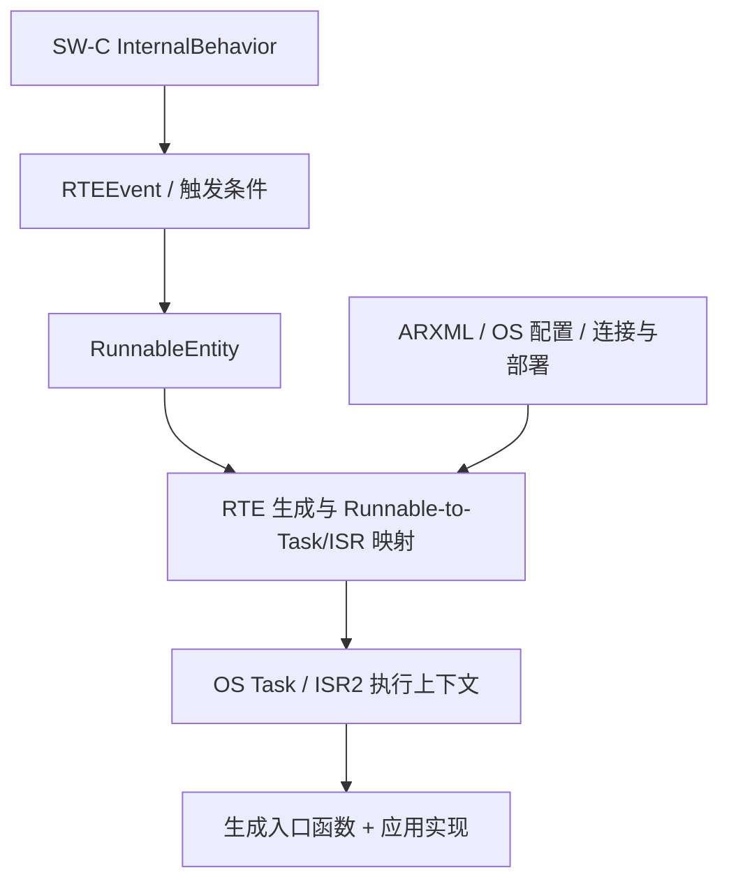
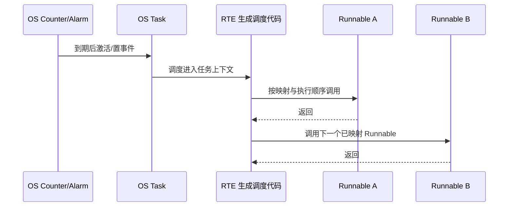
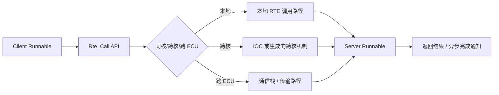
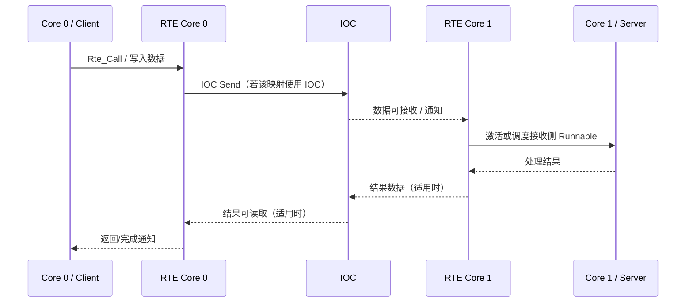

# AUTOSAR 1000 问｜RTE Event、Runnable 调度与跨核 IOC 实战

> 适用范围：AUTOSAR Classic Platform。本文解释通用模型与常见生成路径；具体事件类型、API、调度约束和生成代码以项目采用的 Release、RTE/OS 生成器及供应商实现为准。

## 1. 先区分三个概念

- **RunnableEntity**：SW-C 内部的执行单元，最终由生成的入口函数实现。
- **RTEEvent**：描述什么条件触发 Runnable，例如周期到期、接收数据、服务操作被调用或模式切换。
- **OS Task / ISR2**：承载执行的 OS 上下文。Runnable 通常不是独立线程；RTE 根据映射和生成策略把它连接到任务或中断上下文。

排查 Runnable 没有执行时，不要一开始只盯着 C 函数。沿着 **事件配置 → 端口/接口与连接 → Runnable → 任务映射 → OS 激活/调度 → 生成代码 → 运行时观测** 逐层核对。

## 2. 常见 RTEEvent 的含义与检查点

| 事件类型 | 典型触发条件 | 关键检查点 |
|---|---|---|
| TimingEvent | 周期/时间条件到达 | 周期值、单位、映射的 OS Task、Alarm/Counter、任务优先级与 WCET |
| DataReceivedEvent | Sender-Receiver 接收端满足接收事件条件 | Receiver Port、DataElement、连接关系、数据更新语义、接收缓冲/队列和事件映射 |
| OperationInvokedEvent | Client-Server 操作调用到达服务器侧 | Client/Server Interface、Operation、Server Runnable、同步/异步语义、参数与返回值 |
| SwcModeSwitchEvent | 相关模式切换满足配置条件 | ModeDeclarationGroup、ModeSwitchPoint、模式来源、切换条件与重入行为 |
| InitEvent | SW-C/RTE 初始化阶段的配置条件 | 初始化顺序、初始化 Runnable、所依赖 BSW 服务是否已可用 |
| InternalTriggerOccurredEvent | 组件内部触发条件被触发 | InternalTriggeringPoint 与目标事件的配对、重触发/排队语义和生成器限制 |
| BackgroundEvent | 后台执行条件（是否支持及具体语义依版本/工具） | 工具支持情况、执行上下文、是否可能被其他高优先级活动抢占 |

不是每一种事件在每个工具、每个版本或每个 SW-C 模型里都以完全相同方式支持。先检查项目采用的 AUTOSAR Release 与生成器限制，再依据生成的 RTE/OS 配置确认实际机制。

## 3. TimingEvent：周期配置不等于真实周期

周期 Runnable 的实际启动时间通常受以下因素共同影响：

1. TimingEvent 周期及相位配置；
2. RTE Generator 生成的周期触发机制；
3. OS Counter、Alarm 或等效调度机制；
4. 任务优先级、抢占关系、资源锁与临界区；
5. 同一任务内其他 Runnable 的执行时间与执行顺序；
6. 中断负载、跨核通信和运行时负载。

### 实测建议

- 用 Trace 或 GPIO 翻转测量 Runnable 的启动时刻与执行时间；避免只用 printf，因为日志本身会改变时序。
- 同时记录预期周期、实际启动间隔、最大执行时间、抖动、任务激活次数和 deadline miss。
- 如果同一 OS Task 内有多个 Runnable，检查组件/模型层执行顺序约束；不要假设它们必然按 ARXML 文件顺序执行。
- 如果多个 Runnable 映射到不同任务，继续检查任务优先级、抢占和共享资源保护。

## 4. DataReceivedEvent：收到数据后为什么没有触发？

建议按顺序核对：

1. **接口建模**：Receiver Port、Sender-Receiver Interface、DataElement 是否一致。
2. **系统连接**：Sender 与 Receiver 是否通过正确的 Assembly/Delegation Connector 连接。
3. **部署与映射**：组件是否部署到目标 ECU，RTE 是否为对应连接生成了实现。
4. **数据语义**：检查 implicit/explicit receive、数据有效性、更新标志、超时和队列配置。
5. **事件关联**：DataReceivedEvent 是否关联到预期 Runnable，相关 DataElement 是否满足事件条件。
6. **任务映射**：Runnable 是否映射到有效任务，任务是否被激活并获得运行机会。
7. **生成代码与运行时证据**：检查 RTE 接收 API、回调/事件置位代码、OS Task 入口和实际接收数据。

注意：**数据可读、数据发生更新、Runnable 被触发是三个不同的判断**。在非排队通信中，多次更新可能被最新值覆盖；排队通信则需要关注队列深度、溢出和读取策略。具体语义需查对应 API 与配置。

## 5. OperationInvokedEvent：Client-Server 调用链

典型概念路径如下：

检查点：

- Client/Server Port 与 Operation 是否一致，参数类型、方向和返回值是否匹配；
- 服务端 Runnable 是否关联 OperationInvokedEvent；
- 同步调用是否可能阻塞调用方，是否符合实时性预算；
- 异步调用是否正确配置完成事件、结果读取和超时处理；
- 是否允许服务器 Runnable 并发调用；如果允许，应用数据与共享资源是否线程安全；
- 对跨核/跨 ECU 调用，检查生成的通信机制和错误/超时路径。

## 6. 跨核通信与 IOC：何时出现、怎么排查？

当 SW-C 分布在不同 OS-Application 或不同 Core 上时，RTE 需要遵循系统映射和 OS 配置来实现数据传递。跨核 client-server 或相关通信场景中，生成代码可能使用 IOC（Inter-OS-Application Communication）传递参数/数据并通知接收侧；实际采用的路径依赖具体映射、通信语义和生成器。

跨核排查清单：

- 检查 SW-C 到 Core、OS-Application、Task 的映射是否一致；
- 检查 OS IOC 配置、队列/缓冲区、接收侧通知和错误返回处理；
- 确认跨核数据是否需要复制、是否存在一致性/同步约束，以及队列满时的处理策略；
- 检查两个核的任务优先级、激活条件、时钟/Trace 时间基准和负载；
- 在生成代码中搜索项目实际的 IocSend、IocReceive 或相应供应商封装，不要假设所有 RTE 都使用相同函数名；
- 对 client-server 调用，检查调用参数、返回数据、超时与错误传播是否完整；
- 做压力测试和边界测试：高频调用、队列满、接收侧暂时不运行、超时及错误恢复。

IOC 是 OS 层面的跨 OS-Application 通信机制，不应简单等同于所有 RTE 通信。普通同核 SW-C 通信可能使用直接调用、共享数据或其他生成方式；跨 ECU 通信则通常涉及通信栈。

## 7. Runnable 顺序、并发与数据一致性

- **顺序约束**：同一组件中的 Runnable 可能有执行顺序约束；要同时检查模型、Timing Extensions/ARXML、工具调度设置和最终生成结果。
- **并发调用**：Server Runnable 的并发调用能力受配置和实现限制。若同一 Runnable 可能并发执行，不要默认静态局部变量、共享缓冲区或全局状态安全。
- **Inter-Runnable Variables（IRV）**：用于同一 SW-C 内 Runnable 之间交换数据；需检查访问顺序、读写时刻和数据一致性。
- **Exclusive Area / OS Resource**：可能用于保护共享数据，但锁的范围、优先级影响和死锁风险需要验证。
- **多核可见性**：跨核通信不能只靠 volatile 解决。应使用配置的通信/同步机制，并遵守平台内存模型与 OS/MCAL 约束。

## 8. 故障定位决策表

| 现象 | 首要检查 | 进一步证据 |
|---|---|---|
| 周期 Runnable 从不执行 | TimingEvent、任务映射、OS 激活配置 | 生成的任务入口、Alarm/Counter、OS Trace |
| Runnable 周期漂移 | 任务优先级、执行时间、抢占和临界区 | 启动间隔直方图、WCET、ISR 负载 |
| 数据更新但事件不触发 | DataReceivedEvent、连接、更新语义、事件映射 | RTE 生成代码、接收状态、OS 事件/任务激活 |
| Client 调用后服务端不执行 | OperationInvokedEvent、Server Runnable、路由映射 | Rte_Call 返回值、跨核 IOC、服务端任务 Trace |
| 跨核调用偶发失败 | IOC 缓冲/队列、通知、并发和超时配置 | 队列错误码、双核 Trace、负载压力测试 |
| 同一 Runnable 数据偶发错乱 | 并发调用、共享变量、IRV 与保护区 | 任务/核映射、访问时序、竞态复现测试 |

## 9. 验收清单

- [ ] 每个 Runnable 的触发条件、接口依赖和映射都有明确记录。
- [ ] TimingEvent 的周期、相位、启动间隔和执行时间经过测量。
- [ ] DataReceivedEvent 与 OperationInvokedEvent 都有正向和负向测试。
- [ ] 同核、跨核或跨 ECU 的实际路径已通过生成代码/配置确认。
- [ ] 并发、超时、队列满、数据无效和接收侧延迟均有测试结果。
- [ ] 记录项目 AUTOSAR Release、RTE/OS 工具版本、生成配置和测试证据。

## 10. 官方参考

- [AUTOSAR Classic Platform](https://www.autosar.org/standards/classic-platform)
- [AUTOSAR Specification of RTE Software（R24-11）](https://www.autosar.org/fileadmin/standards/R24-11/CP/AUTOSAR_CP_SWS_RTE.pdf)
- [AUTOSAR Specification of Operating System（R24-11）](https://www.autosar.org/fileadmin/standards/R24-11/CP/AUTOSAR_CP_SWS_OS.pdf)

> 规范文件可用于核对标准语义，但项目调试结论还应结合实际 ARXML、工具版本、生成代码、OS 配置和可复现测试记录。
