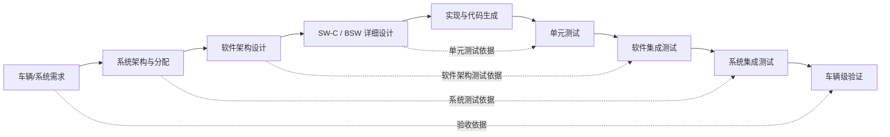

# AUTOSAR 方法论中的 V 模型开发流程

## 1. 一句话理解

V 模型把“从需求逐层分解到实现”的左侧活动，与“从单元到系统逐层验证”的右侧活动对应起来。左侧定义要构建什么，底部实现软件，右侧用测试证据证明实现满足需求。

## 2. 典型映射

这是项目级示意图；各 OEM、Tier 1 和 ASPICE 过程定义中的阶段命名、交付物与测试分层可能不同。

## 3. AUTOSAR 项目里的常见活动

| V 模型阶段     | AUTOSAR 相关活动/工件                        | 典型检查                             |
| -------------- | -------------------------------------------- | ------------------------------------ |
| 系统需求       | 功能需求、诊断/通信/安全约束                 | 需求可追踪、可验证                   |
| 系统架构       | ECU 分配、网络拓扑、系统信号与通信矩阵       | 信号归属、时序和接口一致             |
| 软件架构       | SW-C、Composition、Port、Interface、Runnable | 接口方向、数据类型、事件定义         |
| 详细设计与配置 | ARXML、BSW 配置、OS 任务/中断、内存映射      | 引用关系、变体、模块依赖             |
| 实现           | 手写 SW-C、生成 RTE/BSW 代码、编译链接       | 生成物与配置基线一致                 |
| 单元验证       | SW-C 单元测试、静态分析、覆盖率              | 边界条件、异常路径、接口桩           |
| 软件/BSW 集成  | RTE、通信栈、诊断、NvM、EcuM 等联调          | 初始化顺序、时序、返回值和错误传播   |
| 系统集成/验证  | ECU 与总线、跨 ECU 功能、HIL/SIL             | 端到端链路、故障注入、性能与安全需求 |

## 4. 最重要的工程习惯

1. **双向追踪**：每项需求都能追踪到设计、实现和测试；每个测试也能回溯到需求或风险。
2. **配置也是工程基线**：ARXML、工具版本、配置参数、生成器版本和生成代码要作为一组可复现的基线管理。
3. **尽早验证接口**：在集成前检查 Port/Interface、PDU 映射、Runnable 触发条件和 OS 任务分配。
4. **测试不只看“通过”**：保留测试环境、软件版本、配置版本、日志、覆盖率和失败分析证据。
5. **变更做影响分析**：需求、ARXML 或 BSW 配置变更后，判断哪些生成物、集成测试和回归测试需要重跑。

## 5. 常见误区

- 把 V 模型理解成只能严格单向瀑布推进；实际项目可以迭代，但追踪和验证责任不能丢。
- 认为代码生成后就完成软件开发；配置校验、编译、集成、测试和证据仍然必要。
- 只在右侧测试阶段才开始考虑测试；左侧设计时就应定义可验证条件和测试依据。
- 把 ASPICE 与 AUTOSAR 当成同一个标准：AUTOSAR 主要定义汽车软件架构/接口/模块规范；ASPICE 关注过程能力和工程实践，两者可在项目中协同。

## 参考

- [AUTOSAR Classic Platform](https://www.autosar.org/standards/classic-platform/)
- [AUTOSAR 官方文档检索](https://www.autosar.org/search/)
- [GitHub：AUTOSAR 1000问目录](README.md)
