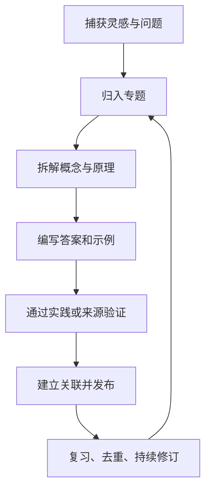

# LIKUI · 知识图谱

> **持续积累，持续连接，持续创造。**  
> 一个以 Markdown 为载体、以问题为入口、以关联和实践为驱动的个人知识花园。

## 从这里开始

-   :material-compass-outline: **1000 问知识体系**

    ---

    从问题出发，建立知识地图、分卷目录、来源追踪与答案验证流程。

    [进入知识总目录](1000-questions/README.md)

-   :material-car: **汽车电子与 AUTOSAR**

    ---

    覆盖 Classic AUTOSAR、RTE/SWC、通信栈、诊断、NvM、OS 与集成排障。

    [进入 AUTOSAR 专题](1000-questions/autosar/README.md)

-   :material-chip: **嵌入式系统**

    ---

    从 MCU、外设和内存，到 RTOS、Bootloader、嵌入式 Linux 与调试。

    [进入嵌入式专题](1000-questions/embedded/README.md)

-   :material-code-braces: **编程与人工智能**

    ---

    通过 C 语言、AI 与大模型问题库，构建可复用的学习路径。

    [C 语言](1000-questions/c-language/README.md) · [AI 1000 问](1000-questions/ai/README.md)

-   :material-function-variant: **数学与系统架构**

    ---

    整理考研数学、概率论、软考与系统架构师相关问题。

    [数学](1000-questions/math/README.md) · [概率论](1000-questions/probability/README.md) · [软考](1000-questions/soft-exam/README.md)

-   :material-book-open-page-variant: **历史、教育与工程工具**

    ---

    将通识探索与 MATLAB / Simulink、电气工程学习内容纳入同一套知识导航。

    [历史](1000-questions/history/README.md) · [教育](1000-questions/child-education/README.md) · [MATLAB](1000-questions/matlab/README.md) · [电气工程](1000-questions/electrical/README.md)

## 知识如何生长

## 内容原则

- **来源可追溯**：保留原始笔记、参考资料和上下文。
- **问题可连接**：通过专题索引和相对路径链接形成知识网络。
- **结论可验证**：区分待整理、初稿、已复核与已验证内容。
- **结构可扩展**：每个专题维护独立页面，避免单页无限膨胀。
- **内容可迁移**：优先使用 Markdown，便于 GitHub 浏览和 MkDocs 构建。

> 本知识库持续演进中。专题入口不代表所有问题均已回答；每份内容以页面中的来源、状态和验证记录为准。
