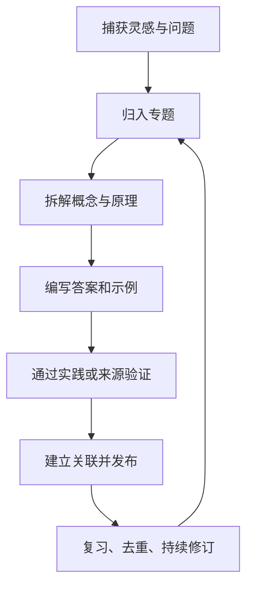

# LIKUI · 知识图谱

> **持续积累，持续连接，持续创造。**  
> 一个以 Markdown 为载体、以问题为入口、以关联和实践为驱动的个人知识花园。

---

## 从这里开始

| 专题 | 内容简介 | 入口 |
|---|---|---|
| **1000 问知识体系** | 以问题驱动学习，建立知识地图、分卷目录、来源追踪与答案验证流程。 | [知识总目录](1000-questions/README.md) |
| **汽车电子与 AUTOSAR** | Classic AUTOSAR、RTE/SWC、通信栈、诊断、NvM、OS 与集成排障。 | [AUTOSAR 专题](1000-questions/autosar/README.md) |
| **嵌入式系统** | MCU、外设、内存、中断、RTOS、Bootloader、嵌入式 Linux 与调试。 | [嵌入式专题](1000-questions/embedded/README.md) |
| **C 语言** | 语言基础、指针、内存、编译链接、未定义行为、嵌入式 C 与工程实践。 | [C 语言专题](1000-questions/c-language/README.md) |
| **AI 与大模型** | AI 基础、大语言模型、RAG、Agent、部署与 AI 辅助知识管理。 | [AI 1000 问](1000-questions/ai/README.md) |
| **数学** | 高等数学、线性代数、概率论、统计学与典型问题。 | [考研数学](1000-questions/math/README.md) · [概率论](1000-questions/probability/README.md) |
| **软件架构** | 操作系统、网络、数据库、架构设计与软考相关问题。 | [软考与系统架构](1000-questions/soft-exam/README.md) |
| **历史与教育** | 历史专题探索、儿童发展、亲子沟通与教育问题。 | [历史](1000-questions/history/README.md) · [儿童教育](1000-questions/child-education/README.md) |
| **工程工具与电气** | MATLAB / Simulink 与电气工程学习问题。 | [MATLAB](1000-questions/matlab/README.md) · [电气工程](1000-questions/electrical/README.md) |

## 知识如何生长

## 内容原则

- **来源可追溯：** 保留原始笔记、参考资料和上下文。
- **问题可连接：** 通过专题索引和相对路径链接形成知识网络。
- **结论可验证：** 区分待整理、初稿、已复核与已验证内容。
- **结构可扩展：** 每个专题维护独立页面，避免单页无限膨胀。
- **内容可迁移：** 优先使用 Markdown，便于 GitHub 浏览和 MkDocs 构建。

> 本知识库持续演进中。专题入口不代表所有问题均已回答；每份内容以页面中的来源、状态和验证记录为准。
