# 文档知识图谱

> 由 GitHub Actions 自动生成。图谱从 docs/ 下的 Markdown 文件及其站内链接提取；修改文档后会自动更新。

- **文档数量：** 57
- **站内关联：** 53
- **阅读方式：** 下方图谱展示文档之间的站内链接关系；文档索引可直接打开原文。

## 知识关系图

```mermaid
flowchart LR
  n_about_about_md_a65cf4b7fe["about · about/about.md"]
  n_cs_Web___md_1a2ede6398["Web开发 · cs/Web开发.md"]
  n_cs______md_a4b5a17244["人工智能 · cs/人工智能.md"]
  n_cs______md_696674bd75["体系结构 · cs/体系结构.md"]
  n_cs______md_c1703d79d9["好书推荐 · cs/好书推荐.md"]
  n_cs__________md_5b41add0f1["并行与分布式系统 · cs/并行与分布式系统.md"]
  n_cs______md_ae1d123847["1 必学工具 · cs/必学工具.md"]
  n_cs______md_863728f381["操作系统 · cs/操作系统.md"]
  n_cs______md_40f27042c2["数学基础 · cs/数学基础.md"]
  n_cs______md_e935b9accf["数学进阶 · cs/数学进阶.md"]
  n_cs_______md_cdcc1cd108["数据库系统 · cs/数据库系统.md"]
  n_cs______md_9ab4480888["数据科学 · cs/数据科学.md"]
  n_cs_________md_e80143a50c["数据结构与算法 · cs/数据结构与算法.md"]
  n_cs______md_e45956814d["机器学习 · cs/机器学习.md"]
  n_cs________md_03612a362d["机器学习系统 · cs/机器学习系统.md"]
  n_cs________md_f4ed7814dc["机器学习进阶 · cs/机器学习进阶.md"]
  n_cs______md_bca91aab54["深度学习 · cs/深度学习.md"]
  n_cs______md_760752f553["电子基础 · cs/电子基础.md"]
  n_cs____md_8fdfb32f1d["目录 · cs/目录.md"]
  n_cs______md_b56e644f97["编程入门 · cs/编程入门.md"]
  n_cs______md_6e1550a42d["编译原理 · cs/编译原理.md"]
  n_cs________md_61273c5ddf["计算机图形学 · cs/计算机图形学.md"]
  n_cs_________md_6ebf56a123["计算机系统安全 · cs/计算机系统安全.md"]
  n_cs_______md_e8cdd1710d["计算机网络 · cs/计算机网络.md"]
  n_cs______md_0116fa377c["软件工程 · cs/软件工程.md"]
  n_dev_guide_README_md_6046a98387["Developer Guide · dev-guide/README.md"]
  n_dev_guide_api_md_7f8ec79d4e["API reference · dev-guide/api.md"]
  n_dev_guide_plugins_md_d667c2c996["MkDocs Plugins · dev-guide/plugins.md"]
  n_dev_guide_themes_md_189fe95361["Developing Themes · dev-guide/themes.md"]
  n_dev_guide_translations_md_d5d8fd4a88["translations · dev-guide/translations.md"]
  n_getting_started_md_2c36225c86["Getting Started with MkDocs · getting-started.md"]
  n_index_md_b8d322cca1["欢迎来到知识 Wiki · index.md"]
  n_ppt_matlab_md_d921e77c11["Matlab · ppt/matlab.md"]
  n_read_Books_md_1efb7b1687["Books · read/Books.md"]
  n_read_Reading_md_e7af9362df["Reading · read/Reading.md"]
  n_types_README_md_337d35f0bd["1000 问知识体系｜Flomo 汇总入口 · types/README.md"]
  n_types_ai_README_md_34922c4442["AI 1000 问｜Flomo 原始专题迁移 · types/ai/README.md"]
  n_types_autosar_README_md_1434ca4036["AUTOSAR 1000 问｜原始问题总表 · types/autosar/README.md"]
  n_types_c_language_README_md_35453f7c79["C 语言 1000 问｜Flomo 原始总表迁移 · types/c-language/README.md"]
  n_types_child_education_README_md_f386da9297["儿童教育 1000 问｜Flomo 原始专题迁移 · types/child-education/README.md"]
  n_types_electrical_README_md_809cfe6fd8["电气工程及其自动化 10000 问｜Flomo 原始内容迁移 · types/electrical/README.md"]
  n_types_electrical_overview_README_md_48bac51935["电气工程学习入口｜Flomo 原始内容迁移 · types/electrical-overview/README.md"]
  n_types_embedded_README_md_6991b7f1df["嵌入式 1000 问｜Flomo 原始总表迁移 · types/embedded/README.md"]
  n_types_history_README_md_0e12f096a5["历史专题问题库｜Flomo 原始专题迁移 · types/history/README.md"]
  n_types_math_README_md_5e04d67081["考研数学 1000 问｜Flomo 原始专题迁移 · types/math/README.md"]
  n_types_matlab_README_md_5bfa9f3db5["MATLAB 与 Simulink 10000 问｜Flomo 原始内容迁移 · types/matlab/README.md"]
  n_types_probability_README_md_f665b9bd47["概率论与数理统计 1000 问｜Flomo 原始专题迁移 · types/probability/README.md"]
  n_types_soft_exam_README_md_81c1415c2a["软考系统架构师 1000 问｜Flomo 原始专题迁移 · types/soft-exam/README.md"]
  n_user_guide_README_md_016115d1b1["User Guide · user-guide/README.md"]
  n_user_guide_choosing_your_theme_md_e84177a96a["Choosing your Theme · user-guide/choosing-your-theme.md"]
  n_user_guide_cli_md_76da6c1760["Command Line Interface · user-guide/cli.md"]
  n_user_guide_configuration_md_0d0439a3b9["Configuration · user-guide/configuration.md"]
  n_user_guide_customizing_your_theme_md_f956c0179c["Customizing Your Theme · user-guide/customizing-your-theme.md"]
  n_user_guide_deploying_your_docs_md_567f517c77["Deploying your docs · user-guide/deploying-your-docs.md"]
  n_user_guide_installation_md_75f3529121["MkDocs Installation · user-guide/installation.md"]
  n_user_guide_localizing_your_theme_md_8450ce35c4["Localizing Your Theme · user-guide/localizing-your-theme.md"]
  n_user_guide_writing_your_docs_md_016d9a181f["Writing your docs · user-guide/writing-your-docs.md"]
  n_cs____md_8fdfb32f1d --> n_cs_Web___md_1a2ede6398
  n_cs____md_8fdfb32f1d --> n_cs______md_a4b5a17244
  n_cs____md_8fdfb32f1d --> n_cs______md_696674bd75
  n_cs____md_8fdfb32f1d --> n_cs______md_c1703d79d9
  n_cs____md_8fdfb32f1d --> n_cs__________md_5b41add0f1
  n_cs____md_8fdfb32f1d --> n_cs______md_ae1d123847
  n_cs____md_8fdfb32f1d --> n_cs______md_863728f381
  n_cs____md_8fdfb32f1d --> n_cs______md_40f27042c2
  n_cs____md_8fdfb32f1d --> n_cs______md_e935b9accf
  n_cs____md_8fdfb32f1d --> n_cs_______md_cdcc1cd108
  n_cs____md_8fdfb32f1d --> n_cs______md_9ab4480888
  n_cs____md_8fdfb32f1d --> n_cs_________md_e80143a50c
  n_cs____md_8fdfb32f1d --> n_cs______md_e45956814d
  n_cs____md_8fdfb32f1d --> n_cs________md_03612a362d
  n_cs____md_8fdfb32f1d --> n_cs________md_f4ed7814dc
  n_cs____md_8fdfb32f1d --> n_cs______md_bca91aab54
  n_cs____md_8fdfb32f1d --> n_cs______md_760752f553
  n_cs____md_8fdfb32f1d --> n_cs______md_b56e644f97
  n_cs____md_8fdfb32f1d --> n_cs______md_6e1550a42d
  n_cs____md_8fdfb32f1d --> n_cs________md_61273c5ddf
  n_cs____md_8fdfb32f1d --> n_cs_________md_6ebf56a123
  n_cs____md_8fdfb32f1d --> n_cs_______md_e8cdd1710d
  n_cs____md_8fdfb32f1d --> n_cs______md_0116fa377c
  n_dev_guide_README_md_6046a98387 --> n_dev_guide_api_md_7f8ec79d4e
  n_dev_guide_README_md_6046a98387 --> n_dev_guide_plugins_md_d667c2c996
  n_dev_guide_README_md_6046a98387 --> n_dev_guide_themes_md_189fe95361
  n_dev_guide_README_md_6046a98387 --> n_dev_guide_translations_md_d5d8fd4a88
  n_dev_guide_api_md_7f8ec79d4e --> n_dev_guide_plugins_md_d667c2c996
  n_dev_guide_themes_md_189fe95361 --> n_user_guide_configuration_md_0d0439a3b9
  n_dev_guide_translations_md_d5d8fd4a88 --> n_about_about_md_a65cf4b7fe
  n_dev_guide_translations_md_d5d8fd4a88 --> n_user_guide_choosing_your_theme_md_e84177a96a
  n_types_README_md_337d35f0bd --> n_types_ai_README_md_34922c4442
  n_types_README_md_337d35f0bd --> n_types_autosar_README_md_1434ca4036
  n_types_README_md_337d35f0bd --> n_types_c_language_README_md_35453f7c79
  n_types_README_md_337d35f0bd --> n_types_child_education_README_md_f386da9297
  n_types_README_md_337d35f0bd --> n_types_electrical_overview_README_md_48bac51935
  n_types_README_md_337d35f0bd --> n_types_electrical_README_md_809cfe6fd8
  n_types_README_md_337d35f0bd --> n_types_embedded_README_md_6991b7f1df
  n_types_README_md_337d35f0bd --> n_types_history_README_md_0e12f096a5
  n_types_README_md_337d35f0bd --> n_types_math_README_md_5e04d67081
  n_types_README_md_337d35f0bd --> n_types_matlab_README_md_5bfa9f3db5
  n_types_README_md_337d35f0bd --> n_types_probability_README_md_f665b9bd47
  n_types_README_md_337d35f0bd --> n_types_soft_exam_README_md_81c1415c2a
  n_user_guide_README_md_016115d1b1 --> n_user_guide_choosing_your_theme_md_e84177a96a
  n_user_guide_README_md_016115d1b1 --> n_user_guide_cli_md_76da6c1760
  n_user_guide_README_md_016115d1b1 --> n_user_guide_configuration_md_0d0439a3b9
  n_user_guide_README_md_016115d1b1 --> n_user_guide_customizing_your_theme_md_f956c0179c
  n_user_guide_README_md_016115d1b1 --> n_user_guide_deploying_your_docs_md_567f517c77
  n_user_guide_README_md_016115d1b1 --> n_user_guide_installation_md_75f3529121
  n_user_guide_README_md_016115d1b1 --> n_user_guide_localizing_your_theme_md_8450ce35c4
  n_user_guide_README_md_016115d1b1 --> n_user_guide_writing_your_docs_md_016d9a181f
  n_user_guide_configuration_md_0d0439a3b9 --> n_dev_guide_plugins_md_d667c2c996
  n_user_guide_writing_your_docs_md_016d9a181f --> n_user_guide_configuration_md_0d0439a3b9
```

## 文档索引

- [about](about/about.md)
- [Web开发](cs/Web开发.md)
- [人工智能](cs/人工智能.md)
- [体系结构](cs/体系结构.md)
- [好书推荐](cs/好书推荐.md)
- [并行与分布式系统](cs/并行与分布式系统.md)
- [1 必学工具](cs/必学工具.md)
- [操作系统](cs/操作系统.md)
- [数学基础](cs/数学基础.md)
- [数学进阶](cs/数学进阶.md)
- [数据库系统](cs/数据库系统.md)
- [数据科学](cs/数据科学.md)
- [数据结构与算法](cs/数据结构与算法.md)
- [机器学习](cs/机器学习.md)
- [机器学习系统](cs/机器学习系统.md)
- [机器学习进阶](cs/机器学习进阶.md)
- [深度学习](cs/深度学习.md)
- [电子基础](cs/电子基础.md)
- [目录](cs/目录.md)
- [编程入门](cs/编程入门.md)
- [编译原理](cs/编译原理.md)
- [计算机图形学](cs/计算机图形学.md)
- [计算机系统安全](cs/计算机系统安全.md)
- [计算机网络](cs/计算机网络.md)
- [软件工程](cs/软件工程.md)
- [Developer Guide](dev-guide/README.md)
- [API reference](dev-guide/api.md)
- [MkDocs Plugins](dev-guide/plugins.md)
- [Developing Themes](dev-guide/themes.md)
- [translations](dev-guide/translations.md)
- [Getting Started with MkDocs](getting-started.md)
- [欢迎来到知识 Wiki](index.md)
- [Matlab](ppt/matlab.md)
- [Books](read/Books.md)
- [Reading](read/Reading.md)
- [1000 问知识体系｜Flomo 汇总入口](types/README.md)
- [AI 1000 问｜Flomo 原始专题迁移](types/ai/README.md)
- [AUTOSAR 1000 问｜原始问题总表](types/autosar/README.md)
- [C 语言 1000 问｜Flomo 原始总表迁移](types/c-language/README.md)
- [儿童教育 1000 问｜Flomo 原始专题迁移](types/child-education/README.md)
- [电气工程及其自动化 10000 问｜Flomo 原始内容迁移](types/electrical/README.md)
- [电气工程学习入口｜Flomo 原始内容迁移](types/electrical-overview/README.md)
- [嵌入式 1000 问｜Flomo 原始总表迁移](types/embedded/README.md)
- [历史专题问题库｜Flomo 原始专题迁移](types/history/README.md)
- [考研数学 1000 问｜Flomo 原始专题迁移](types/math/README.md)
- [MATLAB 与 Simulink 10000 问｜Flomo 原始内容迁移](types/matlab/README.md)
- [概率论与数理统计 1000 问｜Flomo 原始专题迁移](types/probability/README.md)
- [软考系统架构师 1000 问｜Flomo 原始专题迁移](types/soft-exam/README.md)
- [User Guide](user-guide/README.md)
- [Choosing your Theme](user-guide/choosing-your-theme.md)
- [Command Line Interface](user-guide/cli.md)
- [Configuration](user-guide/configuration.md)
- [Customizing Your Theme](user-guide/customizing-your-theme.md)
- [Deploying your docs](user-guide/deploying-your-docs.md)
- [MkDocs Installation](user-guide/installation.md)
- [Localizing Your Theme](user-guide/localizing-your-theme.md)
- [Writing your docs](user-guide/writing-your-docs.md)

---

*本页面由 scripts/generate_knowledge_graph.py 生成，请勿手动编辑。*
