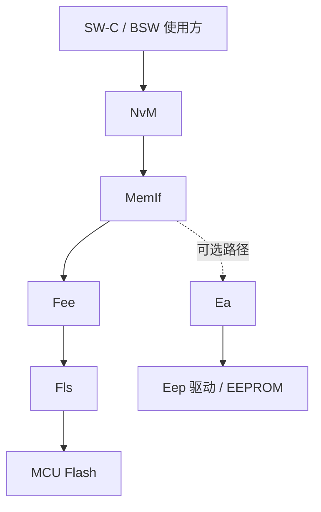
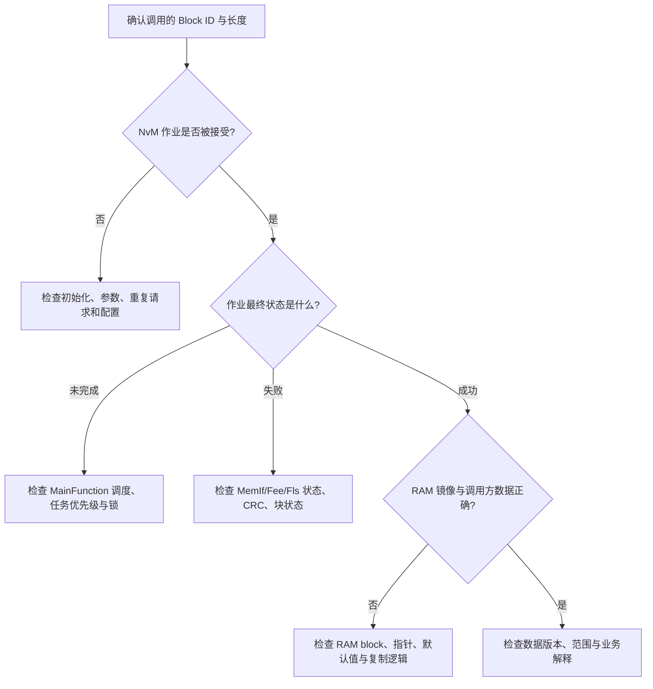

# AUTOSAR 1000 问｜NvM、MemIf、Fee 与非易失性存储工程答案

> 批次：存储栈专题第一批。适用 AUTOSAR Classic Platform。模块 API、配置参数和恢复策略应以项目采用的 Release、供应商实现及 ECU 存储设计为准。

## 1. NvM → MemIf → Fee → Fls 各层分别做什么？

- **NvM**：管理逻辑数据块、RAM 镜像、默认值、CRC、读写请求及作业状态。
- **MemIf**：统一 Fee/Ea 等存储抽象层的接口与设备选择。
- **Fee**：在 Flash 上模拟 EEPROM 的逻辑存储行为，负责虚拟扇区、记录布局、有效记录选择和垃圾回收等实现细节。
- **Fls**：调用 MCU Flash 控制器驱动完成底层读、写、擦除。
- **Ea**：若硬件/项目使用 EEPROM，可作为 EEPROM 抽象层，与 Fee 形成不同存储后端。

这是一种典型架构示意，并不代表每个项目都同时启用 Fee 和 Ea。实际路径取决于 NvM Block 的设备映射与 MemIf 配置。

## 2. NvM Block 与 Fee 扇区是什么关系？Block 能跨扇区吗？

NvM Block 是上层管理的**逻辑数据单元**，通常对应一个数据结构或持久化参数集合；Fee 的虚拟扇区则属于底层 Flash 仿真存储的管理单位。两者不是一一对应关系：

- 一个虚拟扇区可以保存多个逻辑记录；
- 一个 NvM Block 的逻辑长度由 NvM 配置决定；
- 写入时底层可能追加新记录、搬移有效记录或执行垃圾回收；
- 是否允许某个记录跨物理边界、如何处理大块数据，由 Fee 实现和配置决定，不能直接假设一定允许或一定禁止。

工程上应核对 NvM block length、Fee virtual page/sector 配置、底层 Flash 扇区大小及对齐要求，并在生成配置和供应商文档中确认限制。

## 3. 为什么不让 NvM 直接调用 Flash 驱动？

直接用 Fls 写数据意味着上层要自行处理 Flash 擦除粒度、磨损、掉电中断、记录有效性和数据版本等问题。分层的价值在于：

- **可移植性**：上层通过稳定接口使用不同存储后端。
- **逻辑与物理解耦**：应用不需要知道数据最终落在哪个物理扇区。
- **寿命管理**：Fee 可通过记录更新和垃圾回收分散擦写压力。
- **恢复策略**：配合 NvM/底层实现识别有效记录并处理不完整更新。

这并不意味着 Fee 自动保证所有业务数据事务都原子完成；业务级一致性仍需设计与验证。

## 4. 写 NvM 时掉电，如何保证数据一致性？

不能笼统承诺“写到一半掉电也一定恢复原值”。可靠性来自多层机制组合：

1. NvM 对作业进行状态管理，并可按配置使用 CRC、冗余块或数据校验。
2. Fee 通过自身记录格式、有效性信息和恢复扫描识别可用记录；具体行为依供应商实现。
3. 配置为冗余块时，NvM 可维护两个副本，并依据配置的完整性检查和恢复逻辑选择可用数据。
4. 应用在写入关键参数前后，应定义默认值、版本兼容、范围校验及安全降级策略。
5. 系统级测试需在擦除、编程、记录切换、垃圾回收等关键时刻注入掉电或复位。

**关键提醒：** CRC 只能帮助发现部分数据损坏，不能保证数据来源可信；冗余副本也可能同时失效。涉及安全关键参数时，需有明确的安全概念和故障响应。

## 5. Native 与 Redundant Block 如何判断哪份数据有效？

- **Native Block**：通常保存单份逻辑数据。
- **Redundant Block**：由 NvM 管理两个副本，目的是在一份副本不可用时提供恢复机会。

有效性判断可能综合块状态、CRC/完整性检查、底层存储状态及 NvM 的恢复流程。不要假设“两个副本时间戳较新的一份必定正确”——具体判定规则由 AUTOSAR 规范约束与供应商实现共同决定。需要查看 NvM 的冗余块行为、CRC 配置、Fee 的记录恢复说明，并测试单副本损坏、双副本损坏和首次初始化等情况。

## 6. Immediate 写与普通/周期写怎么选择？

项目常见的策略差异是：重要数据变化后尽快安排写入，或将写操作延迟到周期任务/显式请求时批量执行。不要把 “Immediate” 简化理解为“调用 API 后数据立刻物理落盘”，因为底层 Flash 操作通常仍是异步作业。

选择时考虑：

- **关键校准值**：评估掉电丢失的风险、写入频率、Flash 寿命和写作业时序；可使用显式写请求并确认作业结果。
- **高频变化数据**：避免每次变化都触发物理写入，考虑周期保存、变化阈值或合并更新。
- **安全关键数据**：写前验证合法范围，写后检查状态，定义恢复默认值及故障反应。
- **关机保存**：确保 EcuM/BswM 关机流程预留足够时间完成 NvM 作业；不要假设收到 Shutdown 请求后底层一定会等到所有写入成功。

最终策略要通过写入周期、预期掉电窗口、Flash 擦写寿命和启动恢复要求共同决定。

## 7. NvM 同步与异步接口什么时候用？

大多数 AUTOSAR NvM 操作是异步作业模型：调用请求后由 NvM 主函数/调度机制推进，使用方通过状态查询、回调或作业结果获知完成情况。具体同步接口是否存在及其限制要看所用版本和供应商实现。

一般原则：

- 在实时 Runnable 或高优先级路径中，避免等待耗时 Flash 操作完成。
- 需要在启动阶段读取配置时，采用明确的初始化状态机，等待读作业完成后再启用依赖该数据的功能。
- 关机阶段集中提交必要数据，并监测作业是否完成或失败。
- 对写失败、CRC 错误、块未初始化等状态定义可观测的诊断与降级策略。

## 8. NvM 读不到数据时，按什么顺序查？

建议至少采集：Block ID、请求返回值、最终作业结果、错误码/DET 记录、CRC 配置、Fee/Fls 作业状态、RAM block 指针、默认值配置，以及掉电后首次启动的恢复日志。

## 9. NvM 与 Dem 的关系是什么？

NvM 是通用非易失性数据管理模块；Dem 管理诊断事件、DTC 状态、快照和扩展数据等诊断信息。Dem 的部分持久化数据可以通过 NvM 保存，但它们不是同一模块：

- NvM 不负责判断车辆故障的诊断语义；
- Dem 不负责替应用管理所有持久化参数；
- 诊断事件是否存储、何时老化、何时清除由 Dem 配置和诊断策略决定；
- 排查 DTC 掉电后丢失，应同时核对 Dem 事件存储条件、NvM 相关配置、作业完成状态及关机时序。

## 10. 上电后读取到默认值，是不是存储坏了？

不一定。可能原因包括：首次运行、Block 未初始化、校验失败、配置变更导致数据长度/版本不兼容、底层记录不可用，或应用读取时机早于 NvM 作业完成。

建议：

1. 检查 NvM 请求结果与块状态，而非只观察最终 RAM 值。
2. 确认是否配置了 ROM 默认值、初始化回调或恢复回调。
3. 检查软件升级前后 Block ID、长度、CRC 和数据布局是否兼容。
4. 验证默认值是否被复制到正确的 RAM block，及业务代码是否随后覆盖。
5. 在干净存储、旧版本数据、CRC 错误和断电恢复场景分别测试。

## 参考与适用性

- AUTOSAR 官方规范入口：<https://www.autosar.org/standards>
- 相关模块：NvM、MemIf、Fee、Ea、Fls，以及涉及诊断数据时的 Dem。
- 具体 API 名称、冗余块恢复规则、Fee 垃圾回收行为与配置项以项目采用的 AUTOSAR Release 和供应商手册为准。
- 本页是工程学习说明，不替代 ECU 存储设计、功能安全分析和供应商模块文档。
