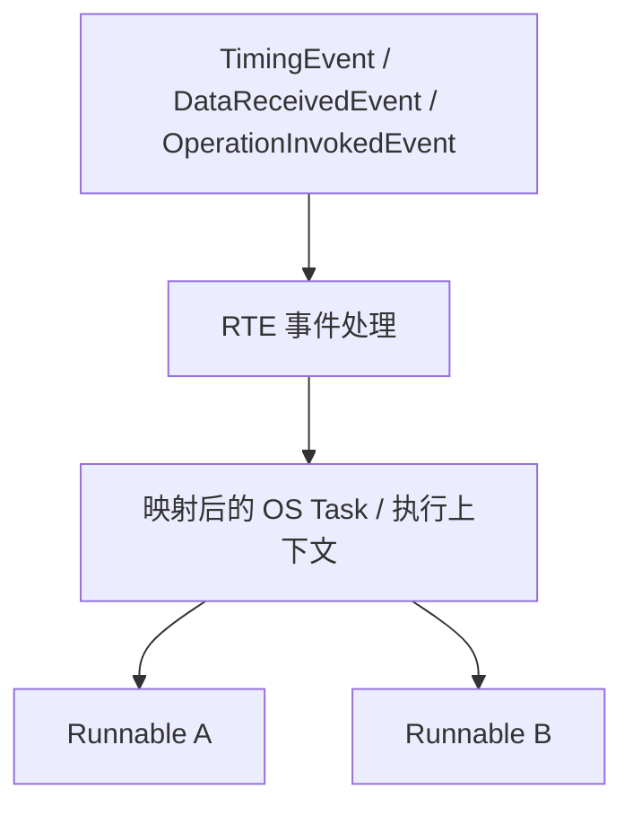
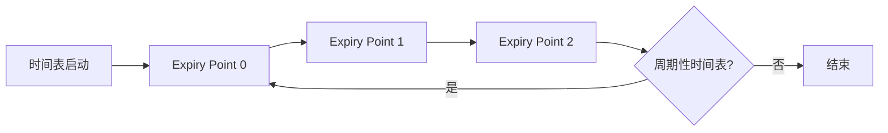

# AUTOSAR 1000 问｜OS、调度与多核工程答案

> 批次：OS 与多核专题第一批。以 AUTOSAR Classic Platform 为主。具体 OS API、配置参数和行为需结合项目采用的 AUTOSAR Release、OS 供应商手册、编译器及芯片手册验证。

## 1. AUTOSAR OS 与 FreeRTOS 等通用 RTOS 的核心区别是什么？

二者都提供任务调度、中断处理、同步和时间服务，但目标和约束不同：

- **AUTOSAR OS**：面向汽车 ECU 的标准化 OS 接口与配置模型，支持静态配置、任务/ISR、Alarm、Schedule Table、OS-Application、可选内存保护和时间保护等机制，并与 BSW/EcuM 等模块集成。
- **FreeRTOS 等通用 RTOS**：强调轻量、灵活和较小的资源占用，具体功能与安全认证、配置模式、工具链和产品版本有关。
- **不能简单说 AUTOSAR OS 一定更快或更安全**：实时性能取决于实现、硬件、配置和应用负载；安全能力取决于系统级安全论证和使用方式。

## 2. Task、ISR 和 Runnable 有什么区别？

- **Task** 是 OS 调度的执行实体，具有优先级、状态和调度属性。
- **ISR** 是中断服务例程，由硬件中断触发，并受中断类别及 OS 规则约束。
- **Runnable** 是 SW-C 内部的可调度功能单元，通常由 RTE 根据 TimingEvent、DataReceivedEvent、OperationInvokedEvent 等事件触发。

Runnable 通常不是独立 OS 任务。RTE/生成代码会把 Runnable 映射到 OS Task 或其他执行上下文。一个 Task 可以依次调用多个 Runnable；同一个 Runnable 的触发方式与具体映射应查看 RTE 配置及生成代码。

## 3. 一个 Runnable 的周期该如何确定？

周期不能只按“越快越好”设定。应根据控制闭环、信号更新率、最坏执行时间、端到端延迟、总线周期和 CPU 预算一起确定。

1. 确定功能所需的最大响应时间与数据新鲜度。
2. 测量或分析 Runnable 的 WCET（最坏执行时间），包含相关路径与边界条件。
3. 计算同一 Task 内其他 Runnable、ISR 和更高优先级任务的干扰。
4. 检查周期任务是否可能超期、错过激活或造成队列积压。
5. 在目标硬件上做负载、极限条件与集成测试，并记录测量证据。

若输入信号每 10 ms 更新，并不意味着消费 Runnable 必须无条件设为 10 ms；要根据允许延迟、任务相位和系统设计确定。

## 4. AUTOSAR OS 如何处理优先级反转？

优先级反转通常发生在低优先级任务持有共享资源，而高优先级任务需要该资源时；中优先级任务又可能持续抢占低优先级任务，使高优先级任务等待过久。

AUTOSAR OS 可通过资源管理和优先级天花板类机制（常见为 OSEK/AUTOSAR OS Resource 规则）限制这种无界阻塞。具体语义依 OS 一致性等级和实现约束而异，不应直接假设它与某个通用 RTOS 的 priority inheritance 完全相同。

工程建议：
- 临界区尽量短，不在持锁期间执行长计算、等待 I/O 或调用不允许的服务。
- 核对资源访问顺序、任务优先级和中断约束。
- 检查是否有锁嵌套、死锁风险或超出配置限制的调用。
- 在最坏负载下测量阻塞时间，而非只在空载下观察。

## 5. AUTOSAR OS Resource、Spinlock 与 Mutex 有什么区别？

| 机制 | 典型用途 | 注意事项 |
|---|---|---|
| OS Resource | 同一 OS 实例内任务/允许上下文间的互斥与优先级管理 | 遵循 OS 资源访问规则和调用限制 |
| Spinlock | 多核间对共享资源做短时自旋互斥 | 持锁期间不能长时间阻塞；需遵守锁顺序和中断约束 |
| Mutex | 通用 OS/运行时中的互斥抽象，语义依具体平台 | 不应把 POSIX/Linux mutex 的行为直接套用到 AUTOSAR OS |

在多核 AUTOSAR OS 中，跨核共享资源需要按 OS 提供的跨核同步机制配置；不能认为一个核上的普通 OS Resource 自动保护另一核。若项目提供 Spinlock API，应按供应商文档确认获取/释放限制、嵌套策略及中断使用规则。

## 6. 为什么 ISR 中不能随意等待 Spinlock？

Spinlock 的等待方会占用当前执行上下文持续轮询。如果中断上下文持锁等待，而持有者又因中断嵌套、优先级或调度关系无法运行，就可能造成死锁或严重的实时性破坏。

原则上：
- 临界区要短，并明确谁可能持锁、谁可能抢占谁。
- 避免在不允许的 ISR 类别或高优先级上下文里获取可能长时间等待的锁。
- 检查锁顺序，防止两个核以相反顺序获取锁。
- 对无法容忍等待的路径，考虑无锁消息、双缓冲、原子操作或受控的短临界区；这些方案也必须验证内存序和硬件缓存一致性。

## 7. Category 1 与 Category 2 ISR 有什么不同？

概念上，**Category 1 ISR** 不通过完整的 OS 中断管理路径运行，受 OS 服务调用限制较多；**Category 2 ISR** 由 OS 管理，能在规范允许范围内使用相应 OS 服务并参与任务调度语义。

具体可调用哪些服务、如何声明中断、优先级如何映射到硬件，取决于 AUTOSAR OS 版本、处理器架构和供应商实现。配置时要核对 ISR 类别和向量映射、ISR 优先级与硬件优先级的对应、ISR 内允许调用的 OS 服务、中断屏蔽/嵌套规则，以及 ISR 的 WCET 与对任务响应时间的影响。

## 8. Schedule Table 是如何工作的？

Schedule Table 在时间轴上定义一组 expiry point，每个 expiry point 可以触发任务激活、事件设置等配置动作。它适合把多个周期/相位相关动作组织到统一的时间基准上。

需要区分绝对/相对启动、周期性时间表、同步时间表以及 expiry point 对应的动作。多个时间表的动作时间重叠时，并不存在一个脱离配置就能套用的“时间表优先级”。最终执行顺序会受 OS 计时处理、任务优先级、激活方式及具体实现影响。应避免依赖未被规范保证的同刻动作先后顺序。

## 9. Alarm 与 Schedule Table 有什么区别？

Alarm 通常用于在某个相对或绝对时间点触发单个动作，并可配置循环周期；Schedule Table 用于组织多个 expiry point 与一组时间动作，支持周期序列及相关同步能力。

选择原则：
- 单一周期/定时触发、简单激活任务或设置事件，可考虑 Alarm。
- 多个具有固定相位关系的动作，或需要同步时间表的场景，可考虑 Schedule Table。
- 不要把二者都当作可任意动态创建的通用软件定时器；很多 AUTOSAR OS 对象是静态配置的。

## 10. Trusted Function 与 Non-Trusted Function 有什么区别？

在启用相应 OS-Application/内存保护能力的系统中，Trusted 与 Non-Trusted 反映的是不同的信任边界和受保护执行方式：

- **Trusted Function**：在受信任的 OS 机制下执行，通常用于非可信应用需要请求受保护操作的场景；它并不是“任何代码都可以安全调用”的万能入口。
- **Non-Trusted Application/Function**：运行在受限的访问权限内，违规访问受保护内存或资源时可能触发保护机制。
- 实际隔离强度依赖 MPU/内存保护、OS 配置、编译器、硬件和系统架构。

设计时应缩小 Trusted Function 的功能面、校验参数、限制副作用，并验证非法指针、越界访问、异常返回等故障路径。不要把“Trusted”理解为自动具备功能安全证明。

## 11. OS Memory Protection 如何发挥作用？

在支持内存保护的 ECU 上，OS 配置会把代码、数据、栈及特定内存区域映射到不同的访问权限。硬件 MPU 或相应保护机制在运行时检查访问是否符合权限。

典型检查顺序：
1. 核对 OS-Application 的可信属性和内存区域分配。
2. 核对 Task/ISR 的栈、私有数据和共享区映射。
3. 检查链接脚本、编译器段属性和 OS 配置是否一致。
4. 注入越界读写、非法执行和栈溢出等故障，验证保护钩子与系统反应。
5. 确认保护机制不会因错误配置而把合法共享区也屏蔽掉。

内存保护不能替代数据竞争分析、接口参数校验或系统级安全论证。

## 12. IOC 与普通 RTE 通信有什么区别？

IOC（Inter-OS-Application Communication）是 AUTOSAR OS 提供的跨 OS-Application 通信机制，特别适合在不同 OS-Application 之间交换数据；多核项目中的具体支持和配置依实现与 OS 配置而定。RTE 则是 SW-C 层的通信抽象，可以根据部署与配置映射到本地数据、OS 服务、IOC 或其他生成机制。

| 维度 | RTE 通信 | IOC |
|---|---|---|
| 抽象层级 | SW-C / VFB / 应用接口 | OS-Application 间的 OS 通信机制 |
| 使用者 | SW-C 通过生成接口读写/调用 | OS/RTE 集成层或相关代码 |
| 具体实现 | 由 RTE 生成配置决定 | 由 OS IOC 配置与实现决定 |
| 主要关注 | 组件解耦、接口语义、部署透明性 | 跨 OS-Application 数据传递与隔离 |

不要把 IOC 当作所有跨核通信的唯一方案，也不要因为 RTE 接口看起来是本地函数，就认定底层一定没有核间通信。

## 13. 多核之间用 volatile 全局变量共享数据可以吗？

通常不能仅靠 volatile 解决并发正确性问题。volatile 主要限制编译器对特定访问的优化，不自动提供原子读写、互斥或一致快照、跨核内存屏障、CPU cache 一致性，以及生命周期和数据所有权约束。

更稳妥的选择包括 OS 支持的 IOC/跨核消息机制、锁保护、原子操作、双缓冲或单写者数据交换。选择前需要明确数据大小、对齐、生产者/消费者关系、是否存在缓存非一致性，以及芯片的内存屏障和 cache maintenance 要求。

即便 32 位对齐读写在目标 MCU 上是原子的，也不意味着多个字段组成的结构体快照是原子的。必须针对硬件和编译器验证。

## 14. 多核任务如何分配？跨核 Runnable 一定需要 IOC 吗？

部署时通常根据 CPU 负载、实时性、外设归属、内存保护域、核间通信开销和故障隔离要求分配 Task/OS-Application/SW-C。Runnable 到 Task 的映射由 RTE/OS 配置决定，不是由 SW-C 源码自行选择核心。

跨核通信实现取决于数据路径：
- 若通过生成的 RTE 接口，RTE 可能生成跨核缓冲、IOC 调用或供应商定义的机制；
- 若设计为 OS-Application 间消息，则需核对 IOC 支持；
- 若采用共享内存，需要明确同步、缓存一致性和数据生命周期。

排查时查看 ECU Extract/系统映射、SW-C 部署、Runnable-Task mapping、OS-Application、IOC 和生成的 RTE 代码，不能只看 ARXML 中的端口连接。

## 15. Task 与 Runnable 的执行顺序如何保证？

三个层次应分开理解：
1. Schedule Table/Alarm 在时间点触发配置动作。
2. OS 根据任务状态、优先级、调度策略和中断状态决定任务何时运行。
3. Task 内的生成代码/RTE 调用一个或多个 Runnable，具体顺序由映射与生成配置决定。

所以，Schedule Table 触发某 Task 并不等于 Runnable 会在同一时刻立即开始。更高优先级任务、ISR、临界区和执行时间都会影响实际启动时刻。应分析端到端响应时间、任务释放抖动、WCET、阻塞时间和最坏负载。

## 16. 任务超期、激活失败或执行时间异常怎么排查？

按“配置—测量—归因”顺序：
1. 核对 Task 的优先级、调度类型、激活次数、栈大小与映射的 Runnable。
2. 核对所有周期、Expiry Point、Alarm 和事件配置是否互相冲突。
3. 用 OS trace、硬件计时器或可验证的测量方法获取释放时间、启动时间、运行时间和阻塞时间。
4. 分析 ISR 占用、更高优先级任务干扰、资源锁等待、跨核同步与 cache miss。
5. 对照实际负载和故障注入结果检查时间保护/监控机制。

不要只通过提高优先级来“修复”超期；这可能把问题转移到其他任务，并增加系统整体的响应时间风险。

## 17. 配置或生成代码中 OS 相关错误怎么定位？

建议依次检查：
- OS 配置对象是否引用正确（Task、Counter、Alarm、Schedule Table、ISR、Resource）；
- 生成代码是否与当前配置、芯片端口和编译器版本匹配；
- 启动序列是否初始化了 OS 依赖项，OS 启动前是否有非法服务调用；
- 链接脚本、向量表、栈和内存段是否与 OS 配置一致；
- 错误钩子、保护钩子和 trace 是否提供了明确的错误码和上下文。

如果升级了 OS 供应商版本或 AUTOSAR Release，应同时检查配置迁移说明、生成器版本、编译选项和 OS API 的变化。

## 参考与版本注意事项

- AUTOSAR 官方规范入口：<https://www.autosar.org/standards>
- 重点参考：AUTOSAR OS、RTE、System Template、Timing Extensions 相关规范，以及 OS 供应商配置和集成手册。
- Category 1/2 ISR、Resource/Spinlock、IOC、Trusted Function、时间保护等机制的具体 API 与限制应以项目使用的 Release 和供应商实现为准。
- 本文是工程学习说明，不替代目标 ECU 的时序分析、功能安全分析或供应商规范。
