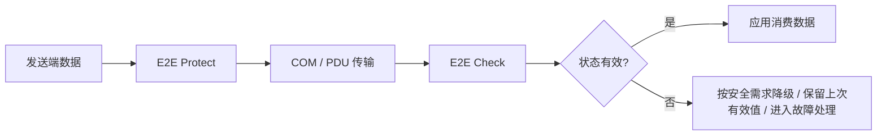
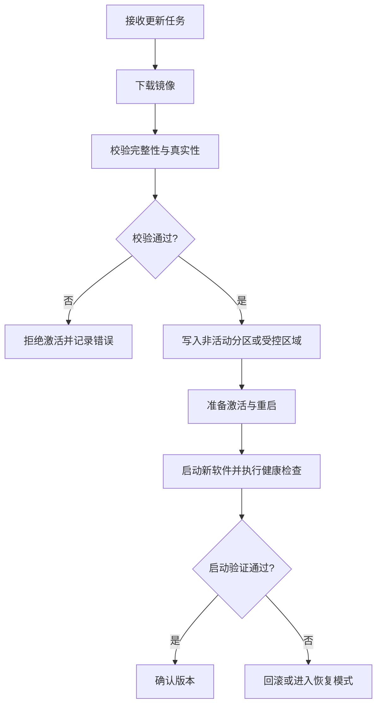

# AUTOSAR 1000 问｜功能安全、E2E 与信息安全工程答案

> 批次：功能安全与信息安全专题第一批。以 AUTOSAR Classic Platform 为主要讨论对象。具体模块支持、API 和配置项依 AUTOSAR Release、供应商实现、硬件安全能力及 OEM 安全规范而定。

## 1. AUTOSAR 如何支持 ISO 26262 功能安全？

AUTOSAR 提供可用于构建安全相关 ECU 软件的标准化架构与机制，但**采用 AUTOSAR 并不自动意味着 ECU 符合 ISO 26262**。功能安全仍需基于整车/系统安全概念开展危害分析、技术安全需求分解、架构设计、验证确认和安全论证。

常见支持方向：
- **故障检测与报告**：DEM、DET、看门狗与安全监控机制（具体职责不同）。
- **执行与时间监控**：WdgM、OS 时间保护等（取决于配置和实现）。
- **通信保护**：E2E 库/保护机制检测部分传输错误、重复、丢失或顺序异常。
- **内存与分区隔离**：在支持的硬件/OS 配置下减少不同软件实体间的干扰。
- **诊断与恢复**：通过故障事件、降级策略、复位或安全状态实现系统响应。

这些机制必须映射到安全需求，并用分析、测试和证据证明满足目标；模块存在不等于安全需求已实现。

## 2. E2E 保护什么？它与 CAN CRC 有什么区别？

CAN 数据链路层 CRC 主要检测单帧传输中的位错误；E2E（End-to-End）保护则从发送端数据到接收端数据的应用通信路径提供额外检查，通常包含与配置 Profile 对应的 CRC、计数器及状态判定等信息。

E2E 可帮助发现部分端到端数据损坏、重复、丢失、错误序列或超时问题，但不能检测所有软件缺陷，也不等同于加密认证。具体检测能力由 Profile、配置、通信周期和接收端状态机决定。

## 3. E2E Profile 1 到 Profile 7 有什么区别？是否能按 ASIL 等级简单对应？

不能把某个 Profile 简单映射成固定 ASIL 等级。Profile 的选择应基于通信假设、数据长度、计数器/CRC布局、需要检测的故障类型、接收周期和安全需求。

工程选择步骤：
1. 明确需检测的故障模型：损坏、重复、丢失、延迟、错序、插入或错误寻址等。
2. 按项目采用的 AUTOSAR E2E Library 规范查阅 Profile 的适用长度、CRC、多项式、Counter 和 Data ID 规则。
3. 核对发送端与接收端的配置完全匹配。
4. 确认 Check 状态与状态机行为在丢帧、重复帧、计数器跳变、初始化和恢复时的定义。
5. 用正向与故障注入测试证明检测行为，并将证据追溯到安全需求。

不同版本的 Profile 定义与支持范围应查对应规范，不能仅凭 Profile 编号推断安全等级或适用场景。

## 4. E2E 校验失败后，接收方应该丢弃数据还是保留上次有效值？

不存在适用于所有应用的单一答案。应由安全需求、数据语义、故障可检测性和降级策略决定：

- 对某些控制量，可能允许在限定时间内使用上次有效值，但必须有明确的超时上限和状态标志。
- 对某些关键控制量，检测到连续错误后可能要求进入降级或安全状态。
- 对状态/事件数据，简单“保持上次值”可能掩盖数据已经过期。
- 对带队列的数据，需要考虑错误消息是否应丢弃、隔离或保留诊断证据。

接收端应同时检查 E2E 状态、数据年龄、连续错误计数和恢复条件；不能只看 CRC 是否通过。测试需覆盖单次错误、连续错误、Counter 回绕、丢失、重复、恢复及上电初始状态。

## 5. WdgM 如何做程序流与时间监控？

WdgM（Watchdog Manager）负责管理配置的监督实体与监督逻辑，并协调相关监控结果和看门狗触发行为。实际监督类型及其配置取决于所用 AUTOSAR 版本和实现。

常见概念：
- **Alive supervision**：检查某实体是否按预期在一定时间窗口内报告活动。
- **Deadline supervision**：检查两个监督点之间的执行时间是否在允许范围内。
- **Logical supervision**：检查监督点的执行顺序或逻辑流是否符合配置。
- **监督实体**：被监控的软件执行单元，具体粒度由系统设计决定。

WdgM 不是“自动理解所有 Runnable 的业务逻辑”。项目必须明确监督点、触发频率、容差、失效处理和恢复策略，并验证异常分支是否会漏报或误报。

## 6. WdgM、看门狗硬件、DEM 和 DET 的职责有什么不同？

- **硬件 Watchdog**：提供底层超时检测或复位机制。
- **WdgM**：协调软件监督，依据监督结果决定是否允许喂狗或采取相应故障处理。
- **DEM**：管理诊断事件及其状态、DTC 与相关数据。
- **DET**：主要用于开发/集成阶段报告开发错误；并不等同于量产诊断事件存储。

具体项目中，监督失败是否上报 DEM、是否触发复位、如何进入安全状态，要查配置与安全需求。不能假设每个 DET 错误都会自动成为 DTC，也不能把“喂狗成功”当成所有安全功能正常的充分证据。

## 7. ASIL QM 到 ASIL D，BSW 模块会自动改变行为吗？

ASIL 是安全完整性等级，通常是系统/安全需求及其分解与分配的属性，不是给一个软件模块贴标签后模块就自动变得安全。不同 ASIL 目标会影响开发过程、验证深度、架构约束、独立性和证据要求。

BSW 模块在具体项目中的安全使用条件可能体现在：
- 供应商安全手册、适用范围与使用约束；
- 安全机制和诊断覆盖率相关假设；
- OS 分区、内存保护和时间保护配置；
- 安全相关参数、故障反应及测试证据；
- 与应用、硬件和其他软件的集成约束。

不能仅凭模块名或 AUTOSAR 版本判断它可直接用于某个 ASIL。需核对供应商安全资料和项目安全案例。

## 8. 同一 MCU 混合部署 QM 与 ASIL 应用，如何考虑 Freedom from Interference？

Freedom from Interference（免受干扰）通常需要从多个维度论证，而不是只靠一个 MPU 配置：

- **空间隔离**：限制代码、数据、栈及外设访问权限。
- **时间隔离**：限制执行时间、任务预算、中断干扰及共享资源阻塞。
- **信息隔离**：限制非预期数据流、共享内存副作用和接口滥用。
- **故障传播控制**：避免一个分区的异常破坏其他分区或安全机制。
- **系统级证据**：通过架构分析、静态分析、故障注入、集成测试和硬件机制验证支撑安全论证。

具体是否可实现取决于 MCU、MPU、OS、编译器、共享外设和总线架构。若硬件缺少所需隔离能力，软件配置本身无法凭空补足。

## 9. SecOC 解决什么问题？它与 E2E 有何不同？

SecOC（Secure Onboard Communication）主要面向车载通信的真实性与完整性保护，通常通过消息认证信息（Authenticator/MAC）和 Freshness Value 等机制降低伪造或重放风险。E2E 更侧重端到端数据传输故障检测，两者目标有交集但不相同。

| 维度 | E2E | SecOC |
|---|---|---|
| 主要目标 | 检测通信数据错误、重复、丢失、错序等特定故障 | 验证消息真实性/完整性并防御重放等攻击 |
| 典型机制 | Profile 对应的 CRC、Counter、Data ID 等 | MAC/Authenticator、Freshness Value、密钥与验证策略 |
| 安全边界 | 端到端通信可靠性/安全相关故障检测 | 信息安全威胁模型下的消息认证 |
| 不能替代 | 不能替代完整的安全分析 | 不能替代 E2E 的所有状态/时序监控需求 |

具体是否同时使用，应由安全需求和威胁分析决定。不能把 E2E CRC 当作密码学认证。

## 10. SecOC 如何降低重放与伪造风险？

概念上，发送端根据消息内容、密钥和 Freshness 信息计算认证值；接收端重建或验证 Freshness 信息，并检查认证值是否匹配。认证失败或新鲜度异常时，接收端应按配置策略拒绝消息或触发相关处理。

工程上需核对：
- 哪些 I-PDU 受保护以及哪些字段参与认证；
- Authenticator 长度、截断策略和消息映射；
- Freshness Value 的生成、同步、持久化和回绕处理；
- 密钥生命周期、更新与访问控制；
- 验证失败的计数、诊断、降级与恢复策略；
- 通信负载与 CPU 时间预算。

具体计算格式、密钥与新鲜度机制必须使用项目授权的安全规范与供应商文档；不应把示意流程当作可直接部署的密码学设计。

## 11. 密钥存在哪里？谁来管理与更新？

密钥管理通常跨越 HSM/硬件安全能力、Crypto Driver、Csm、密钥管理服务或供应商专用接口，以及制造/售后/OTA 的生命周期流程。具体实现依 MCU 和项目架构不同。

必须明确：
- 密钥生成、注入、存储、访问和更新的授权边界；
- 是否使用 HSM、硬件密钥槽或受保护的存储区域；
- 启动、诊断、生产、维修与报废阶段的密钥生命周期；
- 更新失败、密钥损坏、回滚与吊销策略；
- 日志和调试接口如何避免泄露密钥、认证值或敏感材料。

不要把普通 NvM 块视为天然安全的密钥仓库。是否能将密钥存于特定区域，必须由硬件安全能力和安全架构确认。

## 12. Crypto Driver、Crypto Interface、Csm 的职责是什么？

在典型 Classic AUTOSAR Crypto Stack 中，应用或安全服务通过上层接口请求密码学作业，Csm 负责服务层编排与作业管理，Crypto Interface 为上层提供统一的密码学服务接口，底层 Crypto Driver 则连接软件或硬件算法实现。模块名称和精确调用关系应以项目版本规范为准。

需要区分：
- **算法实现**：加密、解密、哈希、MAC、签名/验签等；
- **作业管理**：同步/异步处理、队列、回调与作业状态；
- **密钥对象管理**：密钥元素、权限和生命周期；
- **硬件适配**：软件算法或 HSM/加速器驱动。

MCU 没有硬件加速器时，是否可由软件实现取决于算法、驱动和配置支持。软件实现不等于必然不安全，但性能、抗侧信道能力和密钥保护方式需要单独评估。

## 13. HSM 与 SHE 有什么区别？

HSM 通常指具备隔离执行、受保护密钥存储及密码学服务能力的硬件安全模块；SHE 是一种针对汽车 ECU 的安全硬件扩展规范/能力模型，功能范围和资源通常更受限。二者并非所有 MCU 上都以相同形式出现，也不能只凭名称推断实际功能。

选型/集成时应核对芯片安全手册：密钥槽数量、支持算法、随机数能力、生命周期管理、调试锁定、更新机制、认证/密钥派生能力及软件接口。AUTOSAR Crypto Stack 的具体驱动映射取决于供应商实现。

## 14. OTA 更新如何与 AUTOSAR 安全机制配合？

OTA 不是一个单独模块就能保证的流程。通常涉及下载管理、诊断/通信、镜像验证、存储布局、启动管理、版本策略和失败恢复。

实际项目可能采用不同分区策略，不能假定所有 ECU 都有 A/B 分区或自动回滚。应验证镜像签名/认证、版本防回退、掉电安全、启动验证、恢复入口和安全访问控制。

## 15. OTA 更新到一半掉电，如何避免 ECU 变砖？

关键在于更新架构的可恢复性，而不是单纯依赖传输协议：
- 保留可启动的旧镜像，或提供可信的恢复/重刷路径；
- 对写入数据进行完整性与真实性验证，只有验证成功才激活；
- 持久化必要的更新状态并保证状态本身的掉电一致性；
- 设计失败启动检测、回滚或恢复模式；
- 防止不受信任的降级、未授权镜像和错误版本激活；
- 在下载、擦写、校验、切换、首次启动等关键时点注入掉电/复位。

如果硬件分区、Bootloader 和启动策略不支持恢复，仅靠 AUTOSAR 通信栈或 NvM 无法保证“绝不变砖”。

## 16. 如何验证安全机制在 ECU 上真正有效？

按需求追溯建立测试矩阵，而不是只检查配置工具显示“已启用”：

| 机制 | 至少应验证的行为 |
|---|---|
| E2E | 错误 CRC、计数器跳变、丢帧、重复帧、超时与恢复 |
| WdgM | 活动丢失、执行超期、逻辑顺序错误、监督恢复 |
| SecOC | 认证失败、重放、Freshness 不同步、密钥不可用 |
| 内存保护 | 非法读写、越界、非法执行与保护反应 |
| OTA | 镜像校验失败、下载/擦写/激活中断、回滚与恢复 |
| DEM/诊断 | 事件状态、DTC 存储条件、清除条件与故障恢复 |

每个用例都应记录需求 ID、配置版本、测试环境、输入条件、预期结果、实际结果和日志证据。

## 参考与版本注意事项

- AUTOSAR 官方规范入口：<https://www.autosar.org/standards>
- 重点参考：E2E Library、Secure Onboard Communication、Watchdog Manager、Crypto Stack、NvM、OS，以及项目适用的 ISO 26262 与 ISO/SAE 21434 工作产品。
- Profile、接口、密钥管理和恢复行为随版本与供应商实现而异；安全相关设计必须遵循 OEM 安全规范与供应商安全手册。
- 本文用于工程学习，不是安全认证结论，也不替代威胁分析、功能安全分析或授权安全设计文档。
