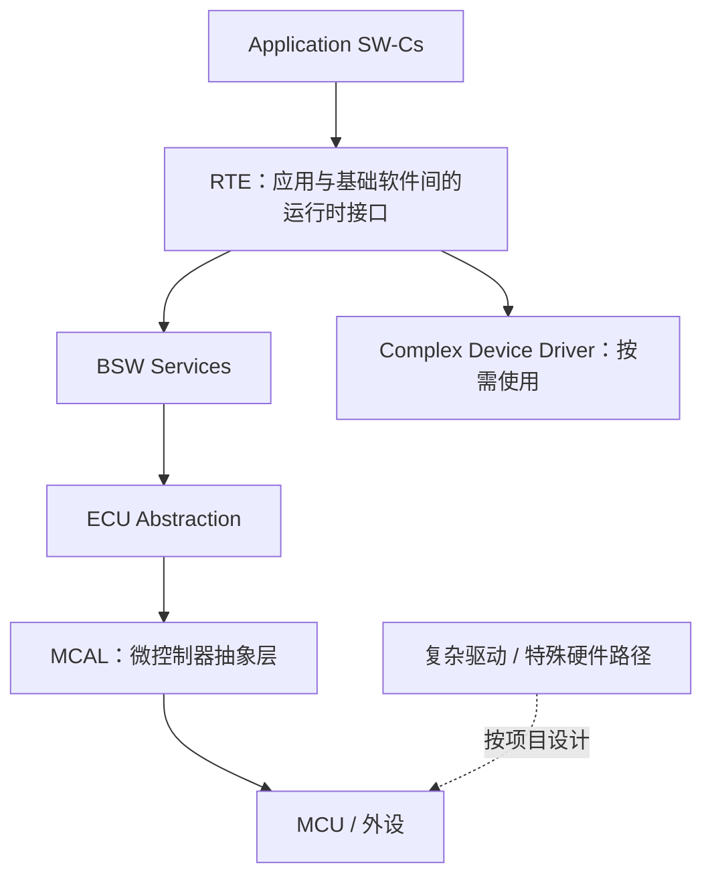
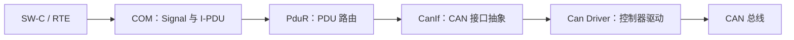

# AUTOSAR 1000 问｜基础架构与通信栈第一批答案

> 本页开始把总表中的问题转成可复习、可验证的工程答案。本文以 Classic Platform 的常见架构为主；具体接口、配置参数和生成代码需以项目采用的 AUTOSAR Release 与供应商实现为准。答案不是对所有 ECU 配置的强制要求。

## 1. 什么是 AUTOSAR？全称与含义是什么？

AUTOSAR 是 **AUTomotive Open System ARchitecture**，即汽车开放系统架构。它是汽车行业推动的标准化合作组织及相关软件架构规范，目标是通过标准化接口、模块职责、交换格式和方法论，降低 ECU 软件对特定硬件、供应商和项目实现的耦合。

核心价值包括：
- **复用**：应用软件组件可以在符合接口与约束的不同 ECU 项目间迁移。
- **分工**：OEM、Tier 1、基础软件供应商可以围绕清晰的接口协作。
- **配置驱动**：通过 ARXML 描述系统、软件组件和基础软件配置，并由工具生成大量框架代码。
- **可集成**：以标准接口和一致的数据模型减少手工集成差异。

AUTOSAR 不会自动保证代码正确、实时性或功能安全。配置质量、供应商实现、集成验证和系统安全分析仍然不可缺少。

## 2. AUTOSAR 联盟成立于哪一年？由谁发起？

AUTOSAR 合作组织于 **2003 年**启动。早期核心合作方包括 BMW、Bosch、Continental、DaimlerChrysler、Siemens VDO 和 Volkswagen 等汽车行业企业。成员和组织结构会随时间演进；若需要用于正式出版或审计的创始成员表，应以 AUTOSAR 官方历史介绍为准，不应把当前成员名单当作最初发起名单。

## 3. Classic Platform 的 Application / RTE / BSW / MCAL 各层如何通信？谁依赖谁？

典型分层如下：

- **Application SW-C** 描述应用功能，通过 Port / Interface 表达通信与服务需求。
- **RTE** 根据 SW-C、接口、连接和部署配置生成运行时通信接口与调用代码。
- **BSW** 提供通信、诊断、存储、操作系统、模式管理等基础能力。
- **ECU Abstraction** 隔离部分 ECU 板级外围差异。
- **MCAL** 提供面向微控制器外设的标准化驱动接口。

依赖方向不是简单的“每一层只能调用下一层”。BSW 模块之间存在标准化依赖关系，RTE 也会连接应用与所需服务；CDD 可以用于标准模块无法直接满足的特殊硬件需求。判断依赖应以模块规范、配置引用和生成代码为依据。

## 4. RTE 的核心作用是什么？没有 RTE 会怎样？

RTE（Runtime Environment）是 AUTOSAR 应用组件模型与具体 ECU 部署之间的生成式运行时适配层。它根据 Port、Interface、Runnable、Event、SW-C 连接关系和部署配置，生成数据访问、Client-Server 调用、Runnable 调度连接及必要的跨组件/跨 ECU 通信适配。

没有 RTE，开发者需要自行维护组件间函数调用、共享数据、通信路由、任务映射和 ECU 部署差异，软件复用与集成成本会显著增加。RTE 并不是万能中间件：它不能代替正确的接口建模、调度设计、通信栈配置或系统验证。

## 5. SW-C 的 Runnable 如何被调度？它与普通 C 函数有什么区别？

Runnable 是 SW-C 中可由 AUTOSAR 运行时模型触发的执行单元。它本身通常不是 OS Task，也不等于一个独立线程。触发来源可能包括 TimingEvent、DataReceivedEvent、OperationInvokedEvent 等，RTE 生成器再依据事件和任务映射把它安排到配置的 OS Task 或相应执行上下文中。

与普通 C 函数相比，Runnable 具有模型化的触发条件、接口访问和调度映射；但最终仍会落实为 C 函数或相应生成代码。分析执行时应沿着 **Event → Runnable → RTE 生成调用 → OS Task → OS 调度**追踪。

## 6. 为什么把配置与代码生成分开？可以合并吗？

配置描述“系统需要什么”和“模块如何连接”，代码生成则把模型转换为特定工具链、版本和目标平台可编译的代码。分开可以支持配置校验、变体管理、工具互操作、可重复构建和生成器升级。

工具可以把编辑、验证和生成操作集成在一个界面或自动化流程里，但概念上仍应区分：
1. 模型/配置输入；
2. 配置一致性校验；
3. 代码生成；
4. 编译与链接；
5. 集成测试与运行时验证。

生成成功不等于配置语义正确，也不等于软件行为符合需求。

## 7. CAN 通信从 PDU 到总线，COM → PduR → CanIf → Can Driver 各做什么？

- **COM**：把 Signal 编码/解码到 I-PDU，处理信号更新、发送模式及相关监控。
- **PduR**：根据配置在模块之间路由 PDU，通常不解释 Signal 的业务含义。
- **CanIf**：提供控制器无关的 CAN PDU 收发接口，并管理与驱动的映射。
- **Can Driver**：操作具体 CAN 控制器及底层硬件。

接收方向大体反向，但可能包含硬件过滤、接收指示、传输协议重组等步骤。真实路径以项目配置为准。

## 8. 两个节点使用同一个 CAN 报文，AUTOSAR 如何避免接收冲突？

CAN 是广播总线，多个节点都可能接收同一帧；这不是冲突，而是正常机制。总线上发送冲突通过 CAN 的基于标识符的非破坏性仲裁处理：同时发送时，优先级较高的标识符赢得仲裁，未获胜节点按控制器机制稍后重发。

接收端则由 CAN ID、硬件过滤、CanIf Rx PDU 映射及上层路由决定哪些帧交给哪个处理路径。若多个接收节点都订阅同一个 ID，它们可以同时接收；需要避免的是网络矩阵中 ID 定义冲突、发送者配置冲突或同一 ECU 内映射错误，而不是禁止多个节点监听。

## 9. Signal 和 PDU 是什么关系？何时一个 PDU 放多个 Signal？

Signal 是带有语义的数据项，例如车速、开关状态或温度；I-PDU 是通信栈中承载一个或多个 Signal 的协议数据单元。COM 根据配置把多个 Signal 按起始位、长度、字节序、更新位等规则打包进 I-PDU。

多个 Signal 放在一个 PDU 中通常是为了满足网络矩阵定义、降低报文开销、共享发送周期或符合带宽与时序预算。但需要考虑更新频率差异、数据一致性、超时监控、报文长度、总线负载及功能安全要求。不能仅为了减少帧数就任意合并。

## 10. 为什么需要 PduR？COM 直接调用 CanIf 不行吗？

PduR 将上层 PDU 处理模块与下层通信接口解耦，统一管理静态配置的路由关系。它可以支持不同通信模块、传输协议和网关路径之间的 PDU 转发，避免 COM 与每一种底层接口形成紧耦合。

若让 COM 直接调用 CanIf，COM 就需要知道具体底层总线与路由细节，复用性和系统集成灵活性会下降，也会绕开标准化的 PDU 路由模型。具体是否经过 PduR、路由方向及回调链应根据实际配置确认。

## 11. 节点唤醒不等于网络唤醒，是什么意思？

**节点唤醒**是某个 ECU 从低功耗状态被唤醒；**网络唤醒**是通信网络或一组相关 ECU 因唤醒请求进入可通信状态。一个 ECU 可能因本地唤醒源（例如点火输入、定时器或硬件事件）启动，但并不一定需要请求整个网络进入通信状态。

在支持网络管理和部分网络的系统中，EcuM 处理 ECU 唤醒源，ComM / Nm 等模块协同管理通信请求与网络状态。具体是否启动完整 BSW、是否请求通信，取决于唤醒源配置、ECU 状态、网络管理策略和项目集成。

## 12. EcuM 如何处理唤醒源？哪些情况下启动 BSW？

EcuM 根据配置识别和验证唤醒源，并执行相应启动或唤醒流程。某些唤醒事件需要恢复 ECU 到可运行状态，其他事件可能被识别为无效、需要验证或仅按配置记录/处理。不能给出适用于所有 ECU 的固定“某类源必启动、某类源只记录”列表。

工程上应核对：
- 唤醒源标识与硬件检测配置；
- Wakeup Validation 及验证超时；
- EcuM 启动/唤醒配置与 Startup Sequence；
- BswM、ComM、Nm 的模式转换；
- 对应平台与供应商实现的回调和生成配置。

## 13. CanNm 的 Repeat Message State 解决什么问题？

Repeat Message State 是网络管理状态机中的一个阶段，常用于节点启动通信、网络唤醒或状态变化后，短时间内更积极地发送网络管理消息，以便其他节点更快识别网络活动与当前状态。它有助于节点协调网络唤醒和状态同步。

进入条件、持续时间、消息周期和退出条件受 AUTOSAR 版本及 CanNm 配置影响。排查时应结合 Nm 状态、通信请求、重复消息定时器、总线抓包和 ComM/EcuM 模式记录判断，不能只看是否有一帧 NM 报文。

## 14. 网络管理节点没有按时进入 Bus-Sleep Mode，会发生什么？

如果节点仍保持网络活动或持续发送 NM 消息，其他节点可能无法满足睡眠条件，导致网络无法按预期进入 Bus-Sleep、静态电流增加或电源管理异常。根因可能是仍有通信请求、NM 状态未满足、超时/定时器配置不一致、应用未释放 ComM 请求，或总线持续有唤醒流量。

排查步骤：
1. 记录 ComM 通信请求与释放时刻。
2. 观察 CanNm 状态和 NM 报文周期。
3. 检查 EcuM、BswM 的模式请求与 Action List。
4. 检查其他节点是否持续唤醒网络。
5. 对照网络管理配置和实测总线时间线定位未满足的睡眠条件。

## 15. 如何使用本页与原始问题总表？

原始问题主表仍保留在 [AUTOSAR 1000 问总表](../README.md)。本页是答案型子页；后续按通信栈、诊断、NvM、OS、多核、功能安全、信息安全、工具链与工程排障继续拆分，避免把全部答案塞进一个难以维护的超长文件。

## 参考资料

- [AUTOSAR 官方标准入口](https://www.autosar.org/standards)
- [AUTOSAR Classic Platform](https://www.autosar.org/working-groups/classic-platform)
- [AUTOSAR 方法论技术报告（R24-11）](https://www.autosar.org/fileadmin/standards/R24-11/CP/AUTOSAR_CP_TR_Methodology.pdf)

> 规范细节、API 名称和配置参数应以项目采用的 Release 为准。发布工程结论时，请补充对应规范章节、工具版本与测试证据。
