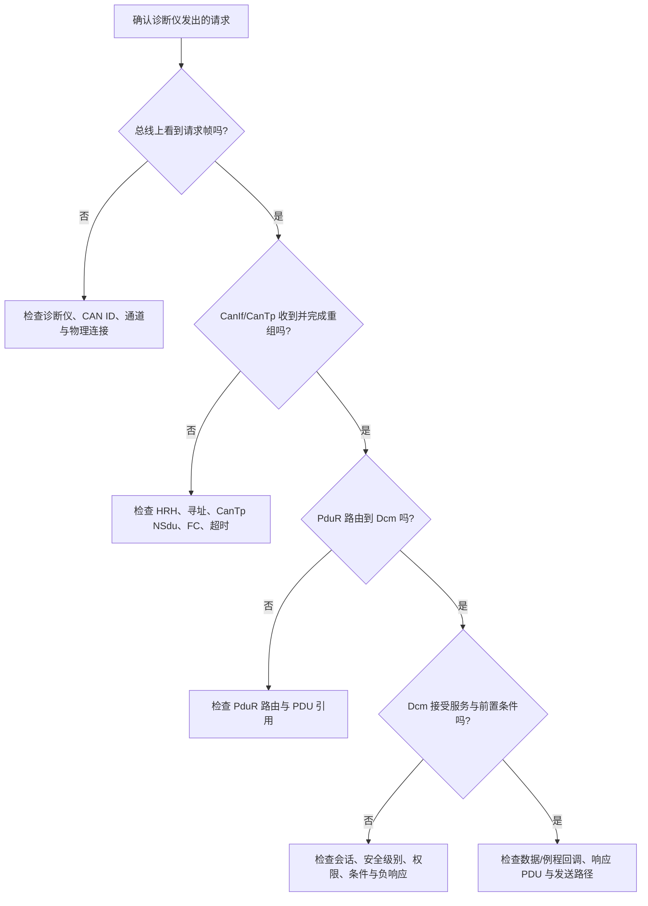

# AUTOSAR 1000 问｜诊断栈、UDS 与 DoIP 工程答案

> 批次：诊断专题第一批。  
> 适用范围：以 AUTOSAR Classic Platform 为主；具体服务、接口和配置项以项目采用的 AUTOSAR Release、供应商实现及诊断规范为准。本文区分协议要求、AUTOSAR 模块职责与项目常见做法。

## 1. UDS over CAN 在 AUTOSAR 中经过哪些层？

典型接收路径如下：

- **Can Driver**：配置控制器、邮箱/硬件对象，处理底层发送和接收事件。
- **CanIf**：为上层屏蔽 CAN 控制器差异，管理 HRH/HTH、PDU 映射和控制器模式。
- **CanTp**：依据 ISO-TP 规则处理单帧、多帧、流控、分段与重组。
- **PduR**：按配置把诊断 I-PDU 路由给 Dcm，并将发送请求转到对应传输路径。
- **Dcm**：处理 UDS 服务、会话、安全访问、权限/条件检查，并调用相应数据或服务回调。
- **SW-C/回调**：提供项目定义的数据、例程或业务处理；并非每个 UDS 请求都会直接调用 SW-C，很多服务由 Dcm、Dem、NvM 或专用回调协作完成。

发送响应通常沿相反方向返回。实际配置应核对 Dcm、PduR、CanTp、CanIf 的 PDU 引用和 Rx/Tx 关联。

## 2. 诊断请求和响应在同一个 CAN 报文里吗？谁决定使用 CanTp？

UDS 请求与响应通常是独立的传输方向和 PDU；不是在同一个 CAN 帧里同时承载。单帧还是多帧主要由传输层承载长度、寻址方式和 CanTp 配置决定：

- **Single Frame (SF)**：负载能放进当前传输协议允许的单帧容量。
- **First Frame / Consecutive Frame (FF/CF)**：较长消息先发首帧，再按序发送后续帧。
- **Flow Control (FC)**：接收方通过流控帧告知发送方继续、等待或中止，以及块大小和最小间隔等参数。

不要只按“某个 UDS 服务”判断是否走多帧；同一服务的消息长度可能因 DID、数据长度或响应内容不同而不同。排查时同时检查寻址格式、CanTp Tx/Rx NSdu、PduR 路由与 Dcm 连接配置。

## 3. 为什么需要 DoIP？它和 UDS over CAN 有什么不同？

**UDS 是诊断应用协议，DoIP 是诊断通信的 IP 承载方案。** 二者并非互相替代的 UDS 服务集合：同一个诊断服务可能通过 CAN/ISO-TP 或以太网/DoIP 传输。

| 对比点 | UDS over CAN | UDS over DoIP |
|---|---|---|
| 传输承载 | CAN + ISO-TP/CanTp | Ethernet + IP + TCP（诊断消息常用）及 DoIP 报文封装 |
| 主要 AUTOSAR 路径 | CanIf → CanTp → PduR → Dcm | EthIf/网络栈与 DoIP → PduR → Dcm（依版本和实现） |
| 常见优势 | 传统 ECU 普及、链路简单 | 高带宽，适合快速诊断和刷写 |
| 典型排查点 | CAN ID、寻址、CanTp、流控、Bus-off | IP 连通性、DoIP Routing Activation、逻辑地址、防火墙/端口、PduR/Dcm 配置 |

具体模块连接和接口名称会随 AUTOSAR Release 及供应商实现变化，不能把示意图当成完整配置清单。

## 4. 怎样把一个 UDS 请求最终接到 SW-C Runnable？

先明确服务类型：

1. **读/写数据类服务**（例如 0x22/0x2E）：在 Dcm 配置 DID、数据长度、读写权限及数据访问回调；回调再读取或更新应用数据。
2. **例程控制 0x31**：配置 Routine Identifier、允许条件、启动/停止/结果回调；需要时由回调通知应用任务或状态机。
3. **故障码服务 0x19**：通常与 Dem 的事件、DTC、状态和快照/扩展数据配置协作，并非简单转发到一个 Runnable。
4. **编程/刷写服务**：还涉及会话、安全访问、下载状态、内存/Flash 驱动、校验和项目的启动管理逻辑。

若业务必须在 Runnable 上下文执行，常见设计是由 Dcm 回调把请求参数投递给应用状态机/队列，再由 Runnable 处理；不要在可能有时序限制的回调里执行长时间阻塞操作。应核对回调执行上下文、重入约束、超时和并发保护。

## 5. Dcm 的 0x22、0x2E 和 DID 如何组织？

- **0x22 ReadDataByIdentifier**：按请求中的 DID 读取已配置数据记录。
- **0x2E WriteDataByIdentifier**：向允许写入的 DID 提交数据；必须配置写权限、长度、会话/安全级别和条件检查。
- DID 的分配通常由 OEM/项目诊断规范统一管理，需避免与保留范围、供应商自定义范围或其他 ECU 的约定冲突。
- 每个 DID 要核对数据长度、字节序、缩放/编码、读写访问条件、回调映射和负响应行为。
- 不应仅因某个 DID 能编译通过，就认为诊断语义正确；用诊断测试用例验证正响应、长度错误、权限不足、条件不满足、会话不允许等路径。

## 6. 0x19 ReadDTCInformation 排障常用哪些子功能？

具体支持项取决于 Dcm/Dem 配置和诊断规范。常见的检查方向包括：

- **按状态掩码读取 DTC**：核对当前 DTC 状态位、状态掩码和筛选条件。
- **读取 DTC 状态**：确认 DTC 的 testFailed、pending、confirmed 等状态位是否与故障注入和监测周期一致。
- **读取快照记录**：检查 Freeze Frame 的记录触发条件、DID 列表、记录编号和数据更新时机。
- **读取扩展数据**：确认计数器、老化/成熟度等项目数据由 Dem 配置并正确更新。

测试时应先制造可重复的故障条件，再检查 Dem 事件状态、DTC 映射、存储触发条件和 Dcm 的服务支持；不要仅凭诊断仪界面上的一个 DTC 字符串判断整条链路。

## 7. UDS Session 与 SecurityAccess 有什么关系？刷写走哪条路径？

- **Diagnostic Session Control (0x10)** 选择诊断会话，影响哪些服务和操作可用。
- **SecurityAccess (0x27)** 按项目安全机制完成解锁；它不是“进入编程会话”的同义词。
- 刷写通常需要满足会话、安全访问、车辆/电压/状态条件等前置要求，再执行下载相关服务；具体服务序列由 OEM 诊断规范定义。
- 典型链路为传输层 → PduR → Dcm → 编程/内存相关回调或模块。下载数据最终写入哪个分区、如何校验与切换，属于项目 Bootloader/更新架构的一部分。

安全算法、密钥、seed-key 计算及权限策略必须以授权项目规范为准；调试记录不应输出密钥或敏感认证材料。

## 8. 同一 ECU 同时支持 CAN 和 DoIP 诊断，Dcm 如何区分？

逻辑上，两个传输入口可映射到 Dcm 的不同连接/协议配置，随后共用或按项目拆分诊断服务处理。关键是配置好：

- 各传输通道的 Rx/Tx PDU 与 PduR 路由；
- Dcm 的连接、协议、寻址与响应关联；
- 同时请求时的并发限制、优先级、会话管理及响应时序；
- 传输路径特有的超时、连接建立/释放与错误处理。

“两个入口完全共享所有状态”或“每个入口必定独立状态”都不能一概而论，必须查看所用 Dcm 版本和供应商实现文档并通过并发诊断测试验证。

## 9. DoIP 刷写一定比 CAN 刷写快吗？断电恢复是否自动支持？

DoIP 通常有更高的可用带宽，但最终速度还受 ECU 内部 Flash 擦写、块大小、校验计算、网关路径、诊断时序和测试设备影响，因此不能只由承载协议断言实际刷写耗时。

**断电恢复不是 DoIP 自动提供的保证。** 它取决于更新设计，例如：

- 是否有 A/B 分区或可恢复的下载状态；
- 下载进度、块序号和校验信息是否可靠保存；
- 镜像完整性/真实性校验是否完成后才激活；
- 启动管理是否具备失败回退机制；
- CAN 与 DoIP 两条传输路径是否接入同一套恢复状态机。

应分别对“下载中断、擦写中断、校验失败、激活失败、首次启动失败”进行掉电/复位测试，并验证最终 ECU 能回到可诊断、可恢复的状态。

## 10. 诊断请求无响应时，建议按什么顺序定位？

建议每一步都留有证据：CANoe trace、模块 DET/DEM 记录、CanTp 状态/计数器、Dcm 回调断点、生成配置中的 PDU 引用。先定位请求在哪一层停止，再改配置；不要一次改多个模块导致根因无法复现。

## 参考与版本注意事项

- AUTOSAR 官方规范入口：<https://www.autosar.org/standards>
- UDS 应用层与 CAN 传输协议的具体要求还涉及 ISO 14229、ISO 15765；DoIP 涉及 ISO 13400。请使用项目有授权的标准版本。
- 具体 API、配置参数名、支持的 UDS 子功能、Dcm 多协议并发行为，均需以项目采用的 AUTOSAR Release、供应商模块手册和生成配置为准。
- 本页是工程学习说明，不替代 OEM 诊断规范、网络安全规范或安全流程。
