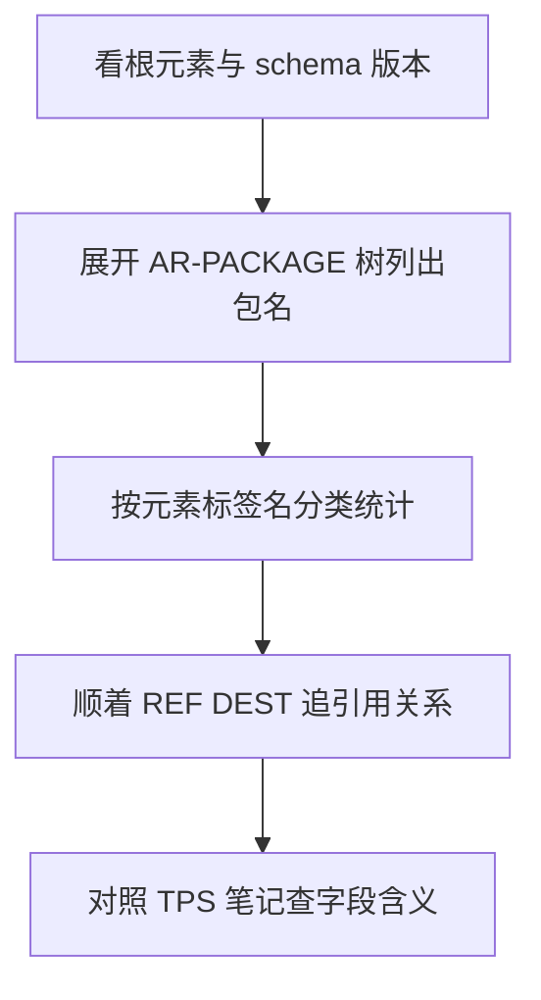
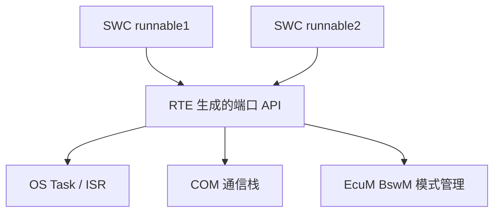
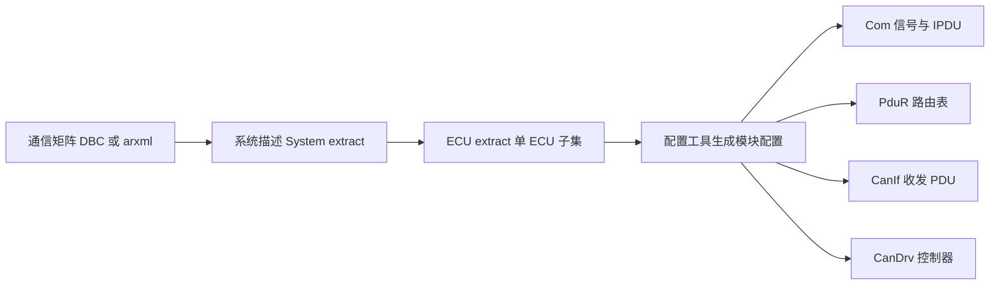

# 帮助 · 使用说明

> 本文档同时覆盖：**A. 笔记库自带工具链（生成脚本）** 和 **B. AUTOSAR 开发工具链速览**。

---

## A. 笔记库工具链

### 目录结构

```
F:\Work\AUTOSAR_Module_Notes\
├── index.html          ← 单页浏览版（推荐：侧边栏 + 搜索 + 345 篇内嵌）
├── README.md           ← Markdown 总索引（编辑器中打开，链接可跳转）
├── HELP.md             ← 本帮助文档
├── _gen_notes.py       ← 脚本 1：扫描规范库 → 生成全部 Markdown 笔记 + 分类索引
├── _gen_html.py        ← 脚本 2：把全部笔记打包 → 生成单页 index.html
├── _report.json        ← 生成报告（数量统计 / 未识别目录）
├── CP\|AP|FO\<类别>\   ← 笔记正文，按 平台\类别\模块名.md 组织
│   └── index.md        ← 每类一个分类索引表
```

### 脚本 1：`_gen_notes.py`（Markdown 笔记生成）

**作用**：扫描 `F:\Work\Standards\01_Sources` 下所有规范文档目录，为每个文档生成一篇
Markdown 笔记（元信息表 / 本地 PDF·ARXML·纯文本路径 / 简介 / 模块依赖 / **章节详细内容**：每章中文标题 + 原文标题 + 正文节选）。

**运行**（可重复执行，覆盖更新）：

```powershell
& "C:\Users\lenovo\.workbuddy\binaries\python\versions\3.13.12\python.exe" `
    "F:\Work\AUTOSAR_Module_Notes\_gen_notes.py"
```

**数据来源（优先级从高到低）**：

| 信息 | 来源 1 | 来源 2（回退） | 来源 3（再回退） |
|---|---|---|---|
| 文档标题 | 目录内 `_readme.txt` 的 `Document Title` | `000_config\ar_document_catalog.mft.json` 的 `longname` | 目录短名 |
| 规范版本 | `_readme.txt` 的 `Part of Standard Release` | — | zzgen 变更历史首行（`R25-11` 等正则） |
| 简介/依赖 | `zzgen\*.complete.txt` 中 `[HEADING Introduction…]` / `[HEADING Dependencies…]` 章节 | — | 首个章节正文 |

**可自定义的点（直接改脚本顶部常量）**：

- `SRC` / `OUT`：规范库与笔记库路径
- `CAT_NAMES`：类别中文说明（新增类别前缀时同步加这里）
- `KEY_DOCS`：核心模块速查表（README 与 HTML 顶部的优先级列表都来自它）
- `DIR_RE`：目录名解析规则（`平台_类别_短名_UID`）
- `PHRASES` / `WORDS`：章节标题中英对照词典——`PHRASES` 为短语级精确匹配，
  `WORDS` 为逐词回退翻译；章节详细内容以有序小节输出，无法翻译的标题保留英文原文

**跳过的目录**：`000_config`、`001_general_tasks`、`ZGEN_*`、`ZSUPP_*`（AUTOSAR 内部构建/辅助目录，非规范文档）。

### 脚本 2：`_gen_html.py`（单页 HTML 生成）

**作用**：读取全部 Markdown 笔记，打包成一个**自包含、零依赖**的 `index.html`
（内嵌 CSS/JS，全部 345 篇笔记直接嵌在页面里）。

**运行**：

```powershell
& "C:\Users\lenovo\.workbuddy\binaries\python\versions\3.13.12\python.exe" `
    "F:\Work\AUTOSAR_Module_Notes\_gen_html.py"
```

**功能**：左侧分类导航（CP/AP/FO + 类别，带篇数）、顶部搜索框即时过滤并自动展开、
「★ 核心模块速查」跳转区、模块详情可折叠（元信息表/路径/简介/依赖/章节详细内容）。

**为什么需要它**：Markdown 里的相对链接在 WorkBuddy 预览面板中无法跳转（只能在
VSCode/Typora 等编辑器里用）；HTML 单页版没有这个问题。本帮助文档也会自动嵌入
HTML 页面顶部。

**规范库更新后如何刷新**：依次重跑脚本 1、脚本 2 即可，两脚本均幂等（覆盖生成）。

### 常见问题

- **链接点不开**：请用 `index.html`（预览面板），或用 VSCode 打开 Markdown 版。
- **PowerShell 命令无输出**：本机已知现象，命令实际已执行；以产物文件时间戳为准。
- **笔记内容是英文**：简介/依赖直接提取自官方规范原文（未翻译），保证准确性；
  需要某模块的中文精读笔记请单独提出。
- **Glob 超时**：`Standards` 目录 9 万+ 文件，不要对它用宽 pattern 全局搜索；
  脚本用的是目录遍历（`iterdir`），不受影响。

---

## B. AUTOSAR 开发工具链速览

规范只定义"接口与行为"，实际开发靠工具链落地。整体流程对应 AUTOSAR 方法论
（本地规范：`CP/TR/Methodology`、`AP/TR/Methodology` 笔记）：


文本版（兼容纯 Markdown 环境）：

```
系统设计 (arxml) → ECU 提取 → BSW 配置 → RTE 生成 → 应用代码集成 → 编译调试
SystemDescription  EcuExtract   (配置工具)   (RTE Generator)  (SWC 实现)   (编译器)
```

| 环节 | 做什么 | 常见工具 |
|---|---|---|
| 系统描述 | 通信矩阵/拓扑 → SystemTemplate arxml | Vector DaVinci（System/CANdela）、ETAS ISOLAR、PREEvision |
| BSW/MCAL 配置 | 按 SWS 规范配置 300+ 模块参数 | DaVinci Configurator（MICROSAR）、EB tresos Studio（EB tresos AutoCore）、ETAS RTA-CAR |
| RTE 生成 | SWC 端口映射 → 生成 RTE 源码 | 同上（集成在各自工具链内） |
| 应用建模 | SWC / Runnable 设计 | Matlab/Simulink（Embedded Coder，ARXML 导入导出）、Capital VSTAR |
| 诊断 | DTC/CDD/ODX | CANdelaStudio、Diagnostic Toolset |
| 总线分析/测试 | CAN/ETH 报文、剩余总线仿真 | CANoe、CANalyzer、vTESTstudio |
| AP 侧 | C++ 应用 + ara::com 部署 | 各厂商 AP 集成环境（配置以 arxml + manifest 为主） |

**学习建议**：工具是"壳"，规范是"核"。先用你们项目实际在用的那套（看 `80_Tooling`
目录），配置界面里每项参数都能对应回笔记库中相应 SWS 文档的 ConfigSpec 章节——
这正是这套笔记的用法：**工具里遇到的参数 → 搜笔记 → 跳到官方规范原文**。

## C. 如何读懂 ARXML 文件

ARXML = AUTOSAR XML。AUTOSAR 的系统描述、SWC 设计、ECU 配置、诊断数据库……
全部以同一套 XML 语法表达，元模型由 `MOD` 类文档定义，字段含义由 `TPS` 类文档定义。

### C.1 一个文件只做四件事

无论几百行还是几十万行，任何 ARXML 都在回答四个问题：

1. **有什么**：`AR-PACKAGE` 树里装了哪些元素（SWC、接口、配置参数……）
2. **是什么**：每个元素的 XML 标签名就是它的类型（如 `APPLICATION-SW-COMPONENT-TYPE`）
3. **叫什么**：`SHORT-NAME` 给出名字，`SHORT-NAME-PATH` 拼出全局唯一路径
4. **连什么**：`REF` + `DEST` 指向别的元素，形成引用网络

### C.2 骨架速查（背下这 7 行就够了）

```xml
<AUTOSAR xmlns="http://autosar.org/schema/r4.0"
         xsi:schemaLocation="...AUTOSAR_4-3-0.xsd">   ← 看 schema 版本判断规范版本
  <AR-PACKAGES>
    <AR-PACKAGE>
      <SHORT-NAME>CanIf</SHORT-NAME>                  ← 包名（可多层嵌套）
      <ELEMENTS>
        <ECUC-MODULE-CONFIGURATION-VALUES>            ← 元素类型 = 标签名
          <SHORT-NAME>CanIf_Config</SHORT-NAME>
          ...                                          ← 元素内容
        </ECUC-MODULE-CONFIGURATION-VALUES>
      </ELEMENTS>
    </AR-PACKAGE>
  </AR-PACKAGES>
</AUTOSAR>
```

### C.3 读任何 ARXML 的五步法



- **第 1 步 · 版本**：`xmlns` / `schemaLocation` 里的 `r4.0`、`4-3-0` 决定字段语法，
  版本不同字段名可能不同，先确认再往下读。
- **第 2 步 · 包树**：`AR-PACKAGE` 可嵌套（`SUB-PACKAGES`），把 `SHORT-NAME` 串起来
  就是元素的完整路径，如 `/CanIf/CanIfConfig/CanIfRxPduCfg`。
- **第 3 步 · 元素分类**：常见标签名对照（详见笔记库 TPS 类文档）——

| 标签名（元素类型） | 含义 | 常见于 |
|---|---|---|
| `SYSTEM` | 整车/系统描述（拓扑、通信矩阵） | SystemTemplate |
| `APPLICATION-SW-COMPONENT-TYPE` | 应用层 SWC | SoftwareComponentTemplate |
| `COMPOSITION-SW-COMPONENT-TYPE` | SWC 组合（装配体） | SoftwareComponentTemplate |
| `SENDER-RECEIVER-INTERFACE` | 数据类端口接口 | SoftwareComponentTemplate |
| `CLIENT-SERVER-INTERFACE` | 调用类端口接口 | SoftwareComponentTemplate |
| `ECUC-MODULE-CONFIGURATION-VALUES` | 一个 BSW 模块的配置值集 | ECUConfiguration |
| `ECUC-CONTAINER-VALUE` | 配置容器（参数的分组） | ECUConfiguration |
| `IMPLEMENTATION-DATA-TYPE` | 数据类型映射到 C 类型 | 软件类型定义 |
| `COMPU-METHOD` / `UNIT` | 物理值换算 / 单位 | 系统描述 |

- **第 4 步 · 引用**：`<DEFINITION-REF DEST="ECUC-PARAM-CONF-DEF">/CanIf/...</DEFINITION-REF>`
  ——`DEST` 是目标元素类型，内容是目标元素的 `SHORT-NAME-PATH`。**90% 的读懂障碍
  都是引用指向的元素不在本文件**（拆分在别的 arxml 里），别在一个文件里找全。
- **第 5 步 · 查规范**：XML 标签名 = 元模型类名。把标签名（去掉大写、按 `-` 分词）
  到笔记库搜对应 TPS 文档，如 `ECUC-PARAM-CONF-DEF` → `CP/TPS/ECUConfiguration`。

### C.4 实用技巧

- **ADMIN-DATA 是宝藏**：元素里的 `<ADMIN-DATA>` 记录了生成工具、语言、修改历史，
  出问题先看它判断"这个文件是手写还是工具生成的"。
- **校验比阅读更快**：VSCode + XML 扩展挂上官方 XSD（AUTOSAR 每个版本发布 XSD 包），
  悬停即可看元素定义，结构错误当场标红。
- **C 代码 ↔ arxml 对应**：配置容器名 `CanIfRxPduCfg` 对应 C 结构体类型
  `CanIf_RxPduCfg_Type`，参数名 `CanIfRxPduDataLength` 对应成员——用笔记库搜参数名
  直接命中 SWS 的 ConfigSpec 章节。
- **典型引用链**（CP 通信配置）：`ComConfig` → `ComSignal` → REF 到
  `ComSignalGroup`/`PduR` 路由表 → REF 到 `CanIfTxPduCfg` → REF 到 `CanController`。
  顺着一条信号从 COM 层走到 CAN 驱动，通信栈就通了。

## D. RTE 详解（CP 核心机制）

RTE（Runtime Environment，运行时环境）是 AUTOSAR CP 最核心、也最容易让人望而生畏的
模块。一句话定位：**RTE 是虚拟功能总线（VFB）在具体 ECU 上的实现，是应用层 SWC 与
BSW/OS 之间唯一合法的通道**。官方规范见笔记库 `CP/SWS/RTE`（本地
`Standards\01_Sources\CP_SWS_RTE_084`）。

### D.1 RTE 到底是什么

- **不是操作系统**：OS 负责任务调度、资源管理；RTE 是**生成的代码**（rte.c/rte.h），
  由 RTE 生成器根据 SWC 描述和系统配置自动产出，不存在"手写 RTE"。
- **是胶水层**：向下封装 OS、COM、EcuM 等服务的 API；向上为 SWC 生成
  `Rte_Write/Rte_Read/Rte_Call...` 系列端口 API。
- **双向翻译**：同一份 SWC 代码，不论和本 ECU 的组件通信还是跨总线通信，API 完全一致
  ——这就是 VFB"位置透明"的实现原理。
- **两大职能**：① 通信实现（SWC 端口间数据/操作的传递）② 调度衔接（Runnable →
  OS Task 的映射与触发）。

SWC 与 OS 的关系图：



### D.2 端口与接口：通信的"插座"

每个 SWC 通过 **Port（端口）** 对外交互，端口类型由 **Interface（接口）** 决定：

| 接口类型 | 语义 | 典型 API | 通信实现 |
|---|---|---|---|
| Sender-Receiver（S-R） | 数据广播，1 发 N 收 | `Rte_Write / Rte_Read / Rte_Send / Rte_Receive` | 本地：全局缓存 / 跨 ECU：COM 信号 |
| Client-Server（C-S） | 请求-应答（函数调用） | `Rte_Call / Rte_Result` | 本地：直接函数调用 / 跨 ECU：TP 序列化 |
| Mode-Switch | 模式状态通知/请求 | `Rte_Switch / Rte_Mode` | 与 EcuM/BswM 联动 |
| Parameter | 校准参数访问 | `Rte_Prm` | 本地常量或 NvM |

### D.3 S-R 数据访问：显式 vs 隐式（高频考点）

- **显式访问（Explicit）**：SWC 里显式调用 `Rte_Write_Xxx()` / `Rte_Read_Xxx()`，
  何时读写自己控制，数据在 RTE 缓存中停留多久可见。
- **隐式访问（Implicit）**：Runnable 运行前 RTE 自动把数据拷入局部变量（`Rte_IrvRead`
  之外的数据映射），运行后自动写回——**数据一致性最好**，是最常用的默认方式。
- **queued vs non-queued**：non-queued（状态量，读最新值）用 Write/Read；queued
  （事件量，如按键事件，每条都要处理）用 Send/Receive。

### D.4 Runnable 与调度：代码怎么跑起来

- SWC 内部代码组织为 **Runnable Entity**（可运行实体），RTE 把它们映射到 OS Task：
  - 一个 Task 可装多个 Runnable（同 Task 内按映射顺序执行）
  - Task 由 **RTE Event** 触发：`TimingEvent`（周期）、`DataReceivedEvent`（收到数据）、
    `OperationInvokedEvent`（被 C-S 调用）、`ModeSwitchEvent`、`InitEvent` 等
- 触发即调度：RTE 生成的 task body 里依次调用 Runnable 壳函数，你写的只是业务逻辑。
- **Exclusive Area（EA）**：跨 Runnable 共享数据的临界区，RTE 生成
  `Rte_Enter_Xxx()/Rte_Exit_Xxx()`，实际实现可配置为关中断/OS 互斥量/任务映射归并。
- **InterRunnable Variables（IRV）**：同组件内 Runnable 间传值，API
  `Rte_IrvRead/IrvWrite`。

### D.5 通信的层级实现（同 ECU vs 跨 ECU）

| 场景 | 传递路径 | 说明 |
|---|---|---|
| 同 Task | 内存赋值 / 直接调用 | 最快，映射时决定 |
| 同 ECU 跨 Task | RTE 管理的缓存 + 一致性保护 | OS 原语或 EA |
| 跨 ECU | SWC → RTE → COM → PduR → CanIf → 驱动 | 序列化/信号打包由 COM 完成 |
| 跨分区（多核/混合临界） | RTE + OSIOC（分区间通信） | 涉及内存隔离 |

读 SWS RTE 时重点看 **"RTE 对 COM 的使用"** 章节：跨 ECU 时 `Rte_Write` 并不直接发报文，
只是把值写进 COM 的信号缓存，真正的打包发送由 COM 的周期任务完成——理解这一点，
通信栈各层职责就不再混淆。

### D.6 学习路径建议

1. 先读 `CP/EXP/BSWDistributionGuide` 与 `CP/EXP/ModeManagementGuide` 建立全局观
   （VFB 概念在 EXP 类文档里，不在 SWS 里）。
2. 精读 `CP/SWS/RTE` 笔记的以下章节：**API 规范**（Rte_* 命名规则全在这）、
   **功能规范**（显式/隐式、一致性）、**配置规范**（生成器怎么决定 API 形态）。
3. 配套 `CP/TPS/SoftwareComponentTemplate`：SWC arxml 里的 port/interface/runnable
   描述正是 RTE 生成的输入。
4. 动手：用 DaVinci Configurator 建 2 个 SWC（1 个 S-R 端口 + 1 个 TimingEvent），
   生成 RTE 后打开 rte.c 对照本节看，半天即可通透。

## E. 网络信号配置操作逻辑（从通信矩阵到报文发出）

以最常用的 **CAN 周期信号**为例，讲清一条信号要经过哪些配置环节、各模块各管什么。
对应笔记：`CP/TPS/SystemTemplate`、`CP/SWS/COM`、`CP/SWS/PDURouter`、
`CP/SWS/CANInterface`、`CP/SWS/CANDriver`。

### E.1 全链路总览



**分工一句话版**：Com 管"信号打包进 IPDU 和发送模式"，PduR 管"这个 IPDU 交给谁"，
CanIf 管"映射到哪个 CAN ID / 硬件对象"，CanDrv 管"从哪个控制器发出去"。

### E.2 静态配置链（一次性配好）

**① 系统层（SystemTemplate，整车视角）**
- `SYSTEM` → `CAN-CLUSTER` → `CAN-FRAME-TRIGGERING` 定义帧与总线通道；
- `CAN-FRAME` 内装 `SECURED-I-PDU` 或 `I-PDU`，I-PDU 内是 `I-SIGNAL`；
- 每个 I-SIGNAL 挂 **`COMPU-METHOD`**（物理值↔原始值换算，如 0.1 偏移 -40 的温度）
  和 `UNIT`（单位）；
- `I-PDU-GROUP`（COMMUNICATION-GROUP）声明该 IPDU 何时启用（如上电即发 vs 网络管理唤醒后发）。

**② 生成 ECU extract**：从系统描述提取本 ECU 相关子集（工具自动做），
这是本 ECU 所有 BSW 模块配置的输入。

**③ Com 模块（信号级）**
- `ComSignal`：信号名、长度（bit）、字节序（**Motorola/Intel，错一个字节序整车信号全乱**）、
  初始值、超时时间（`ComRxTimeoutTime`）；
- `ComIPdu`：方向（TX/RX）、长度（字节）、发送模式
  ——`PERIODIC`（周期，配 `ComTxModeTimePeriod`，如 10ms）、`DIRECT`（变化即发）、
  `MIXED`（周期+变化）；
- 信号所属 IPDU：一个 IPDU 最多 8 字节（经典 CAN）装多个信号，偏移量在此定。

**④ PduR（路由级）**
- 发送：`ComIPdu → CanIfTxPdu` 的路由条目；
- 接收：`CanIfRxPdu → ComIPdu`（或直接到 Dcm/XCP 等上层）；
- 网关：`CanIfRxPdu → CanIfTxPdu` 直通转发（跨总线路由）。

**⑤ CanIf（硬件抽象级）**
- `CanIfTxPduCfg`：CAN ID（29 位扩展帧标志）、DLC、HTH（发送硬件对象句柄）；
- `CanIfRxPduCfg`：CAN ID、DLC、HRH、接收指示上调用的上层（软件过滤在此层做）；
- HTH/HRH 绑定到 `CanController`（哪个物理通道）。

**⑥ CanDrv / CanSM / ComM（使能级，最容易漏）**
- CanDrv：控制器波特率、采样点等硬件参数；
- CanSM：通道状态机（上电 → 正常 → 总线关闭恢复）；
- ComM：通信使能管理——**没把通道加入 ComM 的允许列表或 I-PDU-GROUP 没启用，信号配得再对也不发**。

### E.3 运行时链（每次收发都在走）

发送方向（SWC 每 10ms 更新一次信号为例）：

| 步骤 | 动作 | 所在层 |
|---|---|---|
| 1 | `Rte_Write_VehicleSpeed()` 写入 Com 信号缓存 | RTE |
| 2 | Com 周期任务到期，把信号打包进 IPDU，按发送模式下发 | Com |
| 3 | PduR 按路由表转发该 IPDU | PduR |
| 4 | CanIf 写入对应 HTH 硬件对象，请求发送 | CanIf |
| 5 | CanDrv 装入 CAN 消息缓冲，硬件发出 | CanDrv |

接收方向反向：CanDrv 中断 → CanIf `RxIndication`（软件过滤命中）→ PduR →
Com `RxIndication`（解包信号、做超时监控）→ RTE 缓存 → `DataReceivedEvent` 触发 SWC。

### E.4 常见坑清单

| 现象 | 排查点 |
|---|---|
| 信号值乱跳/跨字节错位 | 字节序（Motorola/Intel）与 bit 偏移 |
| 总线有报文但 SWC 收不到 | PduR 上行路由、CanIf RxIndication 上层配置 |
| 报文周期性出现又消失 | ComM 未授权 / I-PDU-GROUP 未启用（NM 睡眠） |
| 周期不对 | ComIPdu 发送模式与 `ComTxModeTimePeriod` |
| 收不到也不报错 | Com 超时监控未使能（`ComTimeout` + Dem 事件挂接） |
| 网关转发不通 | PduR 网关条目 + 两个通道都在 CanSM/ComM 使能 |

### E.5 实操路径（DaVinci Configurator 视角）

1. Import System Description（ECU extract arxml）→ 工具自动生成 Com/PduR/CanIf 大部分默认值；
2. 检查 Frame Mapping：帧 → 控制器 → 通道绑定是否正确；
3. SWC 端口 ↔ Com 信号映射（RTE 连接），确认 Direction 一致；
4. 逐条核对 E.2 的 ⑥：ComM 权限表、I-PDU-GROUP、CanSM；
5. Generate BSW → 烧录后用 CANoe 对比通信矩阵逐信号验证。
遇到每个配置参数，拿参数名（如 `CanIfTxPduCanId`）到本笔记库搜索，即命中对应
SWS 的 ConfigSpec 定义与取值约束。
