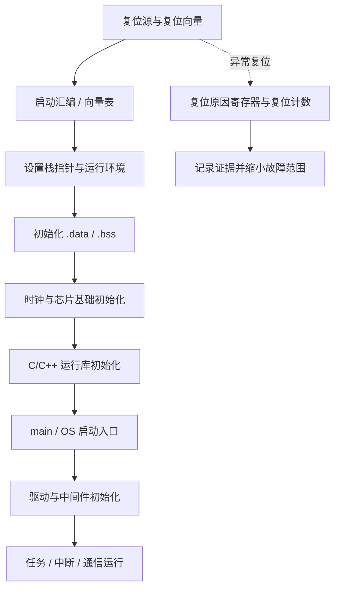

# 嵌入式启动流程与故障隔离指南

> 用途：从复位入口开始，按可验证的证据定位“未进 main、启动后异常复位、任务不运行、通信失效”等问题。具体寄存器、启动文件与异常机制以 MCU 内核、芯片手册和项目链接配置为准。

## 1. 启动链路总览

此图是通用流程，不意味着所有 MCU 的初始化顺序完全一致；部分平台会在进入 C 运行库前初始化时钟，部分项目由 Bootloader 转交控制权。

## 2. 按症状分层排查

| 症状 | 优先检查 | 证据 |
| --- | --- | --- |
| 未进入 main | 复位向量、启动文件、链接地址、栈指针、镜像入口 | PC/LR、向量表内容、Map 文件、调试器反汇编 |
| 进入 main 后异常 | .data/.bss 初始化、时钟、外设早期访问、全局对象初始化 | 断点、内存窗口、时钟状态、异常寄存器 |
| 周期任务不执行 | OS 启动、计数器/Alarm/ScheduleTable、任务激活与优先级 | OS 状态、任务栈、调度跟踪、计数器配置 |
| 中断不触发 | 向量表、使能位、优先级、清除挂起标志、屏蔽状态 | NVIC/INTC 状态、ISR 断点、寄存器快照 |
| 通信失效 | 时钟/波特率、收发器状态、过滤器、DMA/中断、协议路由 | 示波器/逻辑分析仪、总线日志、驱动回调计数 |
| 重启循环 | 复位原因、看门狗、异常处理、启动阶段进度标记 | Reset Cause、复位计数、HardFault/异常现场、日志 |
| 数据重启后丢失 | RAM 镜像与 NV 存储的区别、写入请求和作业完成状态 | NvM 状态、底层存储错误、掉电时序、重启后数据 |

## 3. 最小化故障隔离流程

1. **先确认复位类型**：读取并保存芯片复位原因寄存器，注意有些寄存器需尽早读取或显式清除。
2. **建立启动阶段标记**：在复位入口、C 运行库后、main、驱动初始化完成、OS 启动后分别设置可观测标记；避免仅依赖可能尚未初始化的 printf。
3. **核对镜像与链接布局**：检查 ELF/Map 文件中的入口地址、向量表、代码段、数据段、栈/堆边界及 Bootloader/APP 地址约定。
4. **检查时钟与内存**：确认 PLL/时钟切换成功，RAM 可读写，缓存/MPU/MMU 配置符合平台要求。
5. **检查中断和调度**：确认全局中断、单个中断源、OS 启动状态、任务激活、优先级与栈水位。
6. **沿接口逐层追踪**：通信链路从物理层/驱动回调逐步追到协议栈和应用，不要直接把“应用没收到”认定为应用解析错误。
7. **固定复现条件**：记录软件版本、配置基线、供电、温度、触发顺序和复位原因；每次只改变一个变量。
8. **保留失败现场**：异常 PC/LR、堆栈、关键寄存器、任务状态和最近阶段标记应尽可能在重启前持久化或通过调试器捕获。

## 4. 关键工程注意事项

- 启动代码、链接脚本、编译器选项和芯片启动模式必须作为同一工程基线检查。
- 不要假设所有 RAM 在 C 运行库初始化前都可用；早期日志应使用平台允许的方式。
- ISR 内尽量保持短小，避免阻塞调用、不可控循环或不安全的共享数据访问。
- 看门狗复位可能是结果而不是根因；必须区分任务未运行、喂狗条件错误、异常死循环和真正的硬件故障。
- 在 AUTOSAR 项目中，将 EcuM/BswM/OS 初始化顺序、SchM/ISR 配置、生成代码与 ARXML 配置纳入同一条证据链。

## 5. 验收清单

- [ ] 能确认每次异常的复位来源。
- [ ] 能证明启动流程最后成功到达的阶段。
- [ ] Map 文件与实际烧录地址一致。
- [ ] 任务、ISR 与时钟状态可被观测。
- [ ] 故障复现条件和修复前后证据可追溯。
- [ ] 修复后覆盖冷启动、热复位、看门狗复位及相关异常路径。

## 参考

- [AUTOSAR Classic Platform](https://www.autosar.org/standards/classic-platform/)
- [Arm Developer](https://developer.arm.com/documentation/)
- [GitHub：嵌入式 1000 问目录](README.md)
